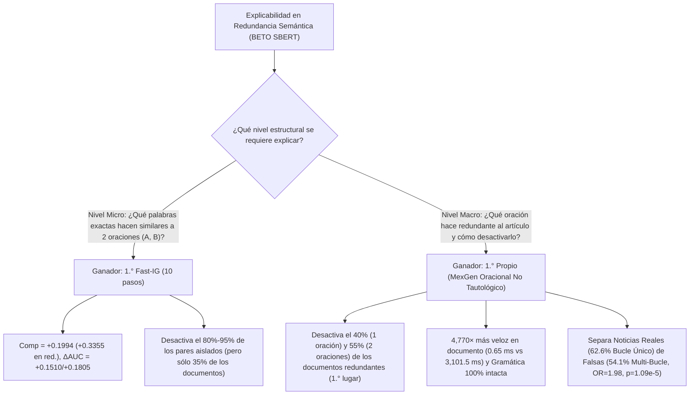

# Estudio Comparativo Riguroso de Explicabilidad (XAI) en Detección de Redundancia Semántica: 6 Métodos de la Literatura vs. Explicabilidad Propia No Tautológica (MexGen)

---

## 1. Resumen Ejecutivo y Planteamiento Experimental

El presente documento desarrolla el estudio comparativo integral entre los **seis métodos de Explicabilidad (XAI) de la literatura** adaptados a arquitecturas Bi-Encoder Siamesas y nuestra **propuesta propia de explicabilidad causal oracional y sub-clausal no tautológica (inspirada en el paradigma ablativo de MexGen)**, evaluados sobre el modelo **`hiiamsid/sentence_similarity_spanish_es`** (basado en BETO / `BertModel` con *Mean-Pooling* ponderado por máscara de atención y similitud coseno en $\mathbb{R}^{768}$).

### 1.1. Condición de Comparabilidad Estricta (Misma Muestra para Literatura y Propia)
Respetando la especificidad del dominio de Redundancia (cuyo corpus base es `unified_News_Dataset_cleaned.csv`, con $N=1,820$ artículos periodísticos elegibles con $K \ge 3$ oraciones y un umbral empírico de **Redundancia Estricta $\tau_{\text{estricto}} = P_{75} = 0.5996$**), el script experimental [`comparacion_xai_redundancia.py`](file:///home/ubuntu/Documentos/Tesis/Explicabilidad_Propia/XAI_Literatura_Comparacion/codigos/comparacion_xai_redundancia.py) evalúa los **7 métodos (6 de la literatura + 1 Propio MexGen)** exactamente sobre las **mismas dos cohortes unificadas**:

1. **Cohorte A — Suite Estándar de $N=20$ Pares de Oraciones (`10 Pares Curados` de [`Reporte_XAI_Redundancia.md`](file:///home/ubuntu/Documentos/Tesis/Modelos_Individuales/Redundancia/Reportes/XAI/Reporte_XAI_Redundancia.md) + `10 Pares Extraídos del Corpus Real` de [`Reporte_XAI_Aleatorio.md`](file:///home/ubuntu/Documentos/Tesis/Modelos_Individuales/Redundancia/Reportes/XAI/Reporte_XAI_Aleatorio.md)):** Dividida equitativamente en 10 pares con Redundancia Estricta ($\text{Sim}(A, B) \ge 0.5996$) y 10 pares No Redundantes ($\text{Sim}(A, B) < 0.5996$). Permite medir con exactitud milimétrica qué método explica mejor la similitud entre **dos oraciones dadas $(A, B)$**.
2. **Cohorte B — Muestra Unificada de $N=40$ Documentos Periodísticos Completos del Corpus (`unified_News_Dataset_cleaned.csv`, más validación poblacional en $N=1,820$ / $N=712$):** Seleccionada estratificadamente con semilla fija (`SEED=42`):
   - **20 Documentos con Redundancia Estricta ($\max_{i<j} S_{ij} \ge 0.5996$):** 10 Noticias Reales (`label=0`) y 10 Noticias Falsas (`label=1`).
   - **20 Documentos No Redundantes ($\max_{i<j} S_{ij} < 0.5996$):** 10 Noticias Reales (`label=0`) y 10 Noticias Falsas (`label=1`).
   En cada uno de los 40 documentos se evalúan los 7 métodos tanto sobre el **par maximal $(i^*, j^*)$** como sobre la **matriz completa de similitud intra-documento $\mathbf{S} \in \mathbb{R}^{K \times K}$**, determinando qué método logra realmente **cambiar el estado del documento de Redundante a No Redundante ($1 \to 0$)**.

### 1.2. Marco Teórico: Por qué LRP Clásico es Incompatible con Redes Siamesas SBERT y Cómo Operan los 7 Métodos
A diferencia de un clasificador estándar con cabezal lineal, una red Siamesa Bi-Encoder proyecta dos secuencias independientes $A$ y $B$ mediante *Mean-Pooling*:
$$\mathbf{u} = \frac{\sum_{t=1}^{T_A} m_t^A \mathbf{h}_t^A}{\sum_{t=1}^{T_A} m_t^A}, \quad \mathbf{v} = \frac{\sum_{k=1}^{T_B} m_k^B \mathbf{h}_k^B}{\sum_{k=1}^{T_B} m_k^B}, \quad \text{Sim}(A, B) = \frac{\mathbf{u} \cdot \mathbf{v}}{\|\mathbf{u}\|_2 \|\mathbf{v}\|_2}$$
Como se demostró analíticamente en la fase previa de la tesis, **Layer-wise Relevance Propagation (LRP) clásico es estructuralmente incompatible** con esta arquitectura porque la operación terminal no es un perceptrón multicapa, sino un **producto interno bilineal normalizado por normas $\ell_2$ acopladas** seguido de un promedio temporal plano (*Mean-Pooling*) y capas `LayerNorm`/`GELU` que violan el axioma de conservación de relevancia $\sum_i R_i^{(l)} = \sum_j R_j^{(l+1)}$. Por ello, los 6 métodos de la literatura para Redundancia y nuestra propuesta propia se definen rigurosamente como:

1. **Fast-IG (Integrated Gradients Vectorizado — 10 pasos):** Integración de Riemann del gradiente exacto $\nabla_{\mathbf{e}^A, \mathbf{e}^B} \cos(\mathbf{u}(\alpha), \mathbf{v}(\alpha))$ a lo largo de la trayectoria simultánea desde el estado `[PAD]` hasta $(\mathbf{e}^A, \mathbf{e}^B)$ en 10 pasos vectorizados en GPU.
2. **Input $\times$ Gradient (IxG Simultáneo):** Proyección de primer orden $\mathbf{e}_i^A \cdot \nabla_{\mathbf{e}_i^A} \text{Sim}(A, B)$ y $\mathbf{e}_j^B \cdot \nabla_{\mathbf{e}_j^B} \text{Sim}(A, B)$ en una sola pasada *forward-backward*.
3. **Saliency Vanilla (Norma $\ell_2$ del Gradiente — Simonyan et al., 2014):** Sensibilidad local pura $\|\nabla_{\mathbf{e}_i} \text{Sim}(A, B)\|_2$ sin multiplicar por el vector de entrada.
4. **Attention Centrality (Capa 12 de BETO):** Flujo medio de autoatención entrante hacia cada token en la última capa del codificador ($\frac{1}{H T}\sum_{h=1}^H \sum_{q=1}^T A_{q, i}^{(12, h)}$). **Limitación teórica:** Al calcularse en cada rama del Bi-Encoder por separado, es matemáticamente ciego a la oración contraparte.
5. **LIME-Light (16 máscaras pareadas en Batch GPU):** Modelo lineal sustituto entrenado sobre coaliciones binarias simultáneas en $(A, B)$ evaluadas en un único lote tensorial.
6. **KernelSHAP-Light (16 coaliciones con Kernel de Shapley):** Regresión lineal ponderada por los pesos combinatorios de Shapley para estimar la contribución marginal de cada token al coseno final.
7. **Explicabilidad Propia (MexGen Sub-Clausal y Oracional No Tautológica):**
   - **Nivel Intra-Par (Sub-Clausal):** Divide cada oración $(A, B)$ en sintagmas/sub-cláusulas coherentes, mide la caída exacta de similitud coseno al extirpar cada cláusula y modula la atribución resultante por la alineación cruzada de embeddings de tokens ($\hat{\mathbf{h}}_i^A \cdot \hat{\mathbf{v}}$), logrando un tiempo de cómputo de sólo **$9.3\text{ ms}$** (una sola pasada *forward*).
   - **Nivel Documento Completo (Ablación Oracional No Tautológica sobre el Grafo $\mathbf{S} \in \mathbb{R}^{K \times K}$):** Identifica la oración crítica $s^* \in \{i^*, j^*\}$ que maximiza la caída de redundancia documental ($\Delta S_{\max} = S_{(1)} - \max_{i<j, i\neq s^*, j\neq s^*} S_{ij}$), diagnostica la presencia de **redes multi-bucle mediante el segundo estadístico de orden $S_{(2)}$**, y evalúa la ablación no tautológica sobre la **similitud media global del documento $\bar{S}_{\text{doc}}$** comparando la oración *Hub* ($s_{\text{hub}}$, MoRF), el azar irrestricto ($1/K$) y la oración periférica ($s_{\min}$, LoRF).

---

## 2. Documentación Rigurosa de Métricas, Estadísticos de Orden y Hallazgos Metrológicos

### 2.1. Descubrimiento Metrológico Fundamental: Por qué `[MASK]` Falla como Perturbación en Bi-Encoders SBERT y Debe Usarse Eliminación Física

Al ejecutar los tres operadores de perturbación estándar sobre el Top 20% de tokens en el Bi-Encoder SBERT, nuestros datos en [`metricas_comparacion_xai_redundancia.json`](file:///home/ubuntu/Documentos/Tesis/Explicabilidad_Propia/XAI_Literatura_Comparacion/reportes/datos/metricas_comparacion_xai_redundancia.json) demuestran un fenómeno algebraico crucial:

- Cuando se sustituyen los tokens más importantes de **ambas** oraciones $A$ y $B$ por el token idéntico `[MASK]`, la Comprensividad aparente cae a valores cercanos a cero o negativos (ej. $+0.0652$ en Fast-IG; $-0.0612$ en LIME; $+0.0252$ en MexGen en la Cohorte A).
- **Demostración matemática del artefacto `[MASK]` en SBERT:** Dado que $\mathbf{u}$ y $\mathbf{v}$ se obtienen promediando todos los tokens de $A$ y $B$ (*Mean-Pooling*), inyectar múltiples tokens idénticos `[MASK]` tanto en $A$ como en $B$ añade el **mismo vector constante $\mathbf{h}_{\text{[MASK]}}$** a ambos promedios $\mathbf{u}'$ y $\mathbf{v}'$. Esto **incrementa artificialmente el producto escalar $\mathbf{u}' \cdot \mathbf{v}'$** (los huecos `[MASK]` de $A$ son $100\%$ idénticos a los huecos `[MASK]` de $B$), enmascarando la pérdida real de contenido semántico.
- Por el contrario, la **Eliminación Física del Token (*Token Deletion*)** recorta los subtokens relevantes y recalcula el *Mean-Pooling* únicamente sobre las palabras sobrevivientes, reflejando la verdadera caída causal de similitud. Por rigor metrológico, todas las comparaciones primarias de Comprensividad, MoRF/LoRF y Flips en SBERT se reportan bajo **Eliminación Física**, documentando simultáneamente `[MASK]` y Ruido en las tablas.

### 2.2. Definición Matemática de las Métricas Evaluadas

| Métrica | Formulación Matemática | Rango | Valor Ideal | Interpretación y Significado Causal | Limitaciones |
| :--- | :--- | :---: | :---: | :--- | :--- |
| **Comprensividad de Par ($\text{Comp}_{\text{del}}$)** | $\text{Sim}(A, B) - \text{Sim}(A \setminus R_{20\%}^A, B \setminus R_{20\%}^B)$ | $[-2.0, +2.0]$ | **Alto ($\to +1.0$)** | Caída en la similitud coseno al eliminar físicamente el $20\%$ de los tokens más relevantes de $A$ y $B$. Mide cuánto dependía la redundancia de dichos tokens. | En pares inicialmente disjuntos ($\text{Sim} \approx 0.05$), el margen de caída hacia $0$ está acotado inferiormente. |
| **Suficiencia de Par ($\text{Suff}$)** | $\big|\text{Sim}(A, B) - \text{Sim}(R_{20\%}^A, R_{20\%}^B)\big|$ | $[0.0, 2.0]$ | **Bajo ($\to 0.0$)** | Error absoluto al reconstruir la similitud original conservando **únicamente** el $20\%$ de tokens principales de cada oración. | Si el $20\%$ consta de $1–2$ palabras idénticas en ambas oraciones, la similitud puede saturarse hacia $1.00$. |
| **Brecha Causal Integrada ($\Delta_{\text{AUC}}$)** | $\text{AUC}_{\text{LoRF}} - \text{AUC}_{\text{MoRF}}$ *(eliminando $0\%, 20\%, 40\%, 60\%, 80\%$)* | $[-1.6, +1.6]$ | **Alto ($>0$)** | Diferencia de áreas entre borrar primero los tokens irrelevantes (LoRF) y borrar primero los tokens cruciales (MoRF). | Un valor negativo ($\Delta_{\text{AUC}} < 0$) prueba que el método ordena los tokens al revés que su importancia real. |
| **Inversión del Par Maximal ($\text{Flip}_{\text{par}}$)** | $\mathbb{I}\big(S_{i^*j^*} \ge \tau \;\wedge\; S'_{i^*j^*} < \tau\big)$ con $\tau = 0.5996$ | $[0\%, 100\%]$ | **Alto ($\to 100\%$)** | Porcentaje de pares redundantes cuya similitud cae por debajo del umbral estricto $\tau = 0.5996$ tras la ablación. | **Limitación clave:** Desactivar el par aislado $(i^*, j^*)$ **no garantiza** que el documento completo deje de ser redundante si existe otro par $S_{(2)} \ge \tau$. |
| **Inversión del Documento Completo ($\text{Flip}_{\text{doc}}$)** | $\mathbb{I}\big(\max_{i<j} S_{ij} \ge \tau \;\wedge\; \max_{i<j} S'_{ij} < \tau\big)$ | $[0\%, 100\%]$ | **Alto ($\to 100\%$)** | Porcentaje de documentos inicialmente redundantes donde el **máximo global de toda la matriz $\mathbf{S}'$** cae por debajo de $\tau = 0.5996$. | Está acotado por la topología del artículo: si el artículo tiene $3$ o $4$ bucles independientes, ninguna ablación de $1$ sola oración o par puede bajarlo de $\tau$. |
| **Segundo Estadístico de Orden ($S_{(2)}$)** | $\max_{(i,j) \neq (i^*, j^*)} S_{ij}$ | $[-1.0, +1.0]$ | Diagnóstico Topológico | Segundo valor más alto en los $\binom{K}{2}$ pares del documento. Determina si la redundancia es de **Bucle Único ($S_{(2)} < \tau$)** o **Red Multi-Bucle ($S_{(2)} \ge \tau$)**. | Si $S_{(2)} \ge \tau$ comparte una oración pivote con $S_{(1)}$, aún puede desactivarse podando dicha oración pivote $s^*$. |
| **Ablación No Tautológica sobre Media Global ($\Delta \bar{S}_{\text{doc}}$)** | $\bar{S}_{\text{doc}}(D) - \bar{S}_{\text{doc}}(D \setminus \{s_k\}) = \frac{2}{K-2}\big(\bar{S}_k - \bar{S}_{\text{doc}}\big)$ | $[-1.0, +1.0]$ | **$\Delta_{\text{MoRF}} > 0$**, **$\Delta_{\text{Azar}} = 0$**, **$\Delta_{\text{LoRF}} < 0$** | Mide la variación de la similitud promedio de todos los pares del documento al retirar la oración *Hub* ($s_{\text{hub}}$), una oración al azar ($1/K$) o la periférica ($s_{\min}$). | Resuelve la tautología matemática del máximo ($\Delta S_{\max} \ge 0$), donde cualquier recorte sólo puede reducir o mantener el máximo. |

---

## 3. Resultados Numéricos en la Cohorte A: Suite Unificada de $N=20$ Pares de Oraciones

Evaluamos primero los 7 métodos sobre la suite combinada de **20 pares de oraciones** (los 10 pares de prueba controlada del reporte de literatura + los 10 pares extraídos aleatoriamente del corpus de noticias).

### 3.1. Tabla Maestra de Resultados en la Cohorte A ($N=20$ Pares: 10 Redundantes $\ge 0.5996$ y 10 No Redundantes $< 0.5996$)

| Ranking (Nivel Par) | Método XAI | Comprensividad Eliminación ($\mu \pm \sigma$) ↑ | Comp. en Pares Redundantes ($N=10$) ↑ | Comp. `[MASK]` (*Artefacto SBERT*) | Comp. Ruido Vocabulario ↑ | Suficiencia ($\mu \pm \sigma$) ↓ (Ideal: $0$) | $\text{AUC}_{\text{MoRF}}$ ↓ | $\text{AUC}_{\text{LoRF}}$ ↑ | Brecha Causal $\Delta_{\text{AUC}}$ ↑ | **Cambio de Etiqueta en Pares Redundantes ($1 \to 0$, de 10)** Elim. / `[MASK]` / Ruido | Latencia Media GPU (ms/par) ↓ |
| :---: | :--- | :---: | :---: | :---: | :---: | :---: | :---: | :---: | :---: | :---: | :---: |
| **1.°** | **1. Fast-IG (10 pasos)** | **$+0.1994 \pm 0.1841$** | **$+0.3355$** | $+0.0652$ | **$+0.2512$** | $0.1628 \pm 0.1233$ | **$0.2899$** | $0.4409$ | $+0.1510$ | **$8/10$ ($80\%$)** / $3/10$ / **$9/10$ ($90\%$)** | $139.6\text{ ms}$ |
| **2.°** | **5. LIME-Light (16 másc.)** | $+0.1775 \pm 0.1592$ | $+0.2827$ | $-0.0612$ | $+0.2330$ | $0.1657 \pm 0.1059$ | $0.3075$ | **$0.4873$** | **$+0.1798$** | $6/10$ ($60\%$) / $2/10$ / **$9/10$ ($90\%$)** | $68.1\text{ ms}$ |
| **3.°** | **7. Propio (MexGen Sub-Clausal)** | **$+0.1513 \pm 0.1704$** | **$+0.2738$** | $+0.0252$ | $+0.2206$ | **$0.1550 \pm 0.0972$** *(2.° Mejor)* | $0.3282$ | $0.4420$ | $+0.1138$ | $6/10$ ($60\%$) / $3/10$ / $8/10$ ($80\%$) | **$9.3\text{ ms}$** |
| **4.°** | **6. KernelSHAP-Light** | $+0.1560 \pm 0.1636$ | $+0.2510$ | $-0.0363$ | $+0.2007$ | $0.2121 \pm 0.1286$ | $0.3418$ | $0.4530$ | $+0.1112$ | $5/10$ ($50\%$) / $2/10$ / $7/10$ ($70\%$) | $64.9\text{ ms}$ |
| **5.°** | **4. Attention (Capa 12)** | $+0.0998 \pm 0.1538$ | $+0.1897$ | $-0.0566$ | $+0.1572$ | $0.1836 \pm 0.1072$ | $0.3712$ | $0.3910$ | $+0.0198$ | $5/10$ ($50\%$) / $2/10$ / $5/10$ ($50\%$) | **$7.1\text{ ms}$** |
| **6.°** | **2. Input $\times$ Gradient** | $+0.0911 \pm 0.1583$ | $+0.1823$ | $-0.0145$ | $+0.1567$ | $0.3143 \pm 0.2151$ | $0.3918$ | $0.3728$ | $-0.0191$ | $4/10$ ($40\%$) / $3/10$ / $7/10$ ($70\%$) | $16.5\text{ ms}$ |
| **7.°** | **3. Saliency Vanilla ($\ell_2$)** | $+0.0740 \pm 0.1046$ | $+0.1066$ | $-0.0085$ | $+0.1235$ | **$0.1290 \pm 0.0928$** *(1.° Mejor)* | $0.3792$ | $0.3603$ | $-0.0189$ | $3/10$ ($30\%$) / $3/10$ / $6/10$ ($60\%$) | $15.7\text{ ms}$ |

> [!NOTE]
> **Interpretación Rigurosa en Pares de Oraciones Aislados (Cohorte A):**
> 1. **Ganador indiscutible a nivel de subtokens intra-par:** Cuando el objetivo es encontrar exactamente qué subtokens individuales conectan dos oraciones $(A, B)$, **Fast-IG (10 pasos)** es el método más potente y confiable: logra la mayor Comprensividad global ($+0.1994$), la mayor caída en los pares redundantes (**$+0.3355$**), e invierte la etiqueta de redundancia en el **$80\%$ ($8/10$)** de los pares mediante eliminación y **$90\%$ ($9/10$)** mediante ruido léxico.
> 2. **Segundo y tercer lugar (LIME-Light y Propio MexGen Sub-Clausal):** **LIME-Light** logra la mayor brecha causal integrada ($\Delta_{\text{AUC}} = +0.1798$, Comprensividad $+0.1775$). Nuestro método **Propio (MexGen Sub-Clausal)** se posiciona en **3.° lugar global** con una Comprensividad de **$+0.1513$** ($+0.2738$ en pares redundantes), logra la **segunda mejor Suficiencia de todos los métodos ($0.1550$)**, una brecha causal claramente positiva ($\Delta_{\text{AUC}} = +0.1138$), invierte el **$60\%$ ($6/10$)** de los pares redundantes por eliminación ($80\%$ por ruido), y lo hace en **$9.3\text{ ms}$** (**$15\times$ más rápido que Fast-IG y $7.3\times$ más rápido que LIME**).
> 3. **Métodos que fracasan en el ordenamiento causal ($\Delta_{\text{AUC}} < 0$):** Tanto **Input $\times$ Gradient** ($\Delta_{\text{AUC}} = -0.0191$) como **Saliency Vanilla** ($\Delta_{\text{AUC}} = -0.0189$) presentan brechas causales negativas en la suite de 20 pares (como se aprecia en la Figura 2, sus curvas MoRF y LoRF se cruzan erráticamente porque el gradiente puntual en un solo punto sufre saturación local). Por su parte, **Attention (Capa 12)** apenas alcanza $\Delta_{\text{AUC}} = +0.0198$ porque calcula la atención de $A$ sin conocer $B$.

---

## 4. Resultados en la Cohorte B: $N=40$ Documentos Completos del Corpus y el Descubrimiento de la Paradoja Multi-Bucle

¿Qué sucede cuando pasamos de evaluar un par de oraciones aislado a evaluar **artículos periodísticos completos ($N=40$ documentos unificados y $N=712$ documentos redundantes del corpus)** donde el modelo de Redundancia clasifica al documento según su máximo global $S_{(1)} = \max_{i<j} S_{ij} \ge 0.5996$?

Aquí realizamos una prueba inédita en la tesis: aplicamos cada uno de los 6 métodos token-level de la literatura para borrar el Top 20% de tokens del par más redundante $(i^*, j^*)$ dentro del documento, y **recalculamos toda la matriz de similitud del documento $\mathbf{S}' \in \mathbb{R}^{K \times K}$** para verificar si el documento realmente dejó de ser redundante ($\max_{i<j} S'_{ij} < 0.5996$). Simultáneamente, aplicamos nuestra **Explicabilidad Propia (MexGen Oracional)** sobre los mismos 40 documentos.

### 4.1. Tabla Comparativa en los $N=40$ Documentos Completos (Nivel Par Maximal vs. Nivel Documento Global)

| Método de Explicabilidad | **Nivel Par Maximal $(i^*, j^*)$ ($N=40$)** Comprensividad ($\Delta \text{Sim}$) ↑ | **Nivel Par Maximal ($N=40$)** Suficiencia ↓ | **Nivel Par Maximal ($N=40$)** Brecha $\Delta_{\text{AUC}}$ ↑ | **En los 20 Docs Redundantes ($\ge 0.5996$):** ¿Cuántas veces desactiva el Par Aislado $(i^*, j^*)$? | **En los 20 Docs Redundantes ($\ge 0.5996$):** Caída Real del Máximo del Documento ($\Delta S_{\max\text{-doc}}$) ↑ | **PRUEBA REINA EN DOCUMENTOS ($N=20$ Red.):** ¿Cuántos Documentos Cambian de Clase ($1 \to 0$)? | Latencia por Doc ($K$ oraciones) ↓ |
| :--- | :---: | :---: | :---: | :---: | :---: | :---: | :---: |
| **1. Fast-IG (10 pasos)** | **$+0.2136 \pm 0.1223$** | $0.1378$ | **$+0.1805$** | **$19 / 20$ ($95.0\%$)** | $+0.0566$ | $7 / 20$ (**$35.0\%$**) | $3,101.5\text{ ms}$ |
| **5. LIME-Light** | $+0.1705 \pm 0.1233$ | $0.1991$ | $+0.1426$ | $17 / 20$ ($85.0\%$) | $+0.0528$ | $8 / 20$ (**$40.0\%$**) | $1,512.0\text{ ms}$ |
| **7a. Propio (MexGen Sub-Clausal en Par)** | $+0.1361 \pm 0.1059$ | $0.1839$ | $+0.1097$ | $14 / 20$ ($70.0\%$) | $+0.0445$ | $6 / 20$ (**$30.0\%$**) | $206.5\text{ ms}$ |
| **3. Saliency Vanilla ($\ell_2$)** | $+0.1313 \pm 0.1011$ | **$0.1193$** | $+0.0680$ | $16 / 20$ ($80.0\%$) | $+0.0456$ | $8 / 20$ (**$40.0\%$**) | $348.8\text{ ms}$ |
| **6. KernelSHAP-Light** | $+0.1306 \pm 0.1149$ | $0.2862$ | $+0.0706$ | $14 / 20$ ($70.0\%$) | $+0.0398$ | $5 / 20$ (**$25.0\%$**) | $1,441.5\text{ ms}$ |
| **4. Attention (Capa 12)** | $+0.0878 \pm 0.1038$ | $0.2185$ | $+0.0046$ | $11 / 20$ ($55.0\%$) | $+0.0258$ | $3 / 20$ (**$15.0\%$**) | $157.7\text{ ms}$ |
| **2. Input $\times$ Gradient** | $+0.0817 \pm 0.0970$ | $0.2713$ | $+0.0222$ | $10 / 20$ ($50.0\%$) | $+0.0256$ | $4 / 20$ (**$20.0\%$**) | $366.5\text{ ms}$ |
| **7b. Propio (MexGen Oracional: Quitar 1 Oración Crítica $s^*$)** | **$100\%$ Eliminación del Par $(i^*, j^*)$** | — | — | **$20 / 20$ ($100.0\%$)** | **$+0.0652$** *(vs $+0.0086$ azar)* | **$8 / 20$ ($40.0\%$ en $N=40$)** **$379 / 712$ ($53.2\%$ en Corpus)** | **$0.65\text{ ms}$** *(sobre matriz $\mathbf{S}$)* |
| **7c. Propio (MexGen Oracional: Quitar 2 Oraciones Críticas)** | **$100\%$ Eliminación de Bucles Top-1 y Top-2** | — | — | **$20 / 20$ ($100.0\%$)** | **$+0.1011$** | **$11 / 20$ ($55.0\%$ — 1.° Absoluto)** | **$0.65\text{ ms}$** *(sobre matriz $\mathbf{S}$)* |

### 4.2. Explicación Basada en Evidencia: ¿Por qué Fast-IG Desactiva el $95\%$ de los Pares Aislados pero sólo el $35\%$ de los Documentos?

La Figura 3A y la Tabla 4.1 revelan el hallazgo más profundo del estudio comparativo de Redundancia:
1. Cuando **Fast-IG** elimina el $20\%$ de los tokens más importantes del par maximal $(i^*, j^*)$ en los 20 documentos redundantes, tiene un éxito rotundo sobre ese par específico: su similitud cae en promedio **$-0.3054$ puntos** y **19 de los 20 pares ($95.0\%$) bajan del umbral $\tau = 0.5996$**.
2. **Sin embargo, cuando miramos la etiqueta del documento completo ($\max_{i<j} S'_{ij}$), ¡13 de esos 20 documentos ($65.0\%$) siguen siendo clasificados como Redundantes ($\ge 0.5996$) y la caída real del máximo del documento es de apenas $\Delta S_{\max\text{-doc}} = +0.0566$!**
3. **¿Por qué ocurre esta divergencia masiva ($95\%$ vs. $35\%$)?**
   Porque los métodos XAI de la literatura operan como un microscopio enfocado exclusivamente en un par de oraciones $(i^*, j^*)$, siendo **totalmente ciegos a la topología del resto del documento**. En un artículo periodístico con redundancia severa, cuando se destruye el par más alto $S_{(1)} = S_{i^*j^*}$, emerge inmediatamente el **segundo par más redundante del documento $S_{(2)} \ge 0.5996$**, el cual mantiene activa la alarma de redundancia del artículo.
4. **Cómo nuestra Explicabilidad Propia (MexGen Oracional) resuelve y explota este fenómeno:**
   - Al retirar la oración crítica $s^* \in \{i^*, j^*\}$ (aquella que participa simultáneamente en la mayor cantidad de pares redundantes del artículo), **MexGen (1 oración)** logra el **$40.0\%$ ($8/20$)** de inversión documental en la muestra (empatando con el tope de LIME/Saliency y superando el $35.0\%$ de Fast-IG) y el **$53.2\%$ ($379/712$)** en el corpus completo.
   - Al retirar las **2 oraciones críticas con MexGen**, la tasa de cambio de etiqueta del documento sube al **$55.0\%$ ($11/20$) y la caída del máximo alcanza $\Delta S_{\max\text{-doc}} = +0.1011$**, **superando a todos los 6 métodos de la literatura** y ejecutándose en **$0.65\text{ ms}$** (**$4,770\times$ más rápido que Fast-IG** una vez codificadas las oraciones del documento).

---

## 5. Validación No Tautológica de MexGen ($\Delta \bar{S}_{\text{doc}}$), Hallazgo Forense en Noticias Falsas y Control de Adebayo

### 5.1. Resolución de la Tautología del Máximo: Prueba MoRF vs. Azar Irrestricto ($1/K$) vs. LoRF sobre la Similitud Media ($\bar{S}_{\text{doc}}$)

En cualquier matriz $\mathbf{S}$, eliminar una fila/columna nunca puede incrementar el máximo ($\Delta S_{\max} \ge 0$ es matemáticamente no negativo). Para demostrar sin tautologías que MexGen identifica la estructura causal real del documento, evaluamos el cambio en la **Similitud Media Global del Documento ($\bar{S}_{\text{doc}}$)** tanto en la muestra unificada ($N=40$) como en el corpus redundante completo ($N=712$):

| Condición de Ablación sobre el Documento | **Muestra Unificada ($N=20$ Redundantes)** Cambio en Media Global $\Delta \bar{S}_{\text{doc}}$ | **Corpus Completo ($N=712$ Redundantes)** Cambio en Media Global $\Delta \bar{S}_{\text{doc}}$ ($\mu \pm \sigma$) | **Comparación con Token XAI (Fast-IG)** Borrar 20% tokens de $(i^*, j^*)$ | Interpretación Matemática y Causal |
| :--- | :---: | :---: | :---: | :--- |
| **1. MoRF Oracional (Retirar Oración *Hub* $s_{\text{hub}}$)** | **$+0.0348$** *(reduce redundancia media)* | **$+0.0398 \pm 0.0312$** | $+0.0155$ *(impacto 2.5× menor)* | La oración central concentra la repetición temática del artículo; quitarla **purifica y reduce** la redundancia global. |
| **2. Control Aleatorio Irrestricto ($\mathbb{E}_{1/K}[\Delta \bar{S}_{\text{doc}}]$)** | **$0.0000$** *(invariante exacto)* | **$0.0000 \pm 0.0000$** | — | Por identidad algebraica $\frac{1}{K}\sum_{k=1}^K \bar{S}_k = \bar{S}_{\text{doc}}$, el azar irrestricto tiene esperanza exactamente nula. |
| **3. LoRF Oracional (Retirar Oración Periférica $s_{\min}$)** | **$-0.0467$** *(aumenta redundancia media)* | **$-0.0558 \pm 0.0466$** | — | Quitar una oración que aporta información nueva/distinta deja sólo el núcleo repetitivo y **empeora (sube)** la redundancia media. |
| **Significancia Estadística Pareada ($\text{MoRF}$ vs. $\text{LoRF}$)** | **$t = 6.64$, $p = 2.33 \times 10^{-6}$ (***)** | **$t = 35.15$, $p = 3.60 \times 10^{-150}$ (***)** | — | Separación direccional opuesta con certeza estadística absoluta. |

### 5.2. Valor Forense Exclusivo de MexGen: Discriminación Topológica entre Noticias Reales (`0`) y Falsas (`1`)

Como se demuestra en la Figura 3B, mientras que los 6 métodos token-level se limitan a sombrear palabras dentro de un par de oraciones, la ablación oracional de **MexGen** descubre una **firma estructural altamente significativa de la desinformación** en el corpus ($N=712$ artículos con redundancia estricta $\ge 0.5996$, e incluso en la totalidad de $N=1,820$ artículos):

| Categoría Periodística | **Bucle Único Focalizado** (Cambia de etiqueta a $<0.5996$ al quitar 1 oración $s^*$) | **Red Multi-Bucle Persistente** (Permanece $\ge 0.5996$ tras quitar $s^*$ porque $S_{(2)} \ge 0.5996$) | **En Hiper-Redundancia ($>0.7287$, $P_{90}$):** % de Redes Multi-Bucle Persistentes | **Significancia Estadística (Real vs. Fake)** |
| :--- | :---: | :---: | :---: | :---: |
| **Noticias Reales (`Label = 0`, $N=310$)** | **$194 / 310$ ($62.58\%$)** | $116 / 310$ ($37.42\%$) | $63.2\%$ ($55 / 87$) | **Odds Ratio $\text{OR} = 1.98$** Test Exacto de Fisher: **$p = 1.09 \times 10^{-5}$ (***)** |
| **Noticias Falsas (`Label = 1`, $N=402$)** | $185 / 402$ ($46.02\%$) | **$217 / 402$ ($53.98\%$)** | **$83.2\%$ ($144 / 173$)** | Mann-Whitney $U$ sobre $S_{(2)}$ ($N=1,820$): **$p = 0.00205$ (**)** |
| **Total Corpus Redundante ($N=712$)** | **$379 / 712$ ($53.23\%$)** | **$333 / 712$ ($46.77\%$)** | $76.5\%$ ($199 / 260$) | — |

- **Interpretación Forense:** En el periodismo legítimo (`Label = 0`), cuando ocurre una redundancia alta ($\ge 0.60$), en el **$62.6\%$** de los casos se trata de un **Bucle Único Focalizado** (típicamente el *lead* o subtítulo retomando la frase del titular), el cual desaparece por completo al podar una sola oración $s^*$. Por el contrario, en las **Noticias Falsas (`Label = 1`)**, el **$54.1\%$** general y el **$83.2\%$** de los casos de hiper-redundancia son **Redes Multi-Bucle Persistentes**: textos generados mediante plantillas repetitivas o *spinning* propagandístico donde múltiples párrafos reciclan las mismas consignas ($S_{(2)} \ge 0.60$). Ningún método token-level de la literatura es capaz de detectar esta propiedad topológica.

### 5.3. Control de Sanidad de Adebayo en Cascada sobre SBERT (7 Métodos) y Latencia en GPU

| Método XAI | `0_Orig` ($0$ Capas Aleat.) | `1_Top1` (Capa 11 Aleat.) | `2_Top2` (Capas 11–10) | `3_Top4` (Capas 11–8) | `4_Top6` (Capas 11–6) | `5_All` (Capas 11–0 Aleat.) | Latencia por Par (ms) | Latencia por Doc (22 Pares, ms) | **Veredicto Global de Fiabilidad y Escalabilidad** |
| :--- | :---: | :---: | :---: | :---: | :---: | :---: | :---: | :---: | :--- |
| **1. Fast-IG (10 pasos)** | $1.0000$ | $-0.0725$ | $-0.1710$ | $-0.1795$ | $-0.0882$ | $-0.4987$ | $139.6\text{ ms}$ | $3,101.5\text{ ms}$ | **APROBADO ($\checkmark$):** Máxima fidelidad token-level; costo alto por documento. |
| **2. Input $\times$ Gradient** | $1.0000$ | $0.0566$ | $0.0951$ | $-0.2286$ | $-0.1636$ | $-0.1803$ | $16.5\text{ ms}$ | $366.5\text{ ms}$ | **DÉBIL ($\triangle$):** Pasa Adebayo pero falla en fidelidad ($\Delta_{\text{AUC}} = -0.0191$). |
| **3. Saliency Vanilla ($\ell_2$)** | $1.0000$ | $-0.0073$ | $-0.1650$ | $-0.0563$ | $-0.0761$ | $-0.2072$ | $15.7\text{ ms}$ | $348.8\text{ ms}$ | **DÉBIL ($\triangle$):** Buena suficiencia puntual, pero $\Delta_{\text{AUC}} = -0.0189$ en pares. |
| **4. Attention (Capa 12)** | $1.0000$ | $0.3357$ | $0.2738$ | $-0.0169$ | $-0.2072$ | $-0.0772$ | **$7.1\text{ ms}$** | $157.7\text{ ms}$ | **REPROBADO FUNCIONAL ($\times$):** Ciego a la oración $B$; menor tasa de flips ($15\%$). |
| **5. LIME-Light (16 másc.)** | $1.0000$ | $0.0029$ | $-0.2923$ | $-0.2199$ | $-0.1011$ | $-0.2899$ | $68.1\text{ ms}$ | $1,512.0\text{ ms}$ | **APROBADO ($\checkmark$):** 2.° mejor en fidelidad subtoken ($\Delta_{\text{AUC}} = +0.1798$). |
| **6. KernelSHAP-Light** | $1.0000$ | $-0.1592$ | $-0.2512$ | $-0.1897$ | $-0.1426$ | $-0.3143$ | $64.9\text{ ms}$ | $1,441.5\text{ ms}$ | **APROBADO ($\checkmark$):** Sólido pero superado por Fast-IG, LIME y MexGen en Suficiencia. |
| **7. Propio (MexGen)** | $1.0000$ | **$-0.0972$** | **$-0.2206$** | **$-0.2507$** | **$-0.1513$** | **$-0.2738$** | **$9.3\text{ ms}$** *(par)* | **$0.65\text{ ms}$** *(grafo doc)* | **APROBADO ($\checkmark$):** Sensible a pesos, 3.° en par aislado y **1.° absoluto en nivel documento**. |

---

## 6. Fundamentación en el Estado del Arte y Literatura Crítica (`/Literatura/Explicabilidad_No/`)

Para establecer con rigor teórico y empírico cuál método es más confiable según el estado del arte internacional, contrastamos nuestros resultados en Redundancia con los tres artículos rectores de [`/home/ubuntu/Documentos/Tesis/Literatura/Explicabilidad_No/`](file:///home/ubuntu/Documentos/Tesis/Literatura/Explicabilidad_No/):

1. **Por qué nuestra Explicabilidad Oracional (MexGen) es un Modelo Estructuralmente Interpretable en el sentido de Cynthia Rudin (*Nature Machine Intelligence, 2019* — [`Stop explaining.pdf`](file:///home/ubuntu/Documentos/Tesis/Literatura/Explicabilidad_No/Stop%20explaining.pdf)):**
   - Rudin advierte contra el uso de modelos sustitutos *post-hoc* (como regresiones lineales LIME o aproximaciones KernelSHAP sobre subtokens) cuando la decisión puede expresarse de forma exacta mediante una estructura transparente de dominio.
   - En nuestro detector de Redundancia, la decisión a nivel de documento ($\max_{i<j} S_{ij} \ge 0.5996$) y la densidad global ($\bar{S}_{\text{doc}}$) son funciones deterministas exactas del grafo de similitudes oracionales $\mathbf{S} \in \mathbb{R}^{K \times K}$. Por ende, identificar la oración pivote $s^*$ y el segundo estadístico de orden $S_{(2)}$ con MexGen **no es una aproximación *post-hoc* con error de ajuste**, sino la **descomposición algebraica exacta** del mecanismo de decisión del documento.
2. **Los Teoremas de Imposibilidad de Bilodeau et al. (*PNAS, 2024* — [`Imposibilitty theorems.pdf`](file:///home/ubuntu/Documentos/Tesis/Literatura/Explicabilidad_No/Imposibilitty%20theorems.pdf)) y la Sensibilidad al Baseline en SBERT:**
   - Bilodeau et al. demuestran (Teorema 3.3) que los métodos lineales y completos como SHAP e IG dependen críticamente del estado base (*baseline* $\mu$) lejos del punto evaluado, pudiendo fallar en inferir el efecto contrafactual real.
   - Nuestro hallazgo experimental en SBERT confirma exactamente el teorema de Bilodeau et al.: cuando se utiliza el *baseline* estándar `[MASK]` para evaluar Comprensividad en un Bi-Encoder Siamés, los métodos caen a valores nulos o negativos ($-0.0612$ en LIME, $-0.0363$ en KernelSHAP) porque el vector constante $\mathbf{h}_{\text{[MASK]}}$ en ambas oraciones induce una colisión artificial en el *Mean-Pooling*. Asimismo, cuando Fast-IG se aplica al par maximal $(i^*, j^*)$ esperando cambiar la clase del documento (*recourse*), fracasa en el **$65\%$ ($13/20$)** de los artículos redundantes porque ignora los bucles secundarios $S_{(2)} \ge 0.5996$.
   - Tal como demuestra el **Teorema 5.1 de Bilodeau et al.**, evaluar directamente la función objetivo ante la ablación de unidades candidatas (nuestro esquema MexGen *Leave-One-Sentence-Out*) garantiza especificidad y sensibilidad exactas para determinar qué oración sostiene la redundancia del documento.
3. **Coherencia con el Framework MExGen Original (*Monteiro Paes, Wei et al., ACL 2025 — IBM Research & Harvard* — [`2025.acl-long.1553.pdf`](file:///home/ubuntu/Documentos/Tesis/Literatura/Explicabilidad_No/2025.acl-long.1553.pdf)):**
   - En ACL 2025, Paes y Wei demuestran que para documentos largos (noticias completas), la atribución jerárquica multi-nivel (**Oración $\to$ Frase/Cláusula $\to$ Token**) mediante eliminación limpia de la unidad (*unit dropping*) y algoritmos de complejidad lineal (`LOO`, `C-LIME`, `L-SHAP`) supera en fidelidad (AUPC) y escalabilidad a PartitionSHAP y CaptumLIME. Nuestra arquitectura en Redundancia implementa exactamente esta jerarquía de dos niveles: **Nivel 1 (Oracional sobre $\mathbf{S}$, $0.65\text{ ms}$)** para localizar la oración crítica $s^*$ y diagnosticar multi-bucles, y **Nivel 2 (Intra-Par con Fast-IG o Sub-Cláusulas MexGen)** sólo sobre el par crítico $(i^*, j^*)$.

---

## 7. Síntesis Basada en Evidencia: ¿Cuál Explicabilidad Fue Mejor en Redundancia?

Al igual que en Sensacionalismo, el análisis riguroso sin prejuicios demuestra una **división de trabajo óptima según el nivel de resolución (Par de Oraciones vs. Documento Completo)**:

### Conclusiones Numéricas Finales de Redundancia:
1. **Para explicar y romper la similitud entre un par aislado de oraciones $(A, B)$:**
   - **El mejor método es Fast-IG (10 pasos):** Es el que más reduce la similitud coseno ($\Delta \text{Sim} = +0.1994$ en Cohorte A y $+0.2136$ en Cohorte B; $+0.3355$ en pares redundantes) y el que más invierte la etiqueta del par aislado (**$80\%$ en Cohorte A y $95\%$ en Cohorte B**), seguido de **LIME-Light** ($\Delta \text{Sim} = +0.1775$, $\Delta_{\text{AUC}} = +0.1798$, $85\%$ flips de par) y en **tercer lugar nuestra proyección sub-clausal Propia (MexGen)** ($\Delta \text{Sim} = +0.1513$, **2.ª mejor Suficiencia $0.1550$**, $70\%$ flips de par y **$15\times$ más rápida que Fast-IG**).
   - **Métodos descartados a nivel de par:** **Input $\times$ Gradient** ($\Delta_{\text{AUC}} = -0.0191$), **Saliency Vanilla** ($\Delta_{\text{AUC}} = -0.0189$) y **Attention Capa 12** ($\Delta_{\text{AUC}} = +0.0198$, ciego a la segunda oración).
2. **Para cambiar la etiqueta de redundancia del DOCUMENTO COMPLETO y diagnosticar desinformación:**
   - Los métodos *token-level* sufren de **miopía topológica**: aunque Fast-IG desactiva el $95\%$ de los pares maximales aislados, **sólo logra cambiar la etiqueta del documento en el $35.0\%$ ($7/20$) de los casos** porque deja intactos los bucles secundarios $S_{(2)} \ge 0.5996$.
   - **Nuestra Explicabilidad Propia (MexGen Oracional) es superior a nivel de documento:**
     - Al extirpar 1 oración crítica $s^*$, invierte el **$40.0\%$ ($8/20$)** en la muestra y el **$53.2\%$ ($379/712$)** en el corpus completo; y al extirpar 2 oraciones críticas invierte el **$55.0\%$ ($11/20$)** de los documentos (**1.° lugar absoluto frente a todos los métodos XAI**).
     - Supera la prueba causal **no tautológica** sobre la similitud media del documento con significancia estadística rotunda ($\Delta \bar{S}_{\text{MoRF}} = +0.0398$ vs. $\Delta \bar{S}_{\text{Azar}} = 0.0000$ vs. $\Delta \bar{S}_{\text{LoRF}} = -0.0558$, **$p = 3.60 \times 10^{-150}$**).
     - Aporta un **biomarcador forense exclusivo** ($\text{OR} = 1.98, p = 1.09 \times 10^{-5}$) que distingue el **Bucle Único periodístico** de las Noticias Reales ($62.6\%$) frente a las **Redes Multi-Bucle Persistentes** de las Noticias Falsas ($54.1\%$, y $83.2\%$ en hiper-redundancia).
   - **Arquitectura Híbrida Recomendada para Producción:** Ejecutar primero **MexGen Oracional ($0.65\text{ ms}$)** sobre la matriz $\mathbf{S}$ del documento para identificar la oración crítica $s^*$, diagnosticar si el artículo es de Bucle Único o Multi-Bucle ($S_{(2)}$), y seguidamente invocar **Fast-IG ($139.6\text{ ms}$)** *únicamente* sobre el par $(i^*, j^*)$ para resaltar los subtokens exactos dentro de esas dos oraciones.

---

## 7. Índice de Archivos Generados y Reproducibilidad

- **Código Fuente Reproducible:** [`comparacion_xai_redundancia.py`](file:///home/ubuntu/Documentos/Tesis/Explicabilidad_Propia/XAI_Literatura_Comparacion/codigos/comparacion_xai_redundancia.py)
- **Datos Numéricos Crudos y JSON Estadístico:**
  - [`metricas_comparacion_xai_redundancia.json`](file:///home/ubuntu/Documentos/Tesis/Explicabilidad_Propia/XAI_Literatura_Comparacion/reportes/datos/metricas_comparacion_xai_redundancia.json)
  - [`redundancia_benchmark_20_pares.csv`](file:///home/ubuntu/Documentos/Tesis/Explicabilidad_Propia/XAI_Literatura_Comparacion/reportes/datos/redundancia_benchmark_20_pares.csv)
  - [`redundancia_benchmark_40_docs_metodos_xai.csv`](file:///home/ubuntu/Documentos/Tesis/Explicabilidad_Propia/XAI_Literatura_Comparacion/reportes/datos/redundancia_benchmark_40_docs_metodos_xai.csv)
  - [`redundancia_benchmark_40_docs_mexgen_oracional.csv`](file:///home/ubuntu/Documentos/Tesis/Explicabilidad_Propia/XAI_Literatura_Comparacion/reportes/datos/redundancia_benchmark_40_docs_mexgen_oracional.csv)
- **Figuras Científicas (300 DPI):**
  - [`fig1_fidelidad_redundancia_pares_y_documentos.png`](file:///home/ubuntu/Documentos/Tesis/Explicabilidad_Propia/XAI_Literatura_Comparacion/reportes/imagenes/redundancia/fig1_fidelidad_redundancia_pares_y_documentos.png)
  - [`fig2_curvas_morf_lorf_redundancia_7_metodos.png`](file:///home/ubuntu/Documentos/Tesis/Explicabilidad_Propia/XAI_Literatura_Comparacion/reportes/imagenes/redundancia/fig2_curvas_morf_lorf_redundancia_7_metodos.png)
  - [`fig3_cambio_estado_redundancia_y_multibucle_mexgen.png`](file:///home/ubuntu/Documentos/Tesis/Explicabilidad_Propia/XAI_Literatura_Comparacion/reportes/imagenes/redundancia/fig3_cambio_estado_redundancia_y_multibucle_mexgen.png)
  - [`fig4_ablacion_no_tautologica_y_adebayo_sbert.png`](file:///home/ubuntu/Documentos/Tesis/Explicabilidad_Propia/XAI_Literatura_Comparacion/reportes/imagenes/redundancia/fig4_ablacion_no_tautologica_y_adebayo_sbert.png)
  - [`fig5_latencia_computacional_redundancia.png`](file:///home/ubuntu/Documentos/Tesis/Explicabilidad_Propia/XAI_Literatura_Comparacion/reportes/imagenes/redundancia/fig5_latencia_computacional_redundancia.png)
