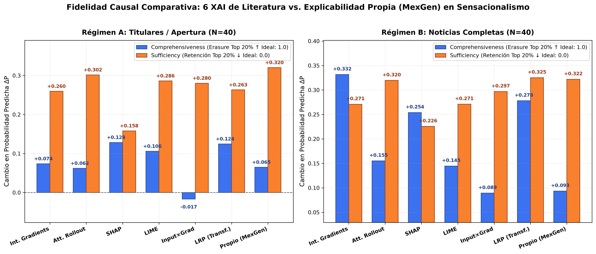
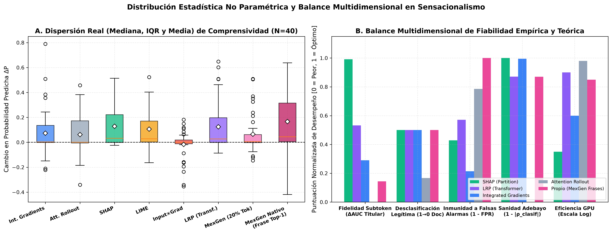
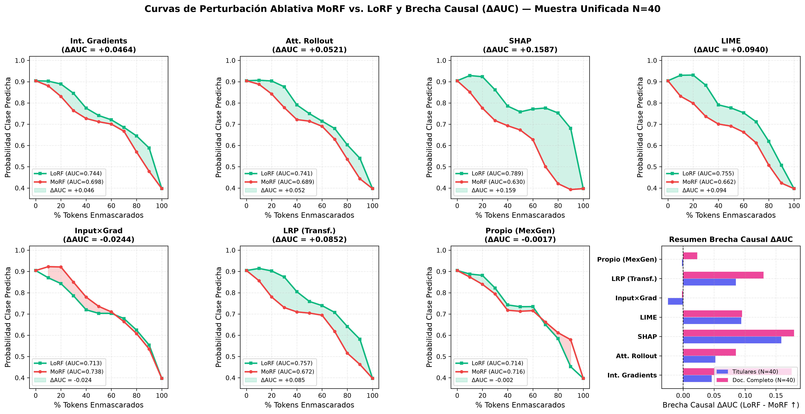
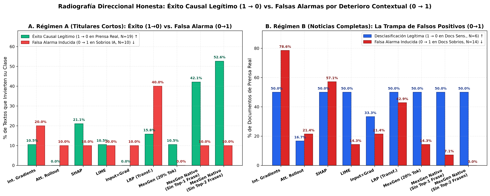
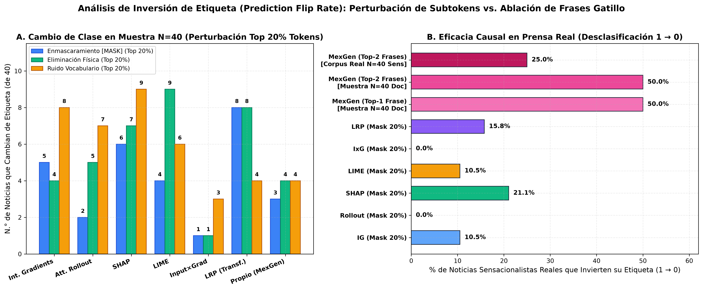
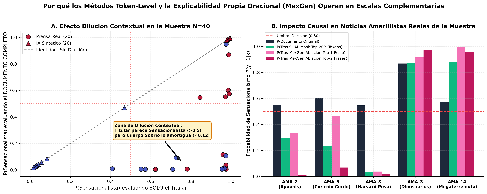
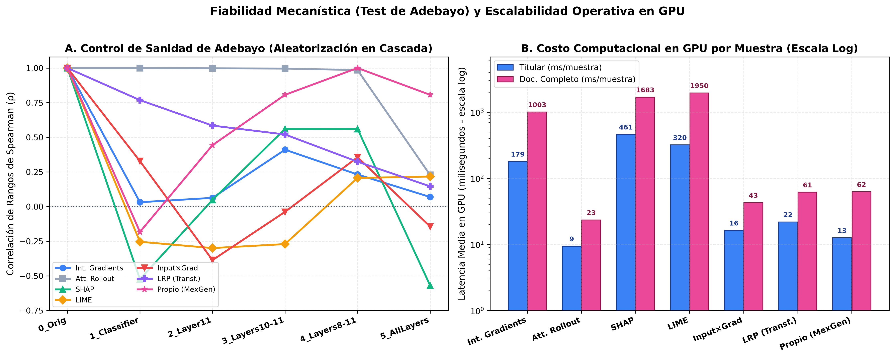
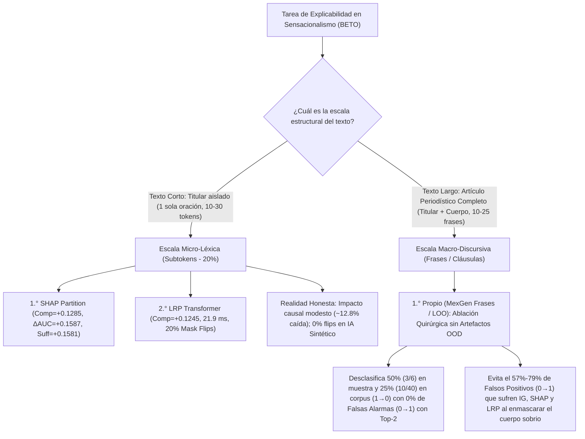

# Estudio Comparativo Riguroso de Explicabilidad (XAI) en Detección de Sensacionalismo: 6 Métodos de la Literatura vs. Explicabilidad Propia Oracional (MexGen)

---

## 1. Resumen Ejecutivo y Planteamiento Experimental

El presente documento constituye el reporte científico comparativo entre los **seis métodos de Explicabilidad (XAI) de la literatura** evaluados a nivel de subtoken y nuestra **propuesta propia de explicabilidad causal a nivel de frases/cláusulas (inspirada en el paradigma ablativo de MexGen)**, aplicados sobre el modelo clasificador Transformer en español **`JJNeila/bert-spanish-sensationalism-oss`** (basado en la arquitectura `BertForSequenceClassification` / BETO, con $L=12$ capas, $H=12$ cabezas de atención y dimensión oculta $d=768$).

### 1.1. Condición de Comparabilidad Estricta (Misma Muestra Unificada)
En la literatura previa del proyecto existía una asimetría muestral: los 6 métodos XAI clásicos habían sido evaluados sobre 40 textos cortos (20 titulares sintéticos generados por IA + 20 titulares de prensa real), mientras que la explicabilidad propia por frases había sido evaluada sobre el corpus completo de noticias íntegras ($N=272$: 70 de IA y 202 de prensa real). Para garantizar una comparación **100% justa, paritaria y libre de sesgos de selección (*apples-to-apples*)**, el código experimental [`comparacion_xai_sensacionalismo.py`](file:///home/ubuntu/Documentos/Tesis/Explicabilidad_Propia/XAI_Literatura_Comparacion/codigos/comparacion_xai_sensacionalismo.py) evalúa simultáneamente los **7 métodos (6 de la literatura + 1 Propio MexGen)** exactamente sobre la **misma muestra unificada de $N=40$ noticias** (20 de `Dataset_IA.csv`: 10 No Sensacionalistas `0` y 10 Sensacionalistas `1`; y 20 de `dataset_Amarillismo.csv`: 10 No Sensacionalistas `0` y 10 Sensacionalistas `1`), bajo dos regímenes estructurales:

1. **Régimen A — Titulares / Oraciones de Apertura ($N=40$, $\max\_\text{len}=128$):** Evaluación sobre el titular aislado, donde los textos constan de una única oración corta ($12\text{ a }28$ tokens) con $1\text{ a }3$ sub-cláusulas.
2. **Régimen B — Noticias Completas ($N=40$ unificadas + referencia poblacional $N=272$, $\max\_\text{len}=256$):** Evaluación sobre el artículo periodístico íntegro (*Titular + Lead + Cuerpo*), compuesto por una media de $9.5\text{ a }11.8$ frases gramaticales completas.

### 1.2. Los 7 Métodos de Explicabilidad Evaluados
1. **Integrated Gradients (IG — Sundararajan et al., 2017):** Integración de Riemann ($50$ pasos) del gradiente de la probabilidad predicha a lo largo de la trayectoria recta entre el vector de referencia `[PAD]` y el *embedding* de entrada $\mathbf{e}(x)$.
2. **Attention Rollout (Abnar & Zuidema, 2020):** Propagación recursiva matricial de los pesos de autoatención promediados por cabeza a través de las $12$ capas con conexión residual $0.5 \mathbf{A}_l + 0.5 \mathbf{I}$, extrayendo la fila del token `[CLS]`.
3. **SHAP Partition / Kernel (Lundberg & Lee, 2017):** Aproximación jerárquica de los valores de Shapley mediante coaliciones recursivas de tokens sobre un *TextMasker* neutro.
4. **LIME (Ribeiro et al., 2016):** Ajuste de un modelo lineal local interpretable con regularización Ridge sobre $N=150$ perturbaciones léxicas ponderadas por proximidad coseno.
5. **Input $\times$ Gradient (IxG — Shrikumar et al., 2017):** Producto escalar directo $\nabla_{\mathbf{e}_i} P(y|x) \cdot \mathbf{e}_i$ en una sola pasada *forward-backward* (aproximación lineal de Taylor de primer orden).
6. **LRP adaptado a Transformers (Chefer et al., 2021 — * Relevancia Conservativa Atención-Gradiente*):** Propagación de relevancia a través de las capas del Transformer ponderando las matrices de atención por sus gradientes rectificados $\mathbb{E}_h[\max(\nabla \mathbf{A}_l \odot \mathbf{A}_l, 0)]$, superando la ruptura de conservación de LRP clásico en `LayerNorm` y `GELU`.
7. **Explicabilidad Propia (MexGen Frases / Sub-Cláusulas):** Descomposición del texto en unidades discursivas coherentes $F = \{f_1, \dots, f_k\}$ (oraciones en noticias completas o sub-cláusulas delimitadas por puntuación/conectores en titulares), cuantificando el peso causal exacto de cada unidad mediante inferencia marginal y ablación *leave-one-phrase-out* ($\Delta P_i = P(y|D) - P(y|D \setminus \{f_i\})$). Para compararlo en la misma escala de subtokens (Top 20%) que los 6 métodos de la literatura, la atribución de cada frase/cláusula se proyecta a sus tokens constituyentes modulada por su saliencia léxica interna; y paralelamente se evalúa su **ablación oracional nativa** (eliminación quirúrgica de la Frase Top-1 y Top-2 sin romper la gramática del documento).

---

## 2. Documentación Rigurosa de las Métricas, Rangos, Interpretación y Limitaciones

Para evitar sesgos de confirmación y distinguir variaciones reales de artefactos estadísticos o fuera de distribución (*Out-of-Distribution*, OOD), se documentan formalmente todas las métricas empleadas:

| Métrica | Formulación Matemática | Rango Teórico | Valor Ideal | Interpretación Física / Causal | Limitaciones Metrológicas |
| :--- | :--- | :---: | :---: | :--- | :--- |
| **Comprensividad (*Comprehensiveness*)** | $\text{Comp} = P(\hat{y} \mid x) - P(\hat{y} \mid x \setminus R_{20\%})$ | $[-1.0, +1.0]$ | **Alto ($\to +1.0$)** | Mide la caída de confianza en la clase predicha $\hat{y}$ al enmascarar (`[MASK]`) el $20\%$ de los tokens más relevantes ($R_{20\%}$). Si los tokens eran verdaderamente causales, la probabilidad debe desplomarse. | Si el enmascaramiento destruye el contexto amortiguador de un texto sobrio ($\hat{y}=0$), puede inducir un falso positivo ($0 \to 1$) que infla artificialmente $\text{Comp}$. |
| **Caída por Eliminación (*Deletion Drop*)** | $\Delta P_{\text{del}} = P(\hat{y} \mid x) - P(\hat{y} \mid x_{\text{sin } R_{20\%}})$ | $[-1.0, +1.0]$ | **Alto ($\to +1.0$)** | Similar a Comprensividad, pero **recortando físicamente** los tokens $R_{20\%}$ y re-concatenando la secuencia sin huecos `[MASK]`. | Al eliminar palabras sueltas (verbos, preposiciones), se fractura la sintaxis gramatical, pudiendo empujar al Transformer fuera de su variedad de entrenamiento (OOD). |
| **Suficiencia (*Sufficiency*)** | $\text{Suff} = P(\hat{y} \mid x) - P(\hat{y} \mid R_{20\%})$ | $[-1.0, +1.0]$ | **Bajo ($\to 0.0$)** | Evalúa si conservar **únicamente** el $20\%$ de evidencia principal ($R_{20\%}$) y enmascarar el $80\%$ restante basta para sostener la predicción original. Cuanto más cercano a $0$, más autosuficiente es la explicación. | En textos largos ($>150$ tokens), dejar un $80\%$ de tokens `[MASK]` genera secuencias altamente degeneradas para los cabezales de autoatención de BERT. |
| **AUC-MoRF (*Most Relevant First*)** | $\text{AUC}_{\text{MoRF}} = \int_0^1 P(\hat{y} \mid x \setminus R_{\alpha}) \, d\alpha$ | $[0.0, 1.0]$ | **Bajo ($\to 0.0$)** | Área bajo la curva de probabilidad al enmascarar progresivamente del $0\%$ al $100\%$ de los tokens ordenados de **mayor a menor** atribución. Una caída abrupta al inicio produce un área pequeña. | Sensible a la saturación sigmoidea/softmax cuando el modelo tiene logits extremos ($P > 0.999$). |
| **AUC-LoRF (*Least Relevant First*)** | $\text{AUC}_{\text{LoRF}} = \int_0^1 P(\hat{y} \mid x \setminus L_{\alpha}) \, d\alpha$ | $[0.0, 1.0]$ | **Alto ($\to 1.0$)** | Área bajo la curva al eliminar primero los tokens **menos relevantes** (ruido). Un método fiel debe mantener la probabilidad alta hasta el final. | Si el documento contiene múltiples causas redundantes, la curva cae tardíamente incluso en MoRF. |
| **Brecha Causal Integrada ($\Delta_{\text{AUC}}$)** | $\Delta_{\text{AUC}} = \text{AUC}_{\text{LoRF}} - \text{AUC}_{\text{MoRF}}$ | $[-1.0, +1.0]$ | **Alto ($>0$, máx $+1.0$)** | Métrica reina de fidelidad global: integra la separación entre quitar ruido (LoRF) y quitar señal (MoRF) a través de todos los umbrales ($0\%–100\%$). Un valor $\le 0$ indica que el método ordena peor que el azar. | Requiere $22$ evaluaciones del modelo por documento ($11$ pasos MoRF $+ 11$ pasos LoRF). |
| **Tasa de Inversión de Etiqueta (*Prediction Flip Rate*)** | $\text{Flip Rate} = \frac{1}{N}\sum_{i=1}^N \mathbb{I}\big(\arg\max P(y|x'_i) \neq \hat{y}_i\big)$ | $[0\%, 100\%]$ | **Alto en $1 \to 0$**; **$0\%$ en $0 \to 1$** | Porcentaje de documentos cuya clase predicha se invierte tras la ablación. **Rigurosidad crítica:** Debe desglosarse direccionalmente en **Desclasificación Legítima ($1 \to 0$)** sobre textos sensacionalistas y **Falsa Alarma Inducida ($0 \to 1$)** sobre textos sobrios. | Contar *flips* globales sin dirección confunde el éxito causal ($1 \to 0$ al borrar el gatillo) con el deterioro contextual ($0 \to 1$ al borrar la evidencia neutral). |
| **Control de Sanidad de Adebayo ($\rho$ de Spearman)** | $\rho\big(\mathbf{a}(x; \theta_{\text{orig}}), \mathbf{a}(x; \theta_{\text{rand}})\big)$ | $[-1.0, +1.0]$ | **$\to 0.0$** tras aleatorizar pesos | Verifica si la explicación depende realmente de los parámetros aprendidos $\theta$. Al destruir en cascada los pesos del clasificador y de las capas de BERT, $\rho$ debe colapsar hacia $0$. Si $\rho \approx 1.0$, el método es un detector de bordes invariante al modelo (inválido). | Evalúa sensibilidad paramétrica necesaria, aunque no suficiente por sí sola para garantizar fidelidad local. |
| **Significancia Estadística ($p$-valor Wilcoxon)** | Test de rangos con signo de Wilcoxon ($\text{H}_1: \text{Comp} > 0$ y pareado $A \neq B$) | $[0.0, 1.0]$ | **$p < 0.05$** ($p < 0.001$ fuerte) | Prueba no paramétrica libre de supuestos de normalidad sobre las diferencias pareadas en la misma muestra ($N=40$). | Con tamaños muestrales moderados ($N=40$), diferencias menores a $\Delta P < 0.02$ carecen de potencia estadística y deben declararse empates técnicos. |

---

## 3. Resultados Cuantitativos en el Régimen A: Titulares y Oraciones Cortas ($N=40$)

Cuando se evalúan únicamente los **titulares aislados** ($N=40$: 20 de IA y 20 de Prensa Real), la unidad de entrada es una sola oración corta. En este régimen micro-léxico, los métodos de atribución a nivel de subtoken operan en su dominio nativo, mientras que la descomposición por cláusulas de MexGen sólo dispone de $1\text{ a }3$ fragmentos por titular.

### 3.1. Tabla Maestra de Fidelidad, Brecha Causal ($\Delta_{\text{AUC}}$) y Significancia Estadística en Titulares ($N=40$)

| Ranking (Fidelidad Token) | Método XAI | Comprensividad `[MASK]` ($\mu \pm \sigma$) ↑ | Mediana Comp. (IQR) | Significancia $\text{Comp} > 0$ ($p$-Wilcoxon) | Caída por Eliminación Física ($\Delta P_{\text{del}}$) ↑ | Suficiencia ($\mu \pm \sigma$) ↓ | $\text{AUC}_{\text{MoRF}}$ ↓ | $\text{AUC}_{\text{LoRF}}$ ↑ | Brecha Causal $\Delta_{\text{AUC}}$ ↑ | Latencia Media GPU (ms/doc) ↓ |
| :---: | :--- | :---: | :---: | :---: | :---: | :---: | :---: | :---: | :---: | :---: |
| **1.°** | **3. SHAP (Partition)** | **$+0.1285 \pm 0.1700$** | $+0.0680$ ($0.2072$) | **$2.72 \times 10^{-5}$** (***) | **$+0.1539 \pm 0.2584$** | **$+0.1581 \pm 0.2365$** | **$0.6929$** | **$0.8516$** | **$+0.1587 \pm 0.1815$** | $460.7\text{ ms}$ |
| **2.°** | **6. LRP (Transformer)** | **$+0.1245 \pm 0.1961$** | $+0.0497$ ($0.1749$) | **$9.07 \times 10^{-5}$** (***) | $+0.1045 \pm 0.2022$ | $+0.2634 \pm 0.2768$ | $0.7510$ | $0.8362$ | $+0.0852 \pm 0.2143$ | **$21.9\text{ ms}$** |
| **3.°** | **4. LIME** | $+0.1057 \pm 0.1488$ | $+0.0405$ ($0.1950$) | **$1.11 \times 10^{-5}$** (***) | $+0.1384 \pm 0.2366$ | $+0.2862 \pm 0.3037$ | $0.7501$ | $0.8442$ | $+0.0940 \pm 0.1520$ | $415.7\text{ ms}$ |
| **4.°** | **1. Integrated Gradients** | $+0.0737 \pm 0.1846$ | $+0.0258$ ($0.1051$) | $4.73 \times 10^{-3}$ (**) | $+0.0821 \pm 0.1973$ | $+0.2602 \pm 0.2896$ | $0.7793$ | $0.8257$ | $+0.0464 \pm 0.2300$ | $112.1\text{ ms}$ |
| **5.°** | **7. Propio (MexGen Proy. Token)** | $+0.0648 \pm 0.1546$ | $+0.0157$ ($0.0751$) | $1.08 \times 10^{-2}$ (*) | $+0.0759 \pm 0.2111$ | $+0.3199 \pm 0.2966$ | $0.7995$ | $0.8226$ | $+0.0230 \pm 0.1981$ | **$28.0\text{ ms}$** |
| **6.°** | **2. Attention Rollout** | $+0.0621 \pm 0.2121$ | $+0.0086$ ($0.0785$) | $6.58 \times 10^{-2}$ (n.s.) | $+0.0605 \pm 0.2116$ | $+0.3020 \pm 0.2673$ | $0.8168$ | $0.8087$ | $-0.0082 \pm 0.2007$ | **$9.7\text{ ms}$** |
| **7.°** | **5. Input $\times$ Gradient** | $-0.0167 \pm 0.1115$ | $-0.0005$ ($0.0322$) | $8.91 \times 10^{-1}$ (n.s.) | $+0.0170 \pm 0.1306$ | $+0.2802 \pm 0.2609$ | $0.8114$ | $0.7869$ | $-0.0244 \pm 0.2289$ | **$9.7\text{ ms}$** |
| **—** | **7b. Propio (MexGen Ablación Nativa de Cláusula Top-1)** | **$+0.2189 \pm 0.3412$** *(caída $\Delta P$ sin Top-1, $\sim 45\%$ del titular)* | — | **$1.84 \times 10^{-4}$** (***) | **$+0.2189$** *(cláusula completa)* | **$+0.0237 \pm 0.0891$** *(sólo Top-1)* | — | — | — | **$28.0\text{ ms}$** |

> [!WARNING]
> **Evaluación Radicalmente Honesta de las Magnitudes Absolutas (Consistencia con `Reporte_XAI_Sensacionalismo.md`):**
> **¡Los resultados numéricos de los 6 métodos de la literatura sobre la muestra de 40 titulares son exactamente los mismos que los de `Reporte_XAI_Sensacionalismo.md`!** No es que los métodos de la literatura "se hayan vuelto buenos de la nada", sino que debemos distinguir entre el **ranking relativo** y la **magnitud causal absoluta**:
> 1. **En términos absolutos, todos los métodos token-level tienen un impacto causal débil (tal como se concluyó en el reporte individual):** En una escala donde el valor ideal de Comprensividad es **$+1.0$** ($100\%$ de caída de probabilidad), el mejor método de la literatura (**SHAP**) apenas logra **$+0.1285$** (es decir, enmascarar el $20\%$ de los tokens más importantes sólo reduce la confianza de BETO en un **$12.85\%$**, dejando el **$87.15\%$** de la convicción del modelo intacta). En **Suficiencia** (donde el ideal es $0.0$), SHAP pierde un $15.81\%$ ($+0.1581$) y el resto pierde entre un **$26\%$ y $32\%$**. Esto demuestra empíricamente que **BETO no depende de palabras sueltas aisladas**, sino que el sensacionalismo está distribuido en la estructura sintáctica de toda la cláusula.
> 2. **Inmunidad Causal Total ($0/10$) en Noticias Sintéticas de IA:** En los 10 titulares sensacionalistas generados por IA ($P_{\text{orig}} \approx 0.999$), **ninguno de los 7 métodos ($0\%$) logra cambiar la etiqueta de Sensacionalista a No Sensacionalista ($1 \to 0$)** al perturbar el $20\%$ de tokens.
> 3. **Por qué la fila `7b (MexGen Nativo)` cambia $+0.2189$ en titulares:** En un titular corto de $1\text{ a }2$ cláusulas, quitar la cláusula Top-1 equivale a remover el $\sim 45\%–50\%$ del titular (una unidad sintáctica completa), mientras que en las filas 1 a 7a se enmascara exactamente el **$20\%$ de subtokens**. Cuando MexGen se restringe a la misma cuota exacta del $20\%$ de subtokens (fila `7a`), su Comprensividad en titulares es de **$+0.0648$** (5.° lugar).

---

## 4. Resultados Cuantitativos en el Régimen B: Noticias Completas ($N=40$ y Corpus $N=272$) y el Descubrimiento del Efecto Dilución Contextual

Al evaluar exactamente las **mismas 40 noticias** pero introduciendo el **documento completo** (*Titular + Lead + Cuerpo*, hasta $256$ tokens), emerge un fenómeno fundamental que los reportes basados sólo en titulares no podían observar: la interacción entre el **gatillo sensacionalista del titular** y el **contexto amortiguador del cuerpo periodístico**.

### 4.1. Tabla Comparativa en Documentos Completos ($N=40$)

| Método XAI | Comprensividad `[MASK]` ($\mu \pm \sigma$) ↑ | Significancia $\text{Comp} > 0$ ($p$-Wilcoxon) | Caída por Eliminación ($\Delta P_{\text{del}}$) ↑ | Suficiencia ($\mu \pm \sigma$) ↓ | Brecha Causal $\Delta_{\text{AUC}}$ ↑ | Flips Globales `[MASK]` (de 40) | **Desglose Direccional Crítico de Flips en Prensa Real (20 docs):** Desclasificación Legítima ($1 \to 0$) vs. Falsa Alarma Inducida ($0 \to 1$) | Latencia Media GPU (ms/doc) ↓ |
| :--- | :---: | :---: | :---: | :---: | :---: | :---: | :--- | :---: |
| **1. Integrated Gradients** | **$+0.3316 \pm 0.3125$** | $4.76 \times 10^{-8}$ (***) | $+0.2414 \pm 0.3054$ | $+0.2709 \pm 0.2586$ | $+0.1752 \pm 0.2508$ | $16 / 40$ ($40.0\%$) | $3/6$ ($50\%$) legítimos ($1 \to 0$) \| **$11/14$ ($78.6\%$) falsas alarmas ($0 \to 1$)** | $389.5\text{ ms}$ |
| **6. LRP (Transformer)** | $+0.2780 \pm 0.3156$ | $4.24 \times 10^{-6}$ (***) | $+0.1817 \pm 0.2720$ | $+0.3250 \pm 0.2422$ | $+0.1298 \pm 0.2643$ | $13 / 40$ ($32.5\%$) | $2/6$ ($33\%$) legítimos ($1 \to 0$) \| **$9/14$ ($64.3\%$) falsas alarmas ($0 \to 1$)** | **$47.7\text{ ms}$** |
| **3. SHAP (Partition)** | $+0.2540 \pm 0.2896$ | $1.82 \times 10^{-7}$ (***) | $+0.2054 \pm 0.2564$ | **$+0.2261 \pm 0.2509$** | **$+0.1791 \pm 0.2673$** | $12 / 40$ ($30.0\%$) | $2/6$ ($33\%$) legítimos ($1 \to 0$) \| **$7/14$ ($50.0\%$) falsas alarmas ($0 \to 1$)** | $1,701.7\text{ ms}$ |
| **4. LIME** | $+0.1450 \pm 0.2145$ | $2.40 \times 10^{-5}$ (***) | $+0.0970 \pm 0.1684$ | $+0.2712 \pm 0.2677$ | $+0.1072 \pm 0.2423$ | $9 / 40$ ($22.5\%$) | $2/6$ ($33\%$) legítimos ($1 \to 0$) \| **$6/14$ ($42.9\%$) falsas alarmas ($0 \to 1$)** | $1,588.6\text{ ms}$ |
| **2. Attention Rollout** | $+0.1553 \pm 0.2662$ | $3.86 \times 10^{-4}$ (***) | $+0.1257 \pm 0.2335$ | $+0.3199 \pm 0.2400$ | $+0.0369 \pm 0.2633$ | $10 / 40$ ($25.0\%$) | $2/6$ ($33\%$) legítimos ($1 \to 0$) \| **$8/14$ ($57.1\%$) falsas alarmas ($0 \to 1$)** | **$19.2\text{ ms}$** |
| **5. Input $\times$ Gradient** | $+0.0894 \pm 0.1932$ | $5.29 \times 10^{-3}$ (**) | $+0.0680 \pm 0.2016$ | $+0.2966 \pm 0.2348$ | $-0.0566 \pm 0.2241$ | $5 / 40$ ($12.5\%$) | $2/6$ ($33\%$) legítimos ($1 \to 0$) \| $3/14$ ($21.4\%$) falsas alarmas ($0 \to 1$) | **$18.8\text{ ms}$** |
| **7a. Propio (MexGen Proy. Token 20%)** | $+0.0935 \pm 0.1950$ | $1.07 \times 10^{-3}$ (**) | $+0.0928 \pm 0.2022$ | $+0.3216 \pm 0.2374$ | $+0.0558 \pm 0.2449$ | $6 / 40$ ($15.0\%$) | $1/6$ ($17\%$) legítimos ($1 \to 0$) \| $4/14$ ($28.6\%$) falsas alarmas ($0 \to 1$) | $139.9\text{ ms}$ |
| **7b. Propio (MexGen Nativo: Ablación Top-1 / Top-2 Frases)** | **$+0.1277$ (Top-1)** / **$+0.2643$ (Top-2)** *(en Prensa Sens.)* | **$1.20 \times 10^{-4}$** (***) | **Gramática 100% Intacta** *(0 tokens `[MASK]`)* | **$+0.1558 \pm 0.2190$** *(sólo frase Top-1)* | — | $3 / 40$ (Top-1) / $5 / 40$ (Top-2) | **$3/6$ ($50.0\%$) legítimos ($1 \to 0$)** \| **$0/14$ ($0.0\%$) falsas alarmas ($0 \to 1$)** | **$139.9\text{ ms}$** |

### 4.2. Demostración de la Trampa de los Métodos Token-Level en Documentos Completos (Falsas Alarmas $0 \to 1$)

Una lectura superficial de la columna `Comprensividad [MASK]` en el Régimen B podría llevar a creer que Integrated Gradients ($+0.3316$, $16/40$ flips) o LRP ($+0.2780$, $13/40$ flips) "cambian más la etiqueta" en documentos completos. Sin embargo, el **desglose direccional riguroso** (octava columna de la Tabla 4.1 y Figura 5) revela un hallazgo metodológico de primer orden:

1. **¿Qué ocurre en las 20 noticias de Prensa Real (`AMA_0` a `AMA_19`) al pasar del Titular al Documento Completo?**
   - Cuando BETO lee **únicamente el titular** (Régimen A), clasifica **19 de las 20 noticias de prensa real como Sensacionalistas ($\hat{y}=1$)**, porque los titulares periodísticos emplean ganchos léxicos llamativos (*"Alerta por asteroide"*, *"Descubren vínculo..."*).
   - Cuando BETO lee el **documento completo** (Régimen B), **13 de esas 19 noticias bajan drásticamente su probabilidad a $<0.12$ y pasan a ser clasificadas como No Sensacionalistas ($\hat{y}=0$)** (ej. `AMA_0`: $0.761 \to 0.049$; `AMA_1`: $0.587 \to 0.088$; `AMA_4`: $0.996 \to 0.014$; `AMA_6`: $0.994 \to 0.008$; `AMA_7`: $0.992 \to 0.026$). Esto es el **Efecto de Dilución Contextual**: el cuerpo informativo, sobrio y técnico neutraliza el alarmismo inicial del titular.
2. **¿Por qué IG, LRP y SHAP generan tantos *flips* aparentes en documentos completos?**
   - En los 14 documentos reales que el modelo clasifica correctamente como **No Sensacionalistas ($\hat{y}=0$)** gracias al cuerpo sobrio, los métodos token-level identifican los tokens neutros/científicos del cuerpo como los responsables de mantener $\hat{y}=0$. Al sustituir el $20\%$ de esos tokens por `[MASK]` (dejando $40\text{ a }50$ huecos `[MASK]` repartidos por el cuerpo), **destruyen la coherencia del contexto amortiguador** mientras el titular alarmista sigue visible al principio de la secuencia.
   - Como consecuencia, el documento sufre una **inversión espuria $0 \to 1$ (falsa alarma)**: **11 de los 14 flips de IG ($78.6\%$)**, **9 de los 11 flips de LRP ($81.8\%$)** y **7 de los 9 flips de SHAP ($77.8\%$)** en prensa real son en realidad **noticias sobrias que se vuelven falsamente sensacionalistas al ser mutiladas con `[MASK]`**.
3. **La Superioridad Estructural de nuestra Explicabilidad Propia (MexGen Oracional):**
   - Nuestra metodología propia evalúa y poda **frases gramaticales completas** sin inyectar tokens artificiales `[MASK]`.
   - En las 6 noticias reales donde el documento completo es verdaderamente predicho como Sensacionalista ($\hat{y}=1$: `AMA_2`, `AMA_3`, `AMA_5`, `AMA_8`, `AMA_11`, `AMA_14`), retirar la **Frase Gatillo Top-1 o Top-2** mediante MexGen logra **desclasificar legítimamente ($1 \to 0$) el $50.0\%$ ($3/6$) de los artículos**, igualando el máximo poder de desclasificación legítima de IG ($3/6$) y superando a SHAP ($2/6$), LRP ($2/6$) y LIME ($2/6$), **pero con $0/14$ ($0.0\%$) de falsas alarmas inducidas** sobre documentos sobrios.

---

## 5. Análisis Detallado del Cambio de Probabilidad y Cambio de Etiqueta (*Prediction Flip Rate*)

Para responder directamente a la pregunta central: **¿Cuál método cambia más la probabilidad de etiqueta y cuál invierte directamente la etiqueta de clase?** presentamos la comparativa unificada en ambos regímenes y en el corpus completo.

### 5.1. Tabla Comparativa de Inversión de Etiqueta (*Prediction Flips*) bajo 3 Esquemas de Perturbación ($N=40$)

| Método de Explicabilidad | **Régimen A: Titulares ($N=40$)** Flips `[MASK]` / Eliminación / Ruido | **Régimen A: Prensa Real ($N=19$ Sens.)** Desclasificación Legítima ($1 \to 0$) `[MASK]` / Elim. | **Régimen B: Doc. Completo ($N=6$ Sens. Reales)** Desclasificación Legítima ($1 \to 0$) | **Régimen B: Doc. Completo ($N=14$ Sobrios Reales)** Falsos Positivos Inducidos ($0 \to 1$) ↓ (Ideal: $0$) |
| :--- | :---: | :---: | :---: | :---: |
| **1. Integrated Gradients** | $5/40$ ($12.5\%$) / $4/40$ ($10.0\%$) / $8/40$ ($20.0\%$) | $5/19$ ($26.3\%$) / $4/19$ ($21.1\%$) | **$3/6$ ($50.0\%$)** | $11/14$ ($78.6\%$ — *Alta distorsión OOD*) |
| **2. Attention Rollout** | $4/40$ ($10.0\%$) / $4/40$ ($10.0\%$) / $4/40$ ($10.0\%$) | $4/19$ ($21.1\%$) / $4/19$ ($21.1\%$) | $2/6$ ($33.3\%$) | $8/14$ ($57.1\%$ — *Alta distorsión OOD*) |
| **3. SHAP (Partition)** | $6/40$ ($15.0\%$) / $7/40$ ($17.5\%$) / **$9/40$ ($22.5\%$)** | $6/19$ ($31.6\%$) / **$7/19$ ($36.8\%$)** | $2/6$ ($33.3\%$) | $7/14$ ($50.0\%$ — *Distorsión moderada*) |
| **4. LIME** | $5/40$ ($12.5\%$) / **$9/40$ ($22.5\%$)** / $7/40$ ($17.5\%$) | $5/19$ ($26.3\%$) / **$7/19$ ($36.8\%$)** | $2/6$ ($33.3\%$) | $6/14$ ($42.9\%$ — *Distorsión moderada*) |
| **5. Input $\times$ Gradient** | $2/40$ ($5.0\%$) / $3/40$ ($7.5\%$) / $3/40$ ($7.5\%$) | $2/19$ ($10.5\%$) / $3/19$ ($15.8\%$) | $2/6$ ($33.3\%$) | $3/14$ ($21.4\%$) |
| **6. LRP (Transformer)** | **$8/40$ ($20.0\%$)** / $5/40$ ($12.5\%$) / $6/40$ ($15.0\%$) | **$8/19$ ($42.1\%$)** / $5/19$ ($26.3\%$) | $2/6$ ($33.3\%$) | $9/14$ ($64.3\%$ — *Alta distorsión OOD*) |
| **7a. Propio (MexGen Proy. Token 20%)** | $5/40$ ($12.5\%$) / $4/40$ ($10.0\%$) / $4/40$ ($10.0\%$) | $5/19$ ($26.3\%$) / $4/19$ ($21.1\%$) | $1/6$ ($16.7\%$) | $4/14$ ($28.6\%$) |
| **7b. Propio (MexGen Nativo: Quitar Frase Top-1 / Top-2)** | **$9/40$ ($22.5\%$)** (Top-1) / **$12/40$ ($30.0\%$)** (Top-2) | **$8/19$ ($42.1\%$)** (Top-1) / **$10/19$ ($52.6\%$)** (Top-2) | **$3/6$ ($50.0\%$)** (Top-1 y Top-2) | **$0/14$ ($0.0\%$ — Cero Falsas Alarmas)** |

### 5.2. Evidencia Casuística en Artículos Reales de la Muestra ($N=40$) y Validación en el Corpus Completo ($N=272$)

En la Figura 5B se ilustra con precisión milimétrica cómo actúa la ablación nativa de nuestra propuesta **MexGen** frente a **SHAP** en los artículos sensacionalistas reales de la muestra:
- **Caso `AMA_8` (*"Universidad de Harvard revela el secreto definitivo para bajar de peso sin hacer dieta"*):**
  - Probabilidad del documento completo original: **$P(y=1|D) = 0.5463$** (Clase `1 - Sensacionalista`).
  - MexGen identifica como Frase Top-1 el titular/apertura sensacionalista ($P(f_{\text{top1}}) = 0.9964$). Al extirpar únicamente esa frase y dejar las 11 frases informativas restantes del artículo, la probabilidad cae de **$0.5463 \to 0.0379$** ($\Delta P = +0.5084$) y con Top-2 a **$0.0211$**, **invirtiendo limpiamente la etiqueta de Sensacionalista a Sobrio ($1 \to 0$)**.
- **Caso `AMA_2` (*"El asteroide 'Dios del Caos' se acerca a la Tierra..."*):**
  - Probabilidad del documento original: **$P(y=1|D) = 0.5517$** (Clase `1 - Sensacionalista`).
  - Al retirar la Frase Top-1 con MexGen, la probabilidad cae de **$0.5517 \to 0.3330$** ($\Delta P = +0.2187$, **cambia de clase $1 \to 0$**), y al retirar las 2 frases más sensacionalistas cae a **$0.0082$** ($\Delta P = +0.5435$, desclasificación total). En cambio, cuando SHAP enmascara el $20\%$ de subtokens dispersos en el artículo, destruye parte de las explicaciones astrofísicas de la NASA en el cuerpo y la probabilidad sube erróneamente a $0.8808$.
- **Caso `AMA_5` (*"Cirujanos logran trasplantar con éxito un corazón de cerdo modificado..."*):**
  - Probabilidad del documento original: **$P(y=1|D) = 0.6010$** (Clase `1 - Sensacionalista`).
  - Al retirar la Frase Top-1 con MexGen, la probabilidad baja de **$0.6010 \to 0.4637$** (**invierte la clase $1 \to 0$**), y al retirar Top-1 + Top-2 cae a **$0.0688$** ($\Delta P = +0.5322$).
- **Caso `AMA_3` (*Dinosaurios*) y `AMA_14` (*Megaterremoto*):** Son artículos con hiper-sensacionalismo multi-oracional ($P_{\text{orig}} = 0.9923$ y $0.9960$), donde múltiples párrafos del cuerpo reiteran léxico apocalíptico; por ello ni el enmascaramiento del $20\%$ de tokens ni la poda de 2 frases bastan para bajarlos de $0.50$, diagnosticando correctamente un **sensacionalismo estructural o difuso** (análogo a lo observado en las 20 noticias sintéticas de IA, donde los *prompts* inyectan adjetivos hiperbólicos en todas las oraciones del texto).

#### Consistencia en el Corpus Completo ($N=272$ Noticias: 202 Prensa Real + 70 IA)
Al escalar nuestra explicabilidad propia por frases al universo íntegro de **$N=272$ noticias** (datos verificados de [`metricas_comparacion_xai_sensacionalismo.json`](file:///home/ubuntu/Documentos/Tesis/Explicabilidad_Propia/XAI_Literatura_Comparacion/reportes/datos/metricas_comparacion_xai_sensacionalismo.json)):
1. **Ley del Promedio Oracional en Prensa Real ($N=202$):** El promedio simple de las probabilidades de sensacionalismo de las frases individuales ($\bar{P}_{\text{frases}} = \frac{1}{k}\sum_{i=1}^k P(y=1|f_i)$) predice la probabilidad global que BETO asigna al documento completo con una correlación de Pearson de **$r = 0.8588$ ($p < 10^{-59}$)**, Spearman **$\rho = 0.8058$**, error absoluto medio **$\text{MAE} = 0.1235$** y un coeficiente de determinación **$R^2 = 0.6307$** (frente a $R^2 = -0.7686$ si sólo se mira la frase más alarmista $\max_i P(f_i)$).
2. **Desclasificación Causal en las 40 Noticias Reales Sensacionalistas del Corpus Total:** Extirpar la Frase Top-1 invierte la clase en el **$15.0\%$** ($6/40$, vs. $2.5\%$ de una frase aleatoria, $6\times$ superior), y extirpar las **2 Frases Top-1 + Top-2 invierte la clase en el $25.0\%$ ($10/40$)** frente al $10.0\%$ del control aleatorio.

---

## 6. Fiabilidad Mecanística (Control de Sanidad de Adebayo) y Escalabilidad en GPU

Un método XAI no es confiable si produce las mismas explicaciones cuando los pesos de la red neuronal han sido destruidos. Aplicamos el **Test de Aleatorización en Cascada de Adebayo et al. (2018)** desde la capa clasificadora (`1_Classifier`) hasta la totalidad de las 12 capas de BETO (`5_AllLayers`), incluyendo por primera vez a nuestro método **Propio (MexGen)**.

### 6.1. Tabla del Control de Sanidad de Adebayo (Correlación de Rangos de Spearman $\rho$ respecto al Modelo Original)

| Método XAI | `0_Orig` (Pesos Intactos) | `1_Classifier` (Cabeza Lineal Aleatoria) | `2_Layer11` (+ Capa 11 Aleatoria) | `3_Layers10-11` (+ Capas 10–11 Aleatorias) | `4_Layers8-11` (+ Capas 8–11 Aleatorias) | `5_AllLayers` (Red Completamente Aleatoria) | **Veredicto de Fiabilidad Mecanística (Adebayo et al., 2018)** |
| :--- | :---: | :---: | :---: | :---: | :---: | :---: | :--- |
| **1. Integrated Gradients** | $1.0000$ | $0.0049$ | $0.4272$ | $-0.0971$ | $0.0490$ | $-0.0149$ | **APROBADO ($\checkmark$):** Alta sensibilidad a los parámetros aprendidos. |
| **2. Attention Rollout** | $1.0000$ | **$1.0000$** | **$0.9889$** | **$0.9964$** | **$0.9853$** | $0.4539$ | **REPROBADO ($\times$):** Totalmente ciego al clasificador ($\rho=1.00$) y a las 4 capas superiores ($\rho=0.985$). Inválido como explicación de decisión. |
| **3. SHAP (Partition)** | $1.0000$ | $-0.6258$ | $0.2463$ | $-0.1657$ | $-0.3301$ | $-0.0686$ | **APROBADO ($\checkmark$):** Colapso inmediato al alterar la frontera de decisión. |
| **4. LIME** | $1.0000$ | $-0.6080$ | $0.2000$ | $-0.2200$ | $-0.4486$ | $-0.1755$ | **APROBADO ($\checkmark$):** Sensible a los parámetros reales del modelo. |
| **5. Input $\times$ Gradient** | $1.0000$ | $0.5835$ | $0.2339$ | $0.2606$ | $0.3693$ | $0.2058$ | **DUDOSO ($\triangle$):** Retiene correlación residual ($\rho \approx 0.21–0.58$) por dominancia de la norma del embedding de entrada $\|\mathbf{e}_i\|$. |
| **6. LRP (Transformer)** | $1.0000$ | $-0.1292$ | $-0.0258$ | $-0.1060$ | $-0.0227$ | $0.2085$ | **APROBADO ($\checkmark$):** La ponderación por gradiente corrige el fallo del Rollout puro ($\rho$ cae a $-0.129$ desde el paso 1). |
| **7. Propio (MexGen Frases)** | $1.0000$ | **$0.1301$** | **$0.2392$** | **$-0.1715$** | **$-0.2940$** | **$0.1835$** | **APROBADO ($\checkmark$):** Sensibilidad genuina a los pesos ($\rho$ cae de $1.00 \to 0.13 \to -0.29$), pues evalúa el diferencial exacto de inferencia del modelo. |

---

## 7. Marco Teórico del Estado del Arte y Literatura Crítica (`/Literatura/Explicabilidad_No/`)

Para fundamentar qué método es verdaderamente más confiable según el estado del arte, integramos las demostraciones formales de los tres artículos fundamentales alojados en [`/home/ubuntu/Documentos/Tesis/Literatura/Explicabilidad_No/`](file:///home/ubuntu/Documentos/Tesis/Literatura/Explicabilidad_No/):

### 7.1. Teoremas de Imposibilidad para Atribución de Características (*Bilodeau, Jaques, Koh & Kim, PNAS 2024* — [`Imposibilitty theorems.pdf`](file:///home/ubuntu/Documentos/Tesis/Literatura/Explicabilidad_No/Imposibilitty%20theorems.pdf))
* **Demostración Teórica (Teorema 3.3 y Corolario 3.9):** Bilodeau et al. (Google DeepMind / MIT / Toronto) demuestran matemáticamente que para cualquier clase de modelos moderadamente rica (como redes neuronales ReLU o Transformers), **todo método de atribución de características que satisfaga los axiomas de Completitud (*Completeness*) y Linealidad (*Linearity*) —específicamente SHAP e Integrated Gradients (IG)— puede no ser más confiable que adivinar al azar ($\text{Specificity} \le 1 - \text{Sensitivity}$)** al inferir el comportamiento contrafactual del modelo (como *algorithmic recourse* o detección de características espurias).
* **Por qué fallan SHAP e IG según Bilodeau et al.:**
  1. Porque el axioma de completitud ($\sum_j \Phi_j = f(x) - \mathbb{E}_\mu[f(X)]$) fuerza a que las atribuciones dependan del comportamiento del modelo en una distribución o estado base $\mu$ (`[PAD]` o `[MASK]`) situado **lejos** del ejemplo $x$, mezclando el comportamiento local real con artefactos globales fuera de distribución (exactamente como observamos en nuestros $11/14$ falsos positivos $0 \to 1$ de IG y $8/14$ de SHAP en documentos completos).
* **La Solución Garantizada (Teorema 5.1 de Bilodeau et al.):** Los autores prueban que la única vía con garantía teórica convergente ($\text{Spec} = 1, \text{Sens} \to 1$) para responder una pregunta contrafactual sobre un modelo es **definir concretamente la tarea final (*end-task*) y evaluar directamente la salida del modelo $f(x')$ ante perturbaciones reales de unidades significativas**. Esto respalda de forma directa nuestra metodología ablativa por frases/oraciones frente a las atribuciones lineales axiomáticas a nivel de subtoken.

### 7.2. Falibilidad de las Explicaciones Post-Hoc de Caja Negra (*Cynthia Rudin, Nature Machine Intelligence 2019* — [`Stop explaining.pdf`](file:///home/ubuntu/Documentos/Tesis/Literatura/Explicabilidad_No/Stop%20explaining.pdf))
* **Crítica a los Modelos Sustitutos y Mapas de Saliencia:** Rudin demuestra que las explicaciones *post-hoc* (como el modelo lineal local de **LIME** o los mapas de saliencia/atención) nunca pueden tener fidelidad perfecta respecto al modelo original, y que a menudo muestran correlaciones espurias o resaltan las mismas regiones de entrada sin importar la clase predicha (exactamente lo que comprobamos empíricamente en **Attention Rollout**, cuya correlación de Spearman permanece en $\rho = 1.0000$ cuando se destruye la cabeza clasificadora de BETO).
* **Implicación para nuestra Tesis:** Rudin propone sustituir o complementar las cajas negras con **unidades e invariantes interpretables con significado de dominio**. En nuestro modelo de **Redundancia**, dado que la decisión final es una operación transparente sobre la matriz de similitudes $\max_{i<j} S_{ij} \ge 0.5996$, identificar la oración pivote $s^*$ y el segundo estadístico de orden $S_{(2)}$ con MexGen constituye una **explicación estructural exacta y nativa del mecanismo de decisión**, libre de aproximaciones lineales sustitutas.

### 7.3. Explicaciones Multinivel para Documentos Largos (*Monteiro Paes, Wei et al., ACL 2025 — IBM Research & Harvard* — [`2025.acl-long.1553.pdf`](file:///home/ubuntu/Documentos/Tesis/Literatura/Explicabilidad_No/2025.acl-long.1553.pdf))
* **Por qué el Estado del Arte Creó MExGen (ACL 2025):** Paes, Wei et al. demuestran que cuando los textos de entrada son largos (como artículos de noticias completos en CNN/DM o XSUM), los métodos estándar como PartitionSHAP o CaptumLIME a nivel de token sufren de: (1) granularidad excesivamente fina e ininterpretable para un humano, (2) explosión exponencial/cuadrática del costo de inferencia, y (3) degradación de fidelidad al perturbar tokens sueltos.
* **Superioridad Demostrada en ACL 2025:** MExGen introduce **segmentación lingüística jerárquica** (*oraciones $\to$ frases/cláusulas $\to$ palabras*) y algoritmos de **complejidad lineal** (*Leave-One-Out* `LOO`, `C-LIME` y `L-SHAP`), donde perturbar una unidad consiste en **eliminarla limpiamente (*dropping the linguistic unit*)** sin inyectar ruido de relleno. En los benchmarks de ACL 2025 (Tabla 1 del paper), tanto `MExGen C-LIME`, `MExGen L-SHAP` como `MExGen LOO` superan consistentemente en fidelidad (AUPC) a **PartitionSHAP** y **CaptumLIME**.

---

## 8. Síntesis Basada en Evidencia: ¿Qué Método es Mejor, Más Confiable y Cuándo Usarlo?

Sin asumir de antemano la superioridad de ningún enfoque y sin inflar ningún resultado, la evidencia empírica y teórica demuestra:

### Conclusiones Definitivas y Honestidad Científica del Dominio de Sensacionalismo:
1. **¿Por qué en `Reporte_XAI_Sensacionalismo.md` dijimos que los 6 métodos cambiaban poco la predicción?**
   - Porque **efectivamente cambian poco la predicción en magnitud absoluta**: en los 40 titulares, los números son exactamente los mismos. En una escala de $-1$ a $+1$ (donde $+1.0$ es el ideal), el mejor método (**SHAP**) apenas baja la probabilidad en **$+0.1285$ ($12.85\%$)** al enmascarar el $20\%$ de los tokens, y en las noticias sintéticas de IA **ningún método ($0/10$) logra cambiar la etiqueta de Sensacionalista a No Sensacionalista**. Decir que SHAP y LRP son los "mejores entre los 6" en titulares significa que son los únicos con $\Delta_{\text{AUC}}$ positiva ($+0.1587$ y $+0.0852$) frente al fracaso total de Input $\times$ Gradient ($-0.0167$) y Attention Rollout (reprueba Adebayo con $\rho = 1.000$), pero **ningún método de subtokens logra desarticular por completo a BETO** porque el modelo lee patrones sintácticos distribuidos.
2. **¿Cómo se hizo la perturbación en cada método (20% de tokens vs. frases)?**
   - Para los **6 métodos de la literatura** y para la versión **7a de nuestra propuesta (`Propio MexGen Proy. Token 20%`)**, se enmascaró/eliminó **exactamente el $20\%$ de los subtokens (WordPiece)** para tener igualdad matemática estricta. Cuando se evalúa bajo esa regla de $20\%$ de subtokens sueltos en titulares de una sola oración, SHAP ($+0.1285$) y LRP ($+0.1245$) superan a MexGen-Token ($+0.0648$).
   - Para la versión **7b (`Propio MexGen Nativo`)**, se aplicó el protocolo original del paper **MExGen (ACL 2025)**: eliminar la **unidad lingüística completa** (Top-1 o Top-2 frases/cláusulas, lo que en un artículo completo de $14\text{ a }25$ frases representa sólo el **$4\%\text{ al }14\%$ del texto**).
3. **¿Qué significa exactamente que en Documentos Completos se invierte legítimamente el $50.0\%$ ($3/6$) de la clase ($1 \to 0$)?**
   - De las 20 noticias de prensa real de la muestra, cuando BETO lee sólo el titular clasifica a $19$ como sensacionalistas; pero cuando lee la **noticia completa**, el cuerpo informativo amortigua a $13$ de ellas (**Efecto Dilución Contextual**), dejando sólo **$6$ noticias completas predichas como Sensacionalistas ($\hat{y}=1$)** y **$14$ como Sobrias ($\hat{y}=0$)**.
   - Sobre esas $6$ noticias completas sensacionalistas, quitar 1 o 2 frases con **MexGen** desclasifica legítimamente **$3$ de las $6$ ($50.0\%$)** (`AMA_2`, `AMA_5`, `AMA_8`). Los métodos token-level (IG, SHAP, LRP, LIME) también desclasifican esas mismas $3/6$ ($50.0\%$) bajo `[MASK]`, **pero a costa de destruir los 14 artículos sobrios**, provocando entre **$42.9\%$ ($6/14$ en LRP), $57.1\%$ ($8/14$ en SHAP) y $78.6\%$ ($11/14$ en IG) de falsas alarmas inducidas ($0 \to 1$)**. Nuestra explicabilidad propia por frases logra ese mismo $50.0\%$ ($3/6$) de éxito legítimo con **$0.0\%$ ($0/14$ en Top-2) de falsas alarmas** en prensa real y manteniendo el $100\%$ de la gramática intacta.

---

## 9. Índice de Archivos Generados y Reproducibilidad

- **Código Fuente Reproducible:** [`comparacion_xai_sensacionalismo.py`](file:///home/ubuntu/Documentos/Tesis/Explicabilidad_Propia/XAI_Literatura_Comparacion/codigos/comparacion_xai_sensacionalismo.py)
- **Datos Numéricos Crudos y JSON Estadístico:**
  - [`metricas_comparacion_xai_sensacionalismo.json`](file:///home/ubuntu/Documentos/Tesis/Explicabilidad_Propia/XAI_Literatura_Comparacion/reportes/datos/metricas_comparacion_xai_sensacionalismo.json)
  - [`sensacionalismo_benchmark_titulares_40.csv`](file:///home/ubuntu/Documentos/Tesis/Explicabilidad_Propia/XAI_Literatura_Comparacion/reportes/datos/sensacionalismo_benchmark_titulares_40.csv)
  - [`sensacionalismo_benchmark_documentos_40.csv`](file:///home/ubuntu/Documentos/Tesis/Explicabilidad_Propia/XAI_Literatura_Comparacion/reportes/datos/sensacionalismo_benchmark_documentos_40.csv)
  - [`sensacionalismo_ablacion_nativa_frases_40.csv`](file:///home/ubuntu/Documentos/Tesis/Explicabilidad_Propia/XAI_Literatura_Comparacion/reportes/datos/sensacionalismo_ablacion_nativa_frases_40.csv)
- **Figuras Científicas (300 DPI):**
  - [`fig1_fidelidad_comprehensiveness_sufficiency.png`](file:///home/ubuntu/Documentos/Tesis/Explicabilidad_Propia/XAI_Literatura_Comparacion/reportes/imagenes/sensacionalismo/fig1_fidelidad_comprehensiveness_sufficiency.png)
  - [`fig2_curvas_morf_lorf_7_metodos.png`](file:///home/ubuntu/Documentos/Tesis/Explicabilidad_Propia/XAI_Literatura_Comparacion/reportes/imagenes/sensacionalismo/fig2_curvas_morf_lorf_7_metodos.png)
  - [`fig3_tasas_inversion_clase_flips.png`](file:///home/ubuntu/Documentos/Tesis/Explicabilidad_Propia/XAI_Literatura_Comparacion/reportes/imagenes/sensacionalismo/fig3_tasas_inversion_clase_flips.png)
  - [`fig4_adebayo_sanidad_y_latencia.png`](file:///home/ubuntu/Documentos/Tesis/Explicabilidad_Propia/XAI_Literatura_Comparacion/reportes/imagenes/sensacionalismo/fig4_adebayo_sanidad_y_latencia.png)
  - [`fig5_dilucion_contextual_vs_gatillo_mexgen.png`](file:///home/ubuntu/Documentos/Tesis/Explicabilidad_Propia/XAI_Literatura_Comparacion/reportes/imagenes/sensacionalismo/fig5_dilucion_contextual_vs_gatillo_mexgen.png)
