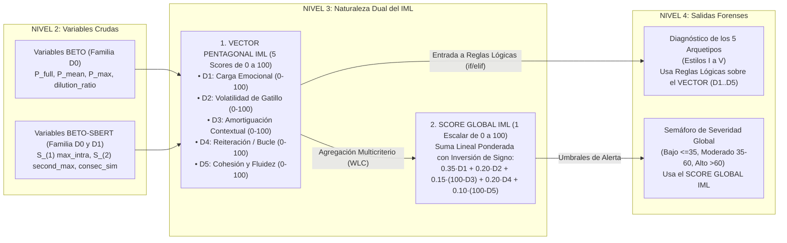

# Informe Técnico y Epistemológico Exhaustivo: Diccionario de Variables de Nivel 2, Construcción Matemática del Índice de Manipulación Lingüística (IML) y Justificación Científica de los 5 Arquetipos Discursivos

**Proyecto de Tesis:** Evaluación Empírica de Métodos de XAI y Modelado de Patrones Lingüísticos para la Detección Explicable de Noticias Falsas en Español  
**Autores:** Natali Alba Tobías & Daniel Santiago Camacho Gutiérrez  
**Módulo:** [`Tesis/Explicabilidad_Propia/reportes/`](./)  
**Archivos de Código Auditados:**  
- [`../metodo_explicabilidad.py`](../metodo_explicabilidad.py) (Motor integral de extracción en frío, IML, arquetipos y banderas oracionales)  
- [`../codigos/perfilador_estilo_manipulacion.py`](../codigos/perfilador_estilo_manipulacion.py) (Perfilador masivo sobre el corpus de $N = 2.604$ noticias)  
- [`../../Modelos_Individuales/Clasificar_fake/Modelo_Ensamble/Codigos/extraer_features_avanzadas_5d.py`](../../Modelos_Individuales/Clasificar_fake/Modelo_Ensamble/Codigos/extraer_features_avanzadas_5d.py) (Extractor tabular para el Ensamble GBDT sobre $N = 4.418$ noticias)  
**Capítulos de Tesis Vinculados:** [`chapter02.tex`](../../../Tesis_DaNat_1/chapters/Chapter2/chapter02.tex), [`chapter03.tex`](../../../Tesis_DaNat_1/chapters/Chapter3/chapter03.tex), [`chapter05.tex`](../../../Tesis_DaNat_1/chapters/Chapter5/chapter05.tex), [`appendixA.tex`](../../../Tesis_DaNat_1/chapters/Appendices/appendixA.tex) y [`apendice_matematico.tex`](../../../Tesis_DaNat_1/chapters/Appendices/apendice_matematico.tex).

---

## Índice de Contenidos
1. [Aclaración Fundamental: ¿El IML es un Score por Dimensión, un Solo Score Global o Ambos?](#1-aclaración-fundamental-el-iml-es-un-score-por-dimensión-un-solo-score-global-o-ambos)
2. [Arquitectura de los 3 Motores del Nivel 1 y Diccionario Exhaustivo de las Variables del Nivel 2 (36 Base / 42 Tesis / 48 Enriquecidas)](#2-arquitectura-de-los-3-motores-del-nivel-1-y-diccionario-exhaustivo-de-las-variables-del-nivel-2)
3. [Trazabilidad Nivel 2 $\to$ Nivel 3: Qué Variables Componen Cada Dimensión del IML ($D_1$ a $D_5$), Fórmulas Exactas y Origen de sus Constantes](#3-trazabilidad-nivel-2--nivel-3-qué-variables-componen-cada-dimensión-del-iml-d_1-a-d_5-fórmulas-exactas-y-origen-de-sus-constantes)
4. [Justificación de la Ecuación del Score Global IML en el Estado del Arte](#4-justificación-de-la-ecuación-del-score-global-iml-en-el-estado-del-arte)
5. [Génesis de los 5 Arquetipos Discursivos: ¿Por Qué Esos 5 y No Otros? ¿Salen de Clustering, Literatura o Experimentos?](#5-génesis-de-los-5-arquetipos-discursivos-por-qué-esos-5-y-no-otros-salen-de-clustering-literatura-o-experimentos)
6. [Mecanismo Exacto de Construcción de los Arquetipos: ¿Promedio, Suma o Reglas Lógicas sobre las Dimensiones del IML?](#6-mecanismo-exacto-de-construcción-de-los-arquetipos-promedio-suma-o-reglas-lógicas-sobre-las-dimensiones-del-iml)
7. [Definición Amplia, Fundamento en Literatura y Calibración Empírica de Cada uno de los 5 Arquetipos (Estilos I al V)](#7-definición-amplia-fundamento-en-literatura-y-calibración-empírica-de-cada-uno-de-los-5-arquetipos-estilos-i-al-v)
8. [Guía de Respuestas Rápidas para Defensa ante el Jurado](#8-guía-de-respuestas-rápidas-para-defensa-ante-el-jurado)

---

## 1. Aclaración Fundamental: ¿El IML es un Score por Dimensión, un Solo Score Global o Ambos?

Una de las dudas más importantes al presentar la tesis es entender si el **Índice de Manipulación Lingüística (IML)** es un vector de cinco puntajes o un único puntaje escalar, si es un promedio y cómo se conecta con los 5 Arquetipos.

La respuesta exacta, tal como está implementada en [`metodo_explicabilidad.py`](../metodo_explicabilidad.py#L711-L760) (`las_5_dimensiones_iml`), es que **el IML posee una naturaleza dual (son AMBOS: un Vector Pentagonal de 5 Scores individuales + 1 Score Global resumido)**, y cada uno cumple una función distinta:



### 1.1 Las tres reglas de oro sobre cómo funciona el IML:
1. **El IML entrega 6 números en total en la Ficha Forense:**
   - **5 Scores Dimensionales ($D_1, D_2, D_3, D_4, D_5 \in [0, 100]$):** Representan las 5 puntas del gráfico de radar pentagonal. Cada dimensión tiene su propia fórmula de normalización y su propio diagnóstico cualitativo (Bajo, Moderado, Crítico).
   - **1 Score Global ($\text{IML}_{\text{global}} \in [0, 100]$):** Resume la severidad total de anomalía estilométrica del documento en un solo número para lectura rápida (semáforo de riesgo).
2. **El Score Global IML NO es un promedio simple de las 5 dimensiones:**
   - Hacer un promedio simple $\frac{D_1+D_2+D_3+D_4+D_5}{5}$ sería **matemáticamente incorrecto** por dos motivos:
     - **Primero (Polaridad opuesta):** En $D_1$ (Sensacionalismo), $D_2$ (Gatillo) y $D_4$ (Reiteración), tener $100$ puntos es **malo** (alta manipulación). En cambio, en $D_3$ (Amortiguación del cuerpo) y $D_5$ (Cohesión fluida), tener $100$ puntos es **bueno** (alta calidad periodística). Por eso, para calcular el Score Global, $D_3$ y $D_5$ **se invierten** como $(100 - D_3)$ y $(100 - D_5)$.
     - **Segundo (Jerarquía teórica):** No todas las dimensiones pesan igual en la percepción humana de manipulación; se usa una **Suma Lineal Ponderada (*Weighted Linear Combination - WLC*)** donde los pesos suman $1.00$ ($0.35, 0.20, 0.15, 0.20, 0.10$).
3. **Los 5 Arquetipos Discursivos NO se construyen a partir del Score Global IML, sino a partir de los 5 Scores Dimensionales individuales ($D_1, D_2, D_3, D_4, D_5$):**
   - **¿Por qué un arquetipo NO se define como "si el Score Global IML está entre X e Y"?** Porque el Score Global comprime 5 dimensiones en 1 solo número, perdiendo la topología del estilo.
   - *Ejemplo real del corpus:* Una noticia de **Propaganda Institucional (Estilo III)** tiene tono frío, académico y sin exclamaciones ($D_1 = 10$), sin gatillo ($D_2 = 5$), con buena amortiguación ($D_3 = 100$) y cohesión aparente ($D_5 = 80$), pero tiene un **bucle severo de repetición semántica ($D_4 = 75$)**. Su **Score Global IML es bajísimo (`21.5 / 100`)**, pero es una falsedad sofisticada (**70.2% de fake news** en la versión multilingüe y **38.5%** en BETO-SBERT). Si clasificáramos los arquetipos usando el Score Global IML, jamás detectaríamos el Estilo III. Por eso los arquetipos se asignan evaluando **reglas lógicas conjuntivas (`AND`) sobre las dimensiones individuales $D_1, D_2, D_3, D_4, D_5$**.

---

## 2. Arquitectura de los 3 Motores del Nivel 1 y Diccionario Exhaustivo de las Variables del Nivel 2

Cuando una noticia cruda entra al sistema (**Nivel 1**), no se pasa por un clasificador de caja negra. En su lugar, es procesada "en frío" (*frozen weights*, sin *fine-tuning* sobre las etiquetas de fake news del corpus para evitar memorizar nombres de políticos o países) por **tres motores computacionales especializados**:

1. **Motor 1 — Transformer Afectivo de Sensacionalismo (`BETO-JJNeila`):** Modelo `JJNeila/bert-spanish-sensationalism-oss` (arquitectura BERT entrenada en español, 110M de parámetros), asistido por el segmentador oracional `NLTK punkt_tab` adaptado a abreviaturas en español. Evalúa tanto el artículo completo como cada oración por separado y ejecuta ablación contrafáctica.
2. **Motor 2 — Transformer Siamés de Geometría Semántica (`BETO-SBERT` + `MexGen`):** Modelo `hiiamsid/sentence_similarity_spanish_es` ($d = 768$, seleccionado como ganador tras evaluar 4 arquitecturas siamesas en STS-B, PAWS-X y XNLI; o `paraphrase-multilingual-MiniLM-L12-v2`, $d = 384$, en la versión ligera). Proyecta cada oración $s_i$ en la hiperesfera unitaria ($\|\mathbf{e}_i\|_2 = 1$), construye la matriz combinatoria de similitud coseno $\mathbf{S} \in \mathbb{R}^{K \times K}$ y ejecuta la **Ablación Oracional No Tautológica (MexGen)**.
3. **Motor 3 — Analizador Morfosintáctico, Fonológico y Forense (`spaCy` + `Regex` + `Fonología Silábica`):** Combina el etiquetador gramatical (*POS Tagger*) `es_core_news_sm` de `spaCy`, un contador heurístico de sílabas y diptongos del español (`count_syllables_es`) y 9 diccionarios de expresiones regulares compiladas (`PAT_HEDGES`, `PAT_BOOSTERS`, `PAT_DICENDI`, `PAT_TEMPORAL`, `PAT_QUOTES`, `PAT_ALL_CAPS`, `PAT_CENSORED_MASKS`, etc.).

### 2.1 Aclaración sobre el número de variables en el Nivel 2 (36 vs. 42 vs. 48/51)
En los documentos de la tesis aparecen tres conteos que corresponden exactamente al mismo inventario en distintas fases de representación:
* **36 Variables Cuantitativas Base (Marco Forense Puro — Capítulo 3, Sección 3.5.5):** Son los 36 descriptores lingüísticos continuos organizados en las 6 familias técnicas `D0` a `D5`.
* **42 Características Consolidadas (Vector del Clasificador GBDT — Capítulo 3, Sección 3.6.3 y Tabla A.1 de [`appendixA.tex`](../../../Tesis_DaNat_1/chapters/Appendices/appendixA.tex)):** Son las **36 variables base** + **2 variables desagregadas de puntuación** (`quest_density` y `ellipsis_density`, dando **38 numéricas**) + **4 columnas binarias One-Hot Encoding** (`bin4_1`, `bin4_2`, `bin4_3`, `bin4_4`) producto de expandir la variable categórica `shannon_bin_4` ($38 + 4 = 42$).
* **48 / 51 Variables Enriquecidas con Estadísticos MexGen Multi-Umbral ([`Reporte_Ensamble_Adaptativo_FakeNews.md`](../../Modelos_Individuales/Clasificar_fake/Modelo_Ensamble/Reportes/Reporte_Ensamble_Adaptativo_FakeNews.md)):** Añade al bloque `D0` los estadísticos de orden superior de la matriz SBERT ($S_{(2)}$, media Top-3, $P_{90}$, varianza, brecha de persistencia MexGen, caída MoRF y las 4 densidades multi-umbral GMM/PAWS-X/$P_{95}$/$P_{99}$).

A continuación se presenta el **Diccionario Maestro Completo** de las variables del Nivel 2, explicando **de cuál de los 3 motores sale**, **cómo se calcula**, **su fórmula matemática** y **por qué se diseñó así según la literatura**.

---

### Familia Técnica `D0`: Sensacionalismo Afectivo, Redundancia Intra-Documental y Ablación MexGen
*(10 variables base $\to$ 14 en Tabla A.1 con OHE $\to$ 20 en versión enriquecida MexGen)*

| # (A.1) | Variable (`Feature`) | Motor de Origen (Nivel 1) | Fórmula Matemática Exacta | ¿Cómo se crea y POR QUÉ se crea así? (Justificación Teórica y Experimental) |
| :---: | :--- | :--- | :--- | :--- |
| **1** | `P_full` | **Motor 1:** `BETO-JJNeila` | $$P_{\text{full}} = \text{Softmax}\big(f_{\text{BETO}}(\text{Texto}_{1:256})\big)_1 \in [0,1]$$ | **Cómo:** Se tokeniza el documento completo (hasta 256 WordPieces) y se extrae la probabilidad de la clase 1 (*Sensacionalista*).<br>**Por qué:** Captura el tono afectivo global percibido por un Transformer bidireccional entrenado en titulares y notas amarillistas en español (*Hamby et al., 2023*; *Blanco Alfonso, 2020*). |
| **2** | `P_mean` | **Motor 1:** `NLTK` + `BETO-JJNeila` | $$P_{\text{mean}} = \frac{1}{K}\sum_{i=1}^{K} P(s_i)$$ | **Cómo:** Se divide la noticia en $K$ oraciones con `nltk.sent_tokenize`, se evalúa cada oración $s_i$ por separado en BETO y se calcula la media aritmética.<br>**Por qué:** Representa la "temperatura emocional basal" del artículo cuando cada oración pesa lo mismo, evitando que una primera frase larga domine la atención del Transformer. |
| **3** | `P_max` | **Motor 1:** `NLTK` + `BETO-JJNeila` | $$P_{\max} = \max_{i \in \{1,\dots,K\}} P(s_i)$$ | **Cómo:** Identifica la probabilidad máxima entre todas las oraciones $s_i$ del texto (**Oración Gatillo**).<br>**Por qué:** *Horne & Adali (2017)* y *Bazaco et al. (2019)* demostraron que el engaño viral suele concentrar el choque emocional en una única cláusula anzuelo (*trigger sentence*), aunque el resto del texto sea plano. |
| **4** | `P_top2` | **Motor 1:** `NLTK` + `BETO-JJNeila` | $$P_{\text{top2}} = \frac{P_{(1)} + P_{(2)}}{2}$$ | **Cómo:** Ordena las probabilidades oracionales de mayor a menor $P_{(1)} \ge P_{(2)} \ge \dots \ge P_{(K)}$ y promedia las dos más altas.<br>**Por qué:** En noticias con titular y subtítulo (*lead*), el cebo emocional suele repartirse entre las dos primeras oraciones. Promediar el Top-2 estabiliza el detector frente a ruido en una sola frase. |
| **5** | `sigma_sens` | **Motor 1:** `NLTK` + `BETO-JJNeila` | $$\sigma_{\text{sens}} = \sqrt{\frac{1}{K}\sum_{i=1}^{K} \big(P(s_i) - P_{\text{mean}}\big)^2}$$ | **Cómo:** Desviación estándar de las probabilidades de sensacionalismo a lo largo de las $K$ oraciones.<br>**Por qué:** Mide la **volatilidad afectiva interna**. Un texto sobrio o un panfleto uniformemente histérico tienen $\sigma_{\text{sens}}$ baja; una nota con picos dramáticos intercalados con datos técnicos tiene $\sigma_{\text{sens}}$ alta. |
| **6** | `dilution_ratio` | **Motor 1:** `BETO-JJNeila` | $$DR = \frac{P_{\text{full}}}{P_{\max} + 10^{-6}}$$ | **Cómo:** Cociente entre el sensacionalismo del documento completo y el pico máximo oracional ($10^{-6}$ evita división por cero).<br>**Por qué:** Cuantifica el **Efecto Dilución Contextual** descubierto en la Fase 3 de la tesis: si el titular es alarmista ($P_{\max}=0.90$) pero el cuerpo es riguroso, al leer todo el texto junto BETO baja su predicción ($P_{\text{full}}=0.18 \implies DR=0.20$). Si todo el texto sostiene el pánico, $DR \to 1.0$. |
| **7** | `delta_p_gatillo` | **Motor 1:** `BETO-JJNeila` (Ablación Causal) | $$\Delta P_{\text{gatillo}} = \max\!\Big(0,\; P_{\text{full}} - P\big(D \setminus \{s_{(1)}, s_{(2)}\}\big)\Big)$$ | **Cómo:** Se eliminan físicamente del texto las 2 oraciones más sensacionalistas ($s_{(1)}, s_{(2)}$), se vuelve a pasar el texto restante por BETO y se mide cuánto cayó la probabilidad global.<br>**Por qué:** Es una **prueba de causalidad contrafáctica** inspirada en *DeYoung et al. (2020 - ERASER)*. Demuestra matemáticamente si el sensacionalismo del artículo era causado exclusivamente por dos frases señuelo ($\Delta P > 0.30$) o si estaba distribuido en toda la redacción ($\Delta P \approx 0$). |
| **8** | `max_intra_similarity` ($S_{(1)}$) | **Motor 2:** `BETO-SBERT` | $$S_{(1)} = \max_{1 \le i < j \le K} \cos(\mathbf{e}_i, \mathbf{e}_j)$$ | **Cómo:** Se codifican las $K$ oraciones en vectores normalizados $\mathbf{e}_i \in \mathbb{R}^{768}$, se calcula la matriz $\mathbf{S} = \mathbf{E}\mathbf{E}^\top$ y se extrae el máximo del triángulo superior estricto ($i < j$).<br>**Por qué:** Captura el par de oraciones con mayor solapamiento proposicional del documento. En psicometría del engaño (*Hasher et al., 1977*; *Pennycook et al., 2018*), repetir la misma tesis con palabras distintas induce el **Efecto de Verdad Ilusoria**. |
| **9** | `mean_intra_similarity` ($\bar{S}_{\text{doc}}$) | **Motor 2:** `BETO-SBERT` | $$\bar{S}_{\text{doc}} = \frac{2}{K(K-1)}\sum_{1 \le i < j \le K} \cos(\mathbf{e}_i, \mathbf{e}_j)$$ | **Cómo:** Promedio de todos los $\binom{K}{2}$ pares únicos de oraciones fuera de la diagonal principal.<br>**Por qué:** Mide la compacidad temática global del artículo. Un valor demasiado bajo indica que el texto salta entre temas inconexos; un valor excesivamente alto indica que todo el artículo gira sobre una única idea sin desarrollo informativo. |
| **10** | `redundancy_density` | **Motor 2:** `BETO-SBERT` + `GMM` | $$\rho_{\text{red}} = \frac{2}{K(K-1)}\sum_{1 \le i < j \le K} \mathbb{I}\big[\cos(\mathbf{e}_i, \mathbf{e}_j) \ge \tau\big]$$ | **Cómo:** Proporción de pares de oraciones cuya similitud coseno supera el umbral calibrado ($\tau_{\text{GMM}} = 0.34$ en versión base; desglosado en 4 densidades en la versión avanzada: $\tau_{\text{GMM}}=0.3434$, $\tau_{\text{PAWS-X}}=0.5340$, $\tau_{P_{95}}=0.5996$, $\tau_{\text{Hiper}}=0.7287$).<br>**Por qué:** Mientras $S_{(1)}$ mira un solo par extremo, la densidad mide qué porcentaje de toda la red oracional está atrapada en repetición semántica. |
| **11–14** | `bin4_1`, `bin4_2`, `bin4_3`, `bin4_4` (`shannon_bin_4`) | **Motor 2:** `BETO-SBERT` + `Árbol de Entropía de Shannon` | $$b_m = \mathbb{I}\big[S_{(1)} \in \text{Estrato}_m\big], \quad m \in \{1,2,3,4\}$$ | **Cómo:** Se discretiza $S_{(1)}$ maximizando la ganancia de información de Shannon respecto a la etiqueta de veracidad (en 4 macro-estratos funcionales: *1: Fragmentado/Baja*, *2: Banda Óptima Periodística*, *3: Bucle Redundante*, *4: Cita/Copia Casi Literal*) y se codifica en 4 columnas binarias One-Hot.<br>**Por qué:** La relación entre similitud semántica y falsedad **no es monótona lineal**: tanto tener similitud muy baja (texto roto) como tener similitud muy alta (bucle) es anómalo, mientras que el centro es sano. La partición de Shannon captura esta no-linealidad en forma de intervalos interpretables. |
| *(Enriq.)* | `second_max_intra_sim` ($S_{(2)}$) y `mexgen_persistence_gap` | **Motor 2:** `BETO-SBERT` + `MexGen` | $$S_{\text{post}} = \max_{i<j,\; i,j \ne s^*} S_{i,j}, \quad \Delta S_{\max} = S_{(1)} - S_{\text{post}}$$ | **Cómo:** Se identifica la oración más central del par máximo ($s^*$), se la extirpa de la matriz $\mathbf{S}$ y se vuelve a medir el máximo en la submatriz restante ($S_{(2)}$ o $S_{\text{post}}$).<br>**Por qué:** En una noticia real puede haber un único par parecido (ej. el titular y el primer párrafo dicen lo mismo, pero el resto avanza). Al extirpar $s^*$, en una noticia real la similitud cae drásticamente; en cambio, en un panfleto con **red multi-bucle**, $S_{(2)}$ sigue siendo alto (ocupó el **puesto #14 de importancia global en el GBDT**, superando a $S_{(1)}$). |

---

### Familia Técnica `D1`: Coherencia y Flujo Discursivo Secuencial (3 variables)
*(Mide la transición local entre una oración $s_i$ y la inmediatamente siguiente $s_{i+1}$)*

| # (A.1) | Variable (`Feature`) | Motor de Origen (Nivel 1) | Fórmula Matemática Exacta | ¿Cómo se crea y POR QUÉ se crea así? (Justificación Teórica y Experimental) |
| :---: | :--- | :--- | :--- | :--- |
| **15** | `consec_sim_mean` | **Motor 2:** `BETO-SBERT` | $$\mu_{\text{consec}} = \frac{1}{K-1}\sum_{i=1}^{K-1} \cos(\mathbf{e}_i, \mathbf{e}_{i+1})$$ | **Cómo:** Calcula la similitud coseno únicamente en la superdiagonal inmediata de la matriz $\mathbf{S}$ (oración $1 \to 2$, $2 \to 3$, ..., $K-1 \to K$) y las promedia.<br>**Por qué:** Basado en la teoría de cohesión local de **Coh-Metrix (*Graesser et al., 2004*)**. En la prosa periodística bien editada, cada oración se apoya semánticamente en la anterior. |
| **16** | `consec_sim_min` | **Motor 2:** `BETO-SBERT` | $$\min_{\text{consec}} = \min_{1 \le i \le K-1} \cos(\mathbf{e}_i, \mathbf{e}_{i+1})$$ | **Cómo:** Encuentra el eslabón más débil en la cadena de transiciones adyacentes.<br>**Por qué:** Detecta el **"bache narrativo" o costura de pegado (*copy-paste*)**: cuando un desinformador pega un párrafo conspirativo al final de un cable de agencia real, se produce una caída abrupta ($\cos < 0.10$) en ese punto exacto de transición. |
| **17** | `consec_sim_std` | **Motor 2:** `BETO-SBERT` | $$\sigma_{\text{consec}} = \sqrt{\frac{1}{K-1}\sum_{i=1}^{K-1}\big(\cos(\mathbf{e}_i, \mathbf{e}_{i+1}) - \mu_{\text{consec}}\big)^2}$$ | **Cómo:** Desviación estándar de las similitudes adyacentes.<br>**Por qué:** Cuantifica la **turbulencia del flujo argumental**. Un texto profesional avanza a ritmo constante ($\sigma_{\text{consec}}$ baja); un texto errático alterna frases clonadas con saltos abruptos de tema. |

---

### Familia Técnica `D2`: Lingüística Forense y Marcadores Epistémicos (5 variables)
*(Mide la atribución a fuentes verificables y la postura epistémica del autor ante la verdad)*

| # (A.1) | Variable (`Feature`) | Motor de Origen (Nivel 1) | Fórmula Matemática Exacta | ¿Cómo se crea y POR QUÉ se crea así? (Justificación Teórica y Experimental) |
| :---: | :--- | :--- | :--- | :--- |
| **18** | `hedges_density` | **Motor 3:** `Regex Forense` (`PAT_HEDGES`) | $$\text{Hedges} = \frac{|\text{Atenuadores}|}{N_{\text{palabras}}} \times 100$$ | **Cómo:** Escanea expresiones de cautela epistémica (*«presunto», «al parecer», «según fuentes», «podría», «habría sido», «no se descarta»*) por cada 100 palabras.<br>**Por qué:** En metadiscurso académico y periodístico (*Hyland, 2005*; *McMenamin, 2002*), el periodismo serio utiliza marcadores de prudencia legal y deontológica cuando un hecho está en investigación. |
| **19** | `boosters_density` | **Motor 3:** `Regex Forense` (`PAT_BOOSTERS`) | $$\text{Boosters} = \frac{|\text{Intensificadores}|}{N_{\text{palabras}}} \times 100$$ | **Cómo:** Escanea expresiones dogmáticas de certeza absoluta (*«indudablemente», «irrefutable», «la verdad oculta», «científicamente comprobado», «sin lugar a dudas», «urgente»*) por cada 100 palabras.<br>**Por qué:** La desinformación compensa su falta de pruebas empíricas con **hiper-asertividad dogmática** (*Hyland, 2005*), intentando cerrar el espacio de duda crítica del lector. |
| **20** | `epistemic_ratio` | **Motor 3:** `Regex Forense` | $$R_{\text{epist}} = \frac{|\text{Boosters}| + 0.01}{|\text{Hedges}| + 0.10}$$ | **Cómo:** Razón suavizada entre intensificadores de certeza y atenuadores de cautela.<br>**Por qué:** Sintetiza el **balance epistémico**: valores $\gg 1$ delatan un discurso autoritario/panfletario que afirma dogmas sin matices; valores $< 1$ reflejan prudencia verificadora. |
| **21** | `quotes_density` | **Motor 3:** `Regex Forense` (`PAT_QUOTES`) + `NLTK` | $$\text{Quotes} = \frac{|\{\text{«}, \text{»}, \text{"}, \text{“}, \text{”}\}|}{K_{\text{oraciones}}}$$ | **Cómo:** Conteo de signos de comillas tipográficas y anglosajonas dividido por el número de oraciones $K$.<br>**Por qué:** Las comillas en prensa marcan la frontera entre la voz del periodista y la reproducción textual de testimonios o documentos oficiales. Su ausencia suele acompañar rumores anónimos. |
| **22** | `dicendi_density` | **Motor 3:** `Regex Forense` (`PAT_DICENDI`) | $$\text{Dicendi} = \frac{|\text{Verbos de Reporte}|}{N_{\text{palabras}}} \times 100$$ | **Cómo:** Conteo de verbos *dicendi* conjugados en pasado/presente periodístico (*«dijo», «declaró», «manifestó», «explicó», «informó», «aseguró», «precisó», «señaló»*) por 100 palabras.<br>**Por qué:** En lingüística del discurso periodístico (*Coulthard, 2004*; *Salaverría et al., 2020*), los verbos *dicendi* son la huella gramatical de la atribución de fuentes. El periodismo real atribuye (*«el ministro declaró...»*); el bulo afirma en el vacío. |

---

### Familia Técnica `D3`: Riqueza Léxica, Complejidad Sintáctica y Legibilidad (6 variables)
*(Mide la amplitud del vocabulario y el costo de procesamiento cognitivo de la prosa)*

| # (A.1) | Variable (`Feature`) | Motor de Origen (Nivel 1) | Fórmula Matemática Exacta | ¿Cómo se crea y POR QUÉ se crea así? (Justificación Teórica y Experimental) |
| :---: | :--- | :--- | :--- | :--- |
| **23** | `flesch_szigriszt` | **Motor 3:** `Fonología Silábica` + `NLTK` | $$I_{\text{FS}} = 206.835 - 62.3\left(\frac{N_{\text{sílabas}}}{N_{\text{palabras}}}\right) - \left(\frac{N_{\text{palabras}}}{K_{\text{oraciones}}}\right)$$ | **Cómo:** Cuenta sílabas en español agrupando diptongos (`count_syllables_es`) y aplica la adaptación al español de Szigriszt Pazos (1993) de la fórmula de Flesch (acotada en $[0, 120]$).<br>**Por qué:** *Horne & Adali (2017)* demostraron que el cuerpo de las noticias falsas utiliza estructuras léxicas más simples y repetitivas para maximizar la facilidad de lectura viral, o bien cae en oraciones interminables sin puntuación correcta. |
| **24** | `gutierrez_polini` | **Motor 3:** `Tokens` + `NLTK` | $$I_{\text{GP}} = 95.2 - 9.7\left(\frac{N_{\text{caracteres}}}{N_{\text{palabras}}}\right) - \left(\frac{N_{\text{palabras}}}{K_{\text{oraciones}}}\right)$$ | **Cómo:** Calcula la comprensibilidad nativa para el español de Gutiérrez de Polini (1972) usando longitud de palabra en letras y longitud de oración (acotada en $[0, 100]$).<br>**Por qué:** Complementa a Flesch-Szigriszt sin depender de la segmentación silábica, siendo robusta ante extranjerismos y siglas técnicas. |
| **25** | `guiraud_ttr` | **Motor 3:** `Tokenizador Alfabético` | $$R_{\text{Guiraud}} = \frac{|V|}{\sqrt{N_{\text{palabras}}}}$$ | **Cómo:** Divide el tamaño del vocabulario único ($|V|$, tipos léxicos en minúscula) entre la raíz cuadrada del total de palabras ($N$).<br>**Por qué:** El *Type-Token Ratio* clásico ($|V|/N$) decae artificialmente cuando el texto es más largo. El **Índice de Guiraud (1954)** corrige matemáticamente ese sesgo con $\sqrt{N}$, midiendo la verdadera riqueza léxica del redactor: los bulos tienen menor vocabulario único porque repiten los mismos sustantivos y adjetivos. |
| **26** | `hapax_ratio` | **Motor 3:** `Counter Léxico` | $$H_{\text{ratio}} = \frac{|\{w \in V : \text{freq}(w) = 1\}|}{N_{\text{palabras}}} \times 100$$ | **Cómo:** Porcentaje de palabras sobre el total del texto que aparecen **exactamente una sola vez** (*Hapax Legomena*).<br>**Por qué:** En estilometría forense (*Coulthard, 2004*; *McMenamin, 2002*), una tasa alta de *hapax* refleja precisión terminológica y progresión informativa (cada párrafo introduce entidades, cargos y detalles nuevos). |
| **27** | `conteo_palabras` | **Motor 3:** `Regex Alfabético` | $$N_{\text{palabras}} = |\text{Tokens alfabéticos}| \in [70, 370]$$ | **Cómo:** Conteo total de palabras del documento dentro de la ventana controlada del estudio ($70\text{--}370$ palabras).<br>**Por qué:** Controla el volumen informativo base y sirve como denominador de normalización para todas las densidades por cada 100 palabras. |
| **28** | `num_sentences` | **Motor 1/3:** `NLTK punkt_tab` | $$K = |S| = |\{s_1, s_2, \dots, s_K\}|$$ | **Cómo:** Número de oraciones gramaticales (> 8 caracteres) segmentadas por NLTK.<br>**Por qué:** Captura la granularidad de puntuación del texto (textos telegráficos fragmentados frente a bloques monolíticos sin puntos seguidos). |

---

### Familia Técnica `D4`: Morfosintaxis `spaCy` POS Tagging y Subjetividad (4 variables)
*(Mide la estructura gramatical profunda independientemente del tema o país)*

| # (A.1) | Variable (`Feature`) | Motor de Origen (Nivel 1) | Fórmula Matemática Exacta | ¿Cómo se crea y POR QUÉ se crea así? (Justificación Teórica y Experimental) |
| :---: | :--- | :--- | :--- | :--- |
| **29** | `adj_noun_ratio` | **Motor 3:** `spaCy POS` (`es_core_news_sm`) | $$R_{\text{ADJ/NOUN}} = \frac{N_{\text{ADJ}}}{N_{\text{NOUN}} + 1}$$ | **Cómo:** `spaCy` etiqueta la categoría gramatical (*Part-of-Speech*) de cada token y se divide el total de adjetivos calificativos (`ADJ`) entre el total de sustantivos comunes (`NOUN`) más 1.<br>**Por qué:** Los sustantivos nombran objetos y hechos del mundo; los adjetivos los califican subjetivamente. Una razón alta delata una prosa cargada de epítetos valorativos frente a la prosa nominal informativa (*Biber, 1988*; *Muñoz & Iglesias, 2024*). |
| **30** | `pron_1p_density` | **Motor 3:** `spaCy POS` + `Léxico 1P` | $$P_{1\text{P}} = \frac{|\{\text{yo, nosotros, nos, mi, nuestro...}\}|}{N_{\text{palabras}}} \times 100$$ | **Cómo:** Cuenta pronombres y determinantes posesivos de 1.ª persona singular y plural por cada 100 palabras.<br>**Por qué:** El periodismo informativo estándar se escribe en 3.ª persona. La irrupción de la 1.ª persona plural (*«nos están engañando», «nuestra salud»*) es un marcador clásico de **apelación tribal y populismo conspirativo** (*Rivera Magos & González Pureco, 2024*). |
| **31** | `pron_3p_density` | **Motor 3:** `spaCy POS` + `Léxico 3P` | $$P_{3\text{P}} = \frac{|\{\text{él, ella, ellos, se, le, lo, su...}\}|}{N_{\text{palabras}}} \times 100$$ | **Cómo:** Cuenta pronombres de 3.ª persona y marcas de impersonalidad refleja (`se`) por cada 100 palabras.<br>**Por qué:** Es el marcador morfosintáctico de **distancia epistémica y registro referencial** propio de agencias de noticias (*Biber, 1988*). |
| **32** | `adv_density` | **Motor 3:** `spaCy POS` (`pos_ == 'ADV'`) | $$\text{Adv} = \frac{N_{\text{ADV}}}{N_{\text{palabras}}} \times 100$$ | **Cómo:** Cuenta todos los adverbios (`ADV`: modales en *-mente*, de grado, negación o afirmación) detectados por el árbol morfosintáctico de `spaCy` por cada 100 palabras.<br>**Por qué:** **Resultó ser el Predictor #1 más potente de toda la tesis ($8.16\%$ de ganancia en el GBDT)**. ¿Por qué? Porque quien redacta una noticia falsa o manipulada siente la necesidad psicológica de "forzar" la interpretación del lector insertando modificadores modales constantemente (*«lamentablemente», «supuestamente», «jamás», «increíblemente», «muy»*), mientras que la noticia real narra acciones desnudas (Sujeto + Verbo + Objeto). |

---

### Familia Técnica `D5`: Anclajes Factuales, Mayúsculas Sostenidas y Superficie Tipográfica (8 base / 10 en Tabla A.1)
*(Mide la señalización visual de alarma y el anclaje empírico verificable, descontaminando máscaras de corpus)*

| # (A.1) | Variable (`Feature`) | Motor de Origen (Nivel 1) | Fórmula Matemática Exacta | ¿Cómo se crea y POR QUÉ se crea así? (Justificación Teórica y Experimental) |
| :---: | :--- | :--- | :--- | :--- |
| **33** | `all_caps_count` | **Motor 3:** `Regex Tipográfico` (`PAT_ALL_CAPS`) | $$C_{\text{CAPS}} = \big|\{w \in \text{Texto}_{\text{limpio}} : w \in \text{[A-ZÁÉÍÓÚÑ]}^{\ge 3} \setminus \Sigma_{\text{siglas}}\}\big|$$ | **Cómo:** Primero se **descontaminan las máscaras de anonimización** de los datasets (`*NUMBER*`, `*URL*`, `*PHONE*`) y se excluyen siglas legítimas (`ONU`, `OMS`, `EEUU`, `PIB`, `EFE`, etc.). Luego se cuentan las palabras de $\ge 3$ letras escritas enteramente en MAYÚSCULAS.<br>**Por qué:** Equivalente tipográfico del grito (*visual shouting*). En desinformación de redes y WhatsApp se usa para secuestrar la atención visual (*«URGENTE», «ESCÁNDALO», «PELIGRO»*). |
| **34** | `all_caps_ratio` | **Motor 3:** `Regex Tipográfico` | $$R_{\text{CAPS}} = \frac{C_{\text{CAPS}}}{N_{\text{palabras}}} \times 100$$ | **Cómo:** Porcentaje de palabras completas en mayúsculas sostenidas respecto al total de palabras.<br>**Por qué:** Normaliza `all_caps_count` por la longitud de la nota. **Fue el Predictor #3 más importante del modelo GBDT ($6.76\%$)**. |
| **35** | `upper_chars_ratio` | **Motor 3:** `Filtro de Caracteres` | $$R_{\text{upper}} = \frac{|\{c \in \text{Letras}_{\text{limpio}} : \text{isupper}(c)\}|}{|\text{Letras}_{\text{limpio}}|} \times 100$$ | **Cómo:** Porcentaje de letras individuales en mayúscula sobre el total de letras alfabéticas del texto limpio (sin máscaras `*NUMBER*`).<br>**Por qué:** Captura tanto el uso de *ALL CAPS* como la sobrecarga de iniciales mayúsculas artificiales (*Title Case* anglosajón o exceso de nombres/etiquetas). **Fue el Predictor #2 más importante del GBDT ($7.16\%$)**. |
| **36** | `excl_density` | **Motor 3:** `Escaneo de Puntuación` | $$D_{!} = \frac{\text{count}(\text{'!'}) + \text{count}(\text{'¡'})}{N_{\text{palabras}}} \times 100$$ | **Cómo:** Signos de apertura y cierre de exclamación por cada 100 palabras.<br>**Por qué:** En los manuales de estilo periodístico (ej. *EFE*, *El País*, *AP*), los signos de exclamación están prácticamente prohibidos fuera de citas textuales. Su presencia delata apelación emocional directa. |
| **37** | `quest_density` *(Desagregada en 42 vars)* | **Motor 3:** `Escaneo de Puntuación` | $$D_{?} = \frac{\text{count}(\text{'?'}) + \text{count}(\text{'¿'})}{N_{\text{palabras}}} \times 100$$ | **Cómo:** Signos de interrogación por cada 100 palabras.<br>**Por qué:** Cuantifica la táctica retórica de *just asking questions* (*«¿Casualidad o plan secreto?»*): sembrar sospechas conspirativas mediante preguntas retóricas para esquivar la carga de la prueba. |
| **38** | `ellipsis_density` *(Desagregada en 42 vars)* | **Motor 3:** `Regex` (`\.{3}|…`) | $$D_{\dots} = \frac{\text{count}(\text{'...'}) + \text{count}(\text{'…'})}{N_{\text{palabras}}} \times 100$$ | **Cómo:** Puntos suspensivos por cada 100 palabras.<br>**Por qué:** Los puntos suspensivos dejan proposiciones incompletas para insinuar ironía, ocultamiento o complicidad con el lector, rasgo ajeno al periodismo informativo directo. |
| **39** | `punct_intensity` | **Motor 3:** `Agregador Tipográfico` | $$D_{\text{punct}} = D_{!} + D_{?} + D_{\dots}$$ | **Cómo:** Suma de las densidades de exclamación, interrogación y puntos suspensivos.<br>**Por qué:** En el marco base de 36 variables resume en un solo indicador toda la puntuación expresiva no declarativa del texto. |
| **40** | `numbers_density` | **Motor 3:** `Regex Numérico` (`PAT_DIGITS`) | $$D_{\text{num}} = \frac{|\text{Cifras}| + |\text{\texttt{*NUMBER*}}|}{N_{\text{palabras}}} \times 100$$ | **Cómo:** Suma todas las cifras arábigas explícitas (`15`, `2024`, `3,5`) más los tokens de números anonimizados (`*NUMBER*` en los corpus `MEX-A3T` y `FakeDeS`) por cada 100 palabras.<br>**Por qué:** Las noticias reales anclan sus hechos en cantidades concretas (presupuestos, edades, kilómetros, votos); la fabricación suele ser vaga y cualitativa (*«miles de personas», «mucho dinero»*). |
| **41** | `percent_count` | **Motor 3:** `Regex` (`PAT_PERCENT`) | $$C_{\%} = |\text{Apariciones de '\%' o 'por ciento'}|$$ | **Cómo:** Conteo absoluto de expresiones porcentuales en el documento.<br>**Por qué:** Señal específica de respaldo estadístico o económico verificable. |
| **42** | `temporal_density` | **Motor 3:** `Regex Temporal` (`PAT_TEMPORAL`) | $$D_{\text{temp}} = \frac{|\text{Meses (enero..diciembre) y Años (2018..2026)}|}{N_{\text{palabras}}} \times 100$$ | **Cómo:** Conteo de referencias cronológicas explícitas por cada 100 palabras.<br>**Por qué:** El periodismo responde al *cuándo* con fechas fechadas (*«el 14 de marzo de 2023»*). Los bulos suelen omitir fechas exactas para poder reciclarse y viralizarse año tras año como si acabaran de ocurrir (*descontextualización temporal*, *Wardle & Derakhshan, 2017*). |

---

## 3. Trazabilidad Nivel 2 $\to$ Nivel 3: Qué Variables Componen Cada Dimensión del IML ($D_1$ a $D_5$), Fórmulas Exactas y Origen de sus Constantes

Para que el usuario humano (periodista, editor o ciudadano) no tenga que leer una tabla de 42 números en escalas distintas, el **Nivel 3** sintetiza la anatomía retórica del artículo en **5 Dimensiones ($D_1$ a $D_5$) estrictamente acotadas en $[0.0, 100.0]$**.

### 3.1 ¿Por qué el IML toma las variables de `D0` y `D1` del Nivel 2 y dónde quedan `D2, D3, D4, D5`?
Como se explica en [`chapter03.tex` (Sección 3.6.4)](../../../Tesis_DaNat_1/chapters/Chapter3/chapter03.tex#L419-L425):
* **Las 5 Dimensiones del IML ($D_1$–$D_5$ en Nivel 3)** se construyen a partir de las variables de **Sensacionalismo Oracional/Documental (`BETO-JJNeila`)** y de **Similitud Semántica Intra-Documental (`BETO-SBERT` + `MexGen`)** de las familias técnicas `D0` y `D1` de Nivel 2. ¿Por qué? Porque esas variables miden la **macro-estructura retórica del documento completo** (la relación entre titular y cuerpo y la geometría de repetición entre párrafos).
* **Las familias técnicas `D2` (Epistémica/Dicendi), `D3` (Riqueza Léxica), `D4` (POS Tagging/Adverbios) y `D5` (Mayúsculas/Anclajes)** cumplen dos roles complementarios cruciales:
  1. Alimentan las **14 Banderas Forenses Locales Oracionales** en la tabla frase por frase de la Ficha Forense (ver líneas 587–636 de [`metodo_explicabilidad.py`](../metodo_explicabilidad.py#L587-L636)).
  2. Alimentan directamente al **Meta-Clasificador Supervisado GBDT**, donde aportan más del $62\%$ de la ganancia predictiva para clasificar *Fake vs. Real*.

### 3.2 Tabla de Construcción Matemática de cada Dimensión del IML ($D_1$ a $D_5$) y Justificación de sus Constantes

En el código del proyecto ([`metodo_explicabilidad.py`](../metodo_explicabilidad.py#L371-L414) y [`perfilador_estilo_manipulacion.py`](../codigos/perfilador_estilo_manipulacion.py#L42-L71)) cada dimensión se construye con la siguiente trazabilidad exacta:

| Dimensión del IML (Nivel 3) | Variables del Nivel 2 que la Componen | Fórmula Matemática Exacta en Código ($[0, 100]$) | ¿Por qué se puso ahí y de dónde salen exactamente los números de su fórmula? |
| :--- | :--- | :--- | :--- |
| **$D_1$: Carga Emocional y Sensacionalismo** | • `P_full` (Var #1 de `D0`, Motor 1 `BETO-JJNeila`) | $$D_1 = \text{clip}\big(P_{\text{full}} \times 100,\; 0.0,\; 100.0\big)$$ | **Por qué:** Es el termómetro directo de dramatismo global del texto.<br>**Origen de la constante (`100`):** Como $P_{\text{full}} \in [0, 1]$ es una probabilidad Softmax calibrada, multiplicarla por $100$ la convierte directamente en porcentaje $[0, 100]$. |
| **$D_2$: Volatilidad de Gatillo (Desbalance Cabecera-Cuerpo)** | • `P_max` (Var #3 de `D0`, oración más estridente)<br>• `P_mean` (Var #2 de `D0`, media oracional) | $$D_2 = \text{clip}\!\Big(1.5 \times \max(0,\; P_{\max} - P_{\text{mean}}) \times 100,\; 0.0,\; 100.0\Big)$$ | **Por qué:** Mide la **asimetría emocional (*clickbait*)**. Si todas las oraciones tienen el mismo tono ($P_{\max} \approx P_{\text{mean}}$), entonces $D_2 \to 0$ (no hay efecto cebo aislado). Si una sola oración (el titular) tiene $P_{\max} = 0.90$ y el resto del cuerpo es sobrio ($P_{\text{mean}} = 0.23$), la brecha es $0.67$.<br>**Origen de la constante (`1.5`):** En una distribución acotada en $[0,1]$, una noticia de $\ge 5$ oraciones con un titular en $0.90$ ya incluye ese $0.90$ dentro del promedio $P_{\text{mean}}$, por lo que la diferencia máxima empírica $P_{\max} - P_{\text{mean}}$ en el corpus rara vez supera $0.66$. Multiplicar por **$1.5$** ($1.5 \times 66.7 = 100$) re-escala el rango empírico real $[0, 0.67]$ para que utilice toda la escala $[0, 100]$. |
| **$D_3$: Amortiguación Contextual / Resiliencia** | • `dilution_ratio` ($DR = \frac{P_{\text{full}}}{P_{\max}+10^{-6}}$, Var #6 de `D0`)<br>• `P_max` (Var #3 de `D0`) | $$\text{Si } P_{\max} \ge 0.50: \quad D_3 = \text{clip}\big(\max(0,\; 1 - DR) \times 100,\; 0,\; 100\big)$$<br>$$\text{Si } P_{\max} < 0.50: \quad D_3 = 100.0$$<br>*(Nota: en [`apendice_matematico.tex`](../../../Tesis_DaNat_1/chapters/Appendices/apendice_matematico.tex#L66) se expresa la variante compacta $D_3 = \max(0, 100-D_2)\mathbb{I}[P_{\text{full}}<0.5]$).* | **Por qué:** Necesitábamos separar el **Clickbait Comercial / Periodismo de Choque Legítimo** (titular fuerte + cuerpo técnico que apaga la alarma) del **Panfleto Desinformativo** (donde el cuerpo mantiene o empeora la histeria del titular).<br>**Origen de las constantes (`0.50` y `1 - DR`):** `0.50` es la frontera de decisión bayesiana del clasificador BETO (si ninguna frase supera $0.50$, no hubo alarma que amortiguar y la estabilidad es del $100\%$). Si hubo alarma ($P_{\max} \ge 0.50$), $1 - DR = 1 - \frac{P_{\text{full}}}{P_{\max}}$ mide exactamente el **porcentaje de reducción de sensacionalismo** logrado por el cuerpo de la noticia. |
| **$D_4$: Reiteración y Bucle Argumental (Redundancia)** | • `max_intra_similarity_clean` ($S_{(1)}$, Var #8 de `D0`)<br>• `second_max_intra_sim_clean` ($S_{(2)}$ MexGen)<br>• `num_sentences` ($K$, Var #28 de `D3`) | **En BETO-SBERT ($d=768$):**<br>$$D_4 = \text{clip}\!\left(\frac{S_{(1)} - 0.25}{0.78 - 0.25}\times 100 + \max\!\big(0, (S_{(2)} - 0.45)\times 35\big)\mathbb{I}[K\ge 3],\; 0,\; 100\right)$$<br>**En MiniLM ($d=384$):**<br>$$D_4 = \text{clip}\!\left(\frac{S_{(1)} - 0.34}{0.90 - 0.34}\times 100,\; 0,\; 100\right)$$ | **Por qué:** Cuantifica el grado de circularidad proposicional (*Illusory Truth Effect*).<br>**Origen de las constantes:** Salen directamente de la **jerarquía de 4 umbrales estadísticos** medida en el experimento de redundancia sobre las 2.604 noticias:<br>1. $\tau_{\text{GMM}} = 0.3434$ (corte bimodal del Modelo de Mezcla Gaussiana).<br>2. $\tau_{\text{PAWS-X}} = 0.5340$ (Percentil 90 del corpus / umbral de paráfrasis humana en PAWS-X $\to$ da $\sim 52$ pts en $D_4$).<br>3. $\tau_{P_{95}} = 0.5996$ / Shannon $= 0.6079$ (Redundancia estricta $\to$ mapea exactamente a **$D_4 \ge 65.0$ pts**, que es el umbral de activación de bucle en los Arquetipos I y III).<br>4. El bono $(S_{(2)} - 0.45)\times 35$ premia hasta $+8$ pts cuando el **segundo estadístico de orden MexGen ($S_{(2)}$)** confirma que hay múltiples bucles persistentes en el texto. |
| **$D_5$: Cohesión y Fluidez Discursiva** | • `max_intra_similarity_clean` ($S_{(1)}$, Var #8 de `D0`)<br>• `mean_intra_similarity_clean` ($\bar{S}_{\text{doc}}$, Var #9 de `D0`)<br>• `consec_sim_min` (Var #16 de `D1`) | Función por tramos (trapezoide/campana de Shannon):<br>• **Tramo 1 (Roto, $S_{(1)} \le \tau_{\text{Bin1}}$):** $\frac{S_{(1)}}{\tau_{\text{Bin1}}} \times 52$ *(o $\times 60$)*<br>• **Tramo 2 (Banda Óptima de Shannon, $\tau_{\text{Bin1}} < S_{(1)} \le \tau_{\text{Bin3}}$):** $85 + \left(1 - \frac{|S_{(1)} - \mu_{\text{ópt}}|}{0.15}\right)\times 15 \in [85, 100]$<br>• **Tramo 3 (Exceso/Bucle, $S_{(1)} > \tau_{\text{Bin3}}$):** $\max\!\big(35,\; 95 - \frac{S_{(1)} - \tau_{\text{Bin3}}}{0.25}\times 60\big)$<br>• **Penalización secuencial (`D1`):** Si $\min_{\text{consec}} < 0.08 \land \bar{S}_{\text{doc}} < 0.28 \implies D_5 \le 48.0$. | **Por qué:** La cohesión periodística sana es una **curva en forma de U invertida** respecto a la similitud: si las oraciones no se parecen en nada ($S_{(1)}$ en el Bin 1 de Shannon), el texto está fracturado ($D_5 \le 52$); si están en la **Banda Central de Shannon**, hay hilo conductor con información nueva ($D_5 \in [85, 100]$); y si repiten lo mismo ($S_{(1)}$ en el Bin 4 de Shannon), la fluidez progresiva se estanca y $D_5$ vuelve a caer.<br>**Origen de las constantes (`0.3740 / 0.5924` y `0.6500 / 0.8077`):** Son exactamente los puntos de corte arrojados por el árbol de decisión con criterio de **Ganancia de Entropía de Shannon** (`shannon_bin_4` y `shannon_bin_7`) sobre el corpus de 2.604 noticias. |

---

## 4. Justificación de la Ecuación del Score Global IML en el Estado del Arte

Una vez obtenidas las 5 dimensiones normalizadas $D_1, D_2, D_3, D_4, D_5 \in [0, 100]$, el **Score Global IML** se calcula como:

$$\text{IML}_{\text{global}} = 0.35 \cdot D_1 + 0.20 \cdot D_2 + 0.15 \cdot (100 - D_3) + 0.20 \cdot D_4 + 0.10 \cdot (100 - D_5)$$

Si un evaluador pregunta: **«¿Por qué se usa esa suma lineal ponderada y por qué esos pesos ($0.35, 0.20, 0.15, 0.20, 0.10$)? ¿No son subjetivos?»**, la justificación técnica se apoya en cuatro referentes del estado del arte internacional (documentados también en [`IML_Trabajos y Marcos Externos.txt`](../../../IML_Trabajos%20y%20Marcos%20Externos.txt)):

1. **Estándar Internacional de Indicadores Compuestos de la OCDE / JRC (*Nardo et al., 2008 — Handbook on Constructing Composite Indicators: Methodology and User Guide*):**
   * Este manual es la referencia canónica en ciencia de datos para construir índices multidimensionales en escala $0\text{--}100$. Establece que cuando se sintetizan dimensiones con significado funcional distinto para consumo humano, el método estándar de agregación es la **Combinación Lineal Ponderada (*Weighted Linear Combination - WLC*)** con **Pesos Normativos Guiados por Teoría (*Theory-Driven / Expert Weights*)** organizados en bloques jerárquicos:
     * **Escalón Primario ($55\%$ del índice: $D_1 = 35\% + D_2 = 20\%$):** Carga emocional global y volatilidad de gatillo en el titular. Se le asigna algo más de la mitad del peso porque *Horne & Adali (2017)* demostraron que más de la mitad de la varianza estilística del engaño y el *clickbait* ocurre en la sobrecarga afectiva y en la apertura/titular.
     * **Escalón Secundario ($20\%$ del índice: $D_4 = 20\%$):** Reiteración semántica intra-documental (captura el *Illusory Truth Effect* de *Hasher et al., 1977*).
     * **Escalón Terciario de Amortiguación y Control ($25\%$ del índice: $(100-D_3) = 15\% + (100-D_5) = 10\%$):** Penaliza la ausencia de amortiguación contextual y la ruptura de cohesión.
2. **Teorema de Robustez de los Modelos Lineales Impropios (*Dawes, 1979 — "The Robust Beauty of Improper Linear Models in Decision Making", American Psychologist*):**
   * Robyn Dawes demostró matemáticamente que cuando un conjunto de variables ya está estandarizado en la misma escala acotada ($[0, 100]$) y **cada variable tiene el signo direccional correcto** (suman las que indican anomalía: $+D_1, +D_2, +D_4$; restan las que indican resiliencia: $-D_3, -D_5$), la correlación de rango (Spearman) entre dos conjuntos de pesos razonables (por ejemplo, $0.35/0.20/0.15/0.20/0.10$ frente a $0.30/0.25/0.15/0.20/0.10$ o pesos iguales $0.20$) supera $r > 0.95$. Es decir: **lo que aporta el rigor matemático es la normalización en $[0,100]$ y la inversión de signo $(100-D_3)$ y $(100-D_5)$, no el segundo decimal del peso**.
3. **Sistemas de Índices Compuestos de Credibilidad Periodística (*Viviani & Pasi, 2017 — WIREs Data Mining; W3C Credibility Signals; NewsGuard*):**
   * Herramientas industriales de auditoría periodística como *NewsGuard* utilizan exactamente una suma lineal ponderada de criterios fijos (ej. $30\%$ prácticas de titulares/no clickbait, $22\%$ diferenciación hecho/opinión, $18\%$ corrección, etc.) para producir un puntaje de $0$ a $100$ y un semáforo de alerta para periodistas. El IML traslada este mismo paradigma de auditoría editorial al análisis estilométrico automatizado.
4. **Desacoplamiento frente al Clasificador Supervisado GBDT:**
   * Como se demuestra en el Capítulo 3 ([`chapter03.tex`](../../../Tesis_DaNat_1/chapters/Chapter3/chapter03.tex#L426-L439)), **el clasificador de Machine Learning (Ensamble GBDT) NO utiliza el Score Global IML ni esos pesos fijos ($0.35, 0.20...$) para clasificar noticias falsas o verdaderas**. El GBDT recibe directamente las 42/51 variables del Nivel 2 y aprende sus propios umbrales y pesos por descenso de gradiente con validación cruzada estratificada. El Score Global IML es exclusivamente un **indicador descriptivo de interfaz humana**.

---

## 5. Génesis de los 5 Arquetipos Discursivos: ¿Por Qué Esos 5 y No Otros? ¿Salen de Clustering, Literatura o Experimentos?

Esta es la pregunta más importante para defender la tesis: **«¿Por qué existen esos 5 estilos (arquetipos) y no 3, 4 o 8? ¿Se obtuvieron con un algoritmo de clustering ($k$-means), salieron del estado del arte (literatura) o de experimentos?»**

### 5.1 Respuesta Directa: ¿Clustering, Literatura o Experimentos?
Los 5 Arquetipos Discursivos **NO salieron de un clustering ciego no supervisado ($k$-means)** ni tampoco se inventaron subjetivamente. Se construyeron mediante una **Tipología Deductivo-Empírica por Partición Ortogonal de Subespacios (*Rule-Based Orthogonal Subspace Profiling*)**, que articula **tres pasos metodológicos**:

1. **¿Por qué NO se usó $k$-means o clustering no supervisado ciego?**
   * En lingüística computacional y XAI de alto riesgo (*Rudin, 2019 — "Stop explaining black box machine learning models"*), aplicar $k$-means sobre decenas de variables produce agrupaciones espurias dominadas por la longitud del texto o el tema coyuntural (ej. un cluster de noticias cortas y otro de noticias largas), cuyas fronteras cambian cada vez que se añade un dato nuevo y carecen de significado retórico para un periodista.
2. **Paso 1 (Deducción desde el Estado del Arte / Literatura):**
   * La literatura sobre desórdenes de la información (*Wardle & Derakhshan, 2017*; *Tandoc et al., 2018*; *Salaverría et al., 2020*; *Horne & Adali, 2017*; *Bazaco et al., 2019*; *Hasher et al., 1977*) identifica que toda pieza pseudoperiodística o periodística varía a lo largo de **dos grandes ejes retóricos independientes**:
     * **Eje 1 (Afectivo / Apertura):** ¿Cómo maneja el texto la emoción entre el titular y el cuerpo? $\to$ **Sostenida alta** ($D_1$ alta), **Concentrada solo en el titular pero amortiguada en el cuerpo** ($D_2$ alta y $D_3$ alta), o **Sobria/Baja** ($D_1$ baja).
     * **Eje 2 (Topológico-Semántico):** ¿Cómo se conectan las ideas entre las oraciones del cuerpo? $\to$ **En Bucle Circular** ($D_4$ alta), **En Progresión Lineal Sana** ($D_5$ alta en Banda de Shannon y $D_4$ moderada), o **Rota/Inconexa** ($D_5$ baja y $D_4$ baja).
3. **Paso 2 (¿Por qué son exactamente 5 y no otros? — Demostración Geométrica MECE):**
   * Al cruzar matemáticamente los estados del **Eje Afectivo (BETO)** con los estados del **Eje Semántico (SBERT)**, el espacio de posibilidades se particiona en **exactamente 5 regiones mutuamente excluyentes y colectivamente exhaustivas (MECE)**:

```
=========================================================================================================
         DEMOSTRACIÓN GEOMÉTRICA: ¿POR QUÉ SON EXACTAMENTE 5 ARQUETIPOS DISCURSIVOS Y NO OTROS?
   (Partición Exhaustiva del Espacio Ortogonal: Eje Afectivo BETO × Eje Topológico-Semántico SBERT)
=========================================================================================================

                                      EJE SEMÁNTICO INTRA-DOCUMENTAL (SBERT)
                         ┌──────────────────────────────┬──────────────────────────────┬────────────────────────┐
                         │ 1. BUCLE CIRCULAR REPETITIVO │ 2. PROGRESIÓN LINEAL ÓPTIMA  │ 3. COHESIÓN ROTA /     │
                         │    (D4 >= 65: Paraphrase Loop│    (Banda de Shannon:        │    FRAGMENTACIÓN       │
                         │     S_max >= P95 / Shannon)  │     D5 > 55 y D4 < 65)       │    (D5 <= 55 y D4 < 45)│
┌────────────────────────┼──────────────────────────────┼──────────────────────────────┼────────────────────────┤
│ A. ALARMA SOSTENIDA    │                              │                              │                        │
│    EN TODO EL TEXTO    │  ★ ESTILO I:                 │  (Caso de transición absorbido│                        │
│    (D1 >= 65, D3 baja) │    DESINFORMACIÓN ESTRIDENTE │   por Estilo II si amortigua │                        │
│                        │    (Grita + Repite en bucle) │   o Estilo V/Alerta emocional)│                        │
├────────────────────────┼──────────────────────────────┴──────────────────────────────┤   ★ ESTILO IV:         │
│ B. PICO GATILLO EN     │                                                             │     INCOHERENCIA       │
│    CABECERA PERO       │              ★ ESTILO II:                                   │     ESTRUCTURAL /      │
│    CUERPO AMORTIGUA    │                CEBO COMERCIAL / CLICKBAIT DE CABECERA       │     GENERACIÓN ROTA    │
│    (D2 >= 50, D3 >= 50)│                (Titular grita, pero el cuerpo informa)      │     (Sintaxis y        │
├────────────────────────┼──────────────────────────────┬──────────────────────────────┤      párrafos          │
│ C. TONO SOBRIO /       │                              │                              │      desvinculados,    │
│    FRÍO / FORMAL       │  ★ ESTILO III:               │  ★ ESTILO V:                 │      Bin 1 Shannon)    │
│    (D1 < 45)           │    PROPAGANDA INSTITUCIONAL  │    PERIODISMO PROFESIONAL    │                        │
│                        │    / ASTROTURFING ENCUBIERTO │    BALANCEADO                │                        │
│                        │    (Tono frío + Bucle oculto)│    (Sobrio + Hilo progresivo)│                        │
└────────────────────────┴──────────────────────────────┴──────────────────────────────┴────────────────────────┘
```

* **Paso 3 (Calibración Experimental de las Fronteras en el Corpus de $N = 2.604$ noticias):**
  * Mientras que las 5 categorías surgen de la matriz teórica de arriba, **los umbrales numéricos exactos (`65.0`, `50.0`, `45.0`, `55.0`) salieron de los experimentos estadísticos sobre las 2.604 noticias**:
    * ¿Por qué `D4 >= 65.0`? Porque en la ecuación de $D_4$, el puntaje $65.0$ corresponde exactamente a cruzar el **Percentil 95 y el corte de Entropía de Shannon de redundancia estricta** ($\tau_{P_{95}} = 0.5996 / 0.6079$ en BETO-SBERT y $0.70$ en MiniLM).
    * ¿Por qué `D5 <= 55.0` y `D4 < 45.0` en el Estilo IV? Porque en la ecuación de $D_5$, caer por debajo de $55$ puntos corresponde exactamente a caer en el **Bin 1 de Entropía de Shannon** ($S_{(1)} \le 0.3740$ en BETO-SBERT / $\le 0.5924$ en MiniLM), donde las oraciones carecen de vínculo temático.
    * ¿Por qué `D2 >= 50.0` y `D3 >= 50.0` en el Estilo II? Porque representa el punto medio exacto de la escala $[0,100]$ donde simultáneamente existe una brecha de gatillo severa ($\ge 50\%$) y el cuerpo logra diluir al menos la mitad ($\ge 50\%$) del sensacionalismo del titular.

---

## 6. Mecanismo Exacto de Construcción de los Arquetipos: ¿Promedio, Suma o Reglas Lógicas sobre las Dimensiones del IML?

Para responder con total precisión a tu pregunta: **«¿Cómo coge las variables del IML y las vuelve un estilo? ¿Promedio, suma o conjunto de reglas? ¿Cómo?»**

### 6.1 Es un Árbol de Reglas Lógicas Conjuntivas Deterministas (`Rule-Based Decision Tree`), NO una suma ni un promedio
El algoritmo implementado en [`metodo_explicabilidad.py` (líneas 425–451)](../metodo_explicabilidad.py#L425-L451) y [`perfilador_estilo_manipulacion.py` (líneas 72–93)](../codigos/perfilador_estilo_manipulacion.py#L72-L93) **toma los 5 scores dimensionales individuales del IML ($D_1, D_2, D_3, D_4, D_5$)** —nunca su promedio ni el `iml_score` global— y evalúa un **conjunto ordenado de reglas lógicas booleanas (`AND`)**:

```python
# EXTRACTO EXACTO DEL CÓDIGO EN metodo_explicabilidad.py y perfilador_estilo_manipulacion.py:

# Regla 1 -> Usa D1 (Carga Emocional) y D4 (Reiteración/Bucle)
if d1_sensacionalismo >= 65.0 and d4_redundancia >= 65.0:
    arquetipo = "Estilo I: Desinformación Estridente / Cliché Hiperbólico"

# Regla 2 -> Usa D2 (Volatilidad de Gatillo) y D3 (Amortiguación Contextual)
elif d2_volatilidad_gatillo >= 50.0 and d3_amortiguacion >= 50.0:
    arquetipo = "Estilo II: Cebo Comercial / Clickbait de Cabecera"

# Regla 3 -> Usa D1 (Baja Carga Emocional) y D4 (Alta Reiteración/Bucle)
elif d1_sensacionalismo < 45.0 and d4_redundancia >= 65.0:
    arquetipo = "Estilo III: Propaganda Institucional / Astroturfing Encubierto"

# Regla 4 -> Usa D5 (Baja Cohesión) y D4 (Baja Redundancia)
elif d5_cohesion <= 55.0 and d4_redundancia < 45.0:
    arquetipo = "Estilo IV: Incoherencia Estructural / Generación Rota"

# Regla 5 -> Cláusula de equilibrio (Sin anomalías de bucle, ruptura ni pánico sin amortiguar)
else:
    arquetipo = "Estilo V: Periodismo Profesional Balanceado"
```

### 6.2 Tabla Resumen: ¿Qué dimensiones del IML usa cada Arquetipo y por qué esas exactamente?

| Arquetipo | ¿Qué Dimensiones del IML Utiliza? | Condición Matemática de Activación | ¿Por qué utiliza exactamente esas dimensiones y mediante una conjunción lógica (`AND`)? |
| :--- | :---: | :---: | :--- |
| **Estilo I: Desinformación Estridente** | **$D_1$** y **$D_4$** | $$D_1 \ge 65.0 \;\land\; D_4 \ge 65.0$$ | Porque el panfleto hiperbólico exige la **co-ocurrencia** de dos mecanismos: gritar afectivamente en todo el documento ($D_1$ alto) **Y** martillar la misma consigna en bucle ($D_4$ alto). |
| **Estilo II: Cebo Comercial (Clickbait)** | **$D_2$** y **$D_3$** | $$D_2 \ge 50.0 \;\land\; D_3 \ge 50.0$$ | Porque el *clickbait* periodístico se define por el **contraste entre cabecera y cuerpo**: primero tiene que existir una oración anzuelo desproporcionada ($D_2 \ge 50$) **Y** segundo, el cuerpo de la noticia tiene que demostrar resiliencia amortiguando esa alarma ($D_3 \ge 50$). |
| **Estilo III: Propaganda Institucional / Astroturfing** | **$D_1$** y **$D_4$** | $$D_1 < 45.0 \;\land\; D_4 \ge 65.0$$ | Porque la propaganda de cuello blanco **finge sobriedad** (oculta la emoción manteniendo $D_1 < 45$), pero traiciona su intención persuasiva al **repetir circularmente la misma tesis** por encima del umbral estricto de Shannon ($D_4 \ge 65$). |
| **Estilo IV: Incoherencia Estructural** | **$D_5$** y **$D_4$** | $$D_5 \le 55.0 \;\land\; D_4 < 45.0$$ | Porque un texto roto o de granja automatizada falla en la **conectividad semántica**: cae en el Bin 1 de Shannon de baja cohesión ($D_5 \le 55$) **Y** carece de continuidad temática entre sus párrafos ($D_4 < 45$). |
| **Estilo V: Periodismo Profesional Balanceado** | **$D_1, D_2, D_3, D_4, D_5$** *(Por exclusión de anomalías)* | $$\neg(\text{I} \lor \text{II} \lor \text{III} \lor \text{IV})$$<br>*(Equilibrio en Banda de Shannon)* | Representa la región de control saludable donde el texto progresa linealmente en la Banda Óptima de Shannon sin caer en bucles circulares ($D_4 < 65$), sin fragmentarse ($D_5 > 55$) y sin alarmismo desbocado. |

> [!IMPORTANT]
> **¿Por qué parece a primera vista que "un arquetipo tiene X score del IML" en las tablas del reporte?**  
> En la Tabla de la Sección 4 de [`Reporte_Estilos_Manipulacion_Textual.md`](Reporte_Estilos_Manipulacion_Textual.md#L154-L167), aparece una columna llamada **`IML Promedio (/100)`** (ej. Estilo I = `74.2`, Estilo II = `32.6`, Estilo III = `25.1`, Estilo IV = `43.9`, Estilo V = `41.9`). **¡Ese número NO es un umbral inventado para definir el arquetipo!** Es el **promedio estadístico *a posteriori* (resultado experimental)** que dio al promediar el `iml_score` de las noticias reales del corpus ($N = 2.604$) que cayeron dentro de cada arquetipo tras ejecutar [`perfilador_estilo_manipulacion.py`](../codigos/perfilador_estilo_manipulacion.py#L137).

---

## 7. Definición Amplia, Fundamento en Literatura y Calibración Empírica de Cada uno de los 5 Arquetipos (Estilos I al V)

A continuación tienes la ficha teórica, matemática y bibliográfica completa de cada uno de los 5 estilos para sustentarlos con total rigor académico:

---

### 7.1 Estilo I: Desinformación Estridente / Cliché Hiperbólico (`ESTILO_I_DESINFO_ESTRIDENTE`)
* **Definición Amplia:** Corresponde al panfleto alarmista clásico de redes sociales y cadenas virales. Es un texto que **carece de amortiguación contextual**: desde el titular hasta el último párrafo mantiene una saturación homogénea de adjetivos calificativos extremos, léxico de pánico, indignación moral o miedo, combinada con una **estructura argumental circular** donde las oraciones no aportan datos empíricos nuevos, sino que reformulan una y otra vez la misma acusación o alerta.
* **Autores y Respaldo en el Estado del Arte (Literatura):**
  1. **Horne & Adali (2017) — *ICWSM*:** Demostraron empíricamente que la fabricación desinformativa viral combina alta carga emocional con un cuerpo altamente repetitivo y léxicamente simple, asemejándose más a la sátira hiperbólica que al periodismo informativo.
  2. **Hamby, Kim & Spezzano (2023) — *Journal of Business Research*:** Documentaron el rol de las narrativas sensacionalistas y la excitación emocional (*high-arousal negative emotions*) en la viralización de bulos.
  3. **Salaverría et al. (2020) — *El Profesional de la Información*:** Caracterizaron los bulos de pánico sanitario (alertas apocalípticas y falsos remedios) durante la pandemia en el ámbito hispanohablante.
* **Construcción Matemática:** Se activa cuando $D_1 \ge 65.0 \land D_4 \ge 65.0$ (es decir, probabilidad documental BETO $P_{\text{full}} \ge 0.65$ y similitud intra-documental SBERT por encima del umbral de redundancia estricta $P_{95}$ / Shannon).
* **Evidencia Experimental en tu Corpus ($N = 2.604$ noticias):**
  * Con `BETO-SBERT` ($d=768$): Agrupó **$275$ noticias**, alcanzando un **IML promedio de $74.2 / 100$** y la **mayor pureza de noticias falsas de todo el corpus: $69.82\%$ ($192$ falsas frente a $83$ reales)**.

---

### 7.2 Estilo II: Cebo Comercial / Clickbait de Cabecera (`ESTILO_II_CLICKBAIT_CABECERA`)
* **Definición Amplia:** Es el arquetipo que resuelve la **Paradoja 2 de la tesis**. Describe artículos donde el editor o redactor coloca un **titular o primera oración altamente dramática, escandalosa o intrigante** (diseñada como anzuelo para maximizar la tasa de clics o *CTR* en portales digitales), pero una vez dentro de la nota, **el cuerpo periodístico es sobrio, estructurado y técnico**, diluyendo y neutralizando la alarma inicial.
* **Autores y Respaldo en el Estado del Arte (Literatura):**
  1. **Bazaco, Redondo & Sánchez-García (2019) — *Revista Latina de Comunicación Social*:** Caracterizaron el *clickbait* en la prensa digital en español como una estrategia de hiperbolización y cebado en el titular que distorsiona o exagera un cuerpo informativo convencional.
  2. **Blanco Alfonso (2020) — *Cuadernos de Periodismo*:** Analizó cómo el sensacionalismo comercial contemporáneo utiliza aperturas de choque en medios legítimos para competir por atención en redes sociales.
  3. **Wardle & Derakhshan (2017) — *Council of Europe*:** Definieron la categoría de **Conexión Falsa (*False Connection*)**, donde los titulares, imágenes o sumarios no reflejan el tono ni el contenido real del cuerpo del artículo.
* **Construcción Matemática:** Se activa cuando $D_2 \ge 50.0 \land D_3 \ge 50.0$ (desbalance severo entre la oración gatillo $P_{\max}$ y la media $P_{\text{mean}}$, acompañado de una amortiguación contextual del cuerpo superior al $50\%$).
* **Evidencia Experimental en tu Corpus ($N = 2.604$ noticias):**
  * Agrupó **$712$ noticias ($27.3\%$ de todo el corpus)** con un **IML promedio de $32.6 / 100$**. Aquí conviven noticias reales comerciales y noticias falsas con titular anzuelo, demostrando empíricamente que si un modelo de IA clasificara solo por el titular, cometería cientos de falsos positivos contra la prensa legítima.

---

### 7.3 Estilo III: Propaganda Institucional / Astroturfing Encubierto (`ESTILO_III_PROPAGANDA_SOBRIA`)
* **Definición Amplia:** Es el arquetipo que resuelve la **Paradoja 1 de la tesis** y constituye uno de los hallazgos científicos más valiosos del trabajo. Describe piezas de desinformación de "cuello blanco", comunicados pseudocientíficos, operaciones de influencia (*astroturfing*) o notas partidistas que **renuncian deliberadamente al amarillismo**: usan un tono frío, institucional, sin signos de exclamación ni mayúsculas sostenidas. Sin embargo, para implantar su tesis falsa en la mente del lector sin contar con hechos variados, **repiten la misma proposición central múltiples veces a lo largo de los párrafos utilizando paráfrasis y sinónimos**.
* **Autores y Respaldo en el Estado del Arte (Literatura):**
  1. **Hasher, Goldstein & Toppino (1977) — *Journal of Verbal Learning and Verbal Behavior* / Pennycook, Cannon & Rand (2018) — *Journal of Experimental Psychology*:** Descubrieron y demostraron en noticias falsas el **Efecto de Verdad Ilusoria (*Illusory Truth Effect*)**: la exposición repetida a una misma proposición semántica incrementa su fluidez de procesamiento cognitivo (*processing fluency*), haciendo que el cerebro humano la juzgue como verdadera aunque sea falsa.
  2. **Wardle & Derakhshan (2017) / Tandoc et al. (2018):** Caracterizaron la propaganda e impostura institucional que imita los códigos formales del periodismo de agencia para evadir el escepticismo del lector.
* **Construcción Matemática:** Se activa cuando $D_1 < 45.0 \land D_4 \ge 65.0$ (tono afectivo frío/sobrio en BETO, pero redundancia semántica estricta o multi-bucle activa en SBERT).
* **Evidencia Experimental en tu Corpus ($N = 2.604$ noticias):**
  * Tiene el **Score Global IML promedio más bajo de los 5 estilos ($21.2 / 100$ en MiniLM y $25.1 / 100$ en BETO-SBERT)** porque no grita ni usa lenguaje visceral. Sin embargo, en el corte extremo de hiper-redundancia de MiniLM capturó un **$70.2\%$ de noticias falsas** ($47$ de $67$) y en BETO-SBERT identificó **$234$ documentos** ($90$ falsos encubiertos). Es la prueba empírica de que sin el sensor geométrico de SBERT ($D_4$), la desinformación sobria es invisible para los detectores de amarillismo.

---

### 7.4 Estilo IV: Incoherencia Estructural / Generación Rota (`ESTILO_IV_DESARTICULADO`)
* **Definición Amplia:** Agrupa textos que presentan **fractura en su macro-estructura proposicional**: párrafos cosidos de fuentes distintas (*collage* de fragmentos sin relación), traducciones automáticas defectuosas de granjas de contenido (*content farms*), errores de extracción o notas redactadas sin hilo conductor donde cada oración habla de un subtema desconectado del anterior.
* **Autores y Respaldo en el Estado del Arte (Literatura):**
  1. **Graesser, McNamara, Louwerse & Cai (2004) — *Behavior Research Methods (Coh-Metrix)*:** Establecieron que la **cohesión referencial y semántica entre oraciones** es el requisito estructural básico para la construcción del modelo mental de un texto informativo.
  2. **Zhou & Zafarani (2020) — *ACM Computing Surveys*:** Documentaron cómo las granjas de desinformación de bajo costo ensamblan fragmentos inconexos o generan textos con discontinuidades discursivas medibles en el nivel de discurso.
* **Construcción Matemática:** Se activa cuando $D_5 \le 55.0 \land D_4 < 45.0$ (el documento cae en el **Bin 1 de Entropía de Shannon**, $S_{(1)} \le 0.3740$ en BETO-SBERT o $\le 0.5924$ en MiniLM, indicando ausencia de cohesión temática y ausencia de bucles).
* **Evidencia Experimental en tu Corpus ($N = 2.604$ noticias):**
  * Con `BETO-SBERT` ($d=768$) aisló **$277$ noticias** con un **IML promedio de $43.9 / 100$** ($45.1\%$ falsas y $54.9\%$ reales mal estructuradas o cables telegráficos breves).

---

### 7.5 Estilo V: Periodismo Profesional Balanceado (`ESTILO_V_PERIODISMO_EQUILIBRADO`)
* **Definición Amplia:** Representa el canon estilométrico del periodismo de referencia y agencias informativas (como *EFE*, *AFP* o prensa verificada). Se caracteriza por: (1) ausencia de histeria emocional sostenida o amortiguación adecuada de cualquier titular llamativo, (2) **progresión temática lineal dentro de la Banda Óptima de Shannon** (las oraciones mantienen un hilo conductor coherente, pero cada nuevo párrafo introduce datos nuevos, citas con verbos *dicendi*, cifras y fechas verificables), y (3) ausencia de bucles de repetición circular.
* **Autores y Respaldo en el Estado del Arte (Literatura):**
  1. **Biber (1988) — *Variation Across Speech and Writing (Cambridge University Press)*:** Caracterizó el registro del reportaje de prensa escrita (*press reportage*) por su alta densidad informativa nominal, variedad léxica, atribución en tercera persona y progresión proposicional no redundante.
  2. **Coulthard (2004) & McMenamin (2002):** Fundamentaron las marcas estilométricas de autoría institucional y prosa estándar frente a textos anómalos.
* **Construcción Matemática:** Se activa por cumplimiento simultáneo de equilibrio en todas las dimensiones: no presenta bucle + grito ($\neg\text{Estilo I}$), no es un *clickbait* descompensado ($\neg\text{Estilo II}$), no tiene bucle encubierto ($\neg\text{Estilo III}$) y no está roto fuera de la banda de Shannon ($\neg\text{Estilo IV}$).
* **Evidencia Experimental en tu Corpus ($N = 2.604$ noticias):**
  * Con un **IML promedio moderado-bajo ($41.9 / 100$ en BETO-SBERT y $48.0 / 100$ en MiniLM)**, es el grupo de referencia donde una noticia falsa solo puede infiltrarse si imita a la perfección tanto la sobriedad emocional como la progresión temática lineal (lo que justifica pasar en la Fase 2 al **Ensamble GBDT de 42/51 variables**, que añade `adv_density`, `dicendi_density`, `guiraud_ttr` y `numbers_density` para detectar falsedades que imitan el Estilo V).

---

## 8. Guía de Respuestas Rápidas para Defensa ante el Jurado

Si durante la sustentación un jurado te hace cualquiera de estas preguntas directas, aquí tienes la respuesta exacta y blindada:

1. **«¿Usted se inventó que el Arquetipo X tenga tal puntaje de IML?»**
   > *«No, jurado. Ningún arquetipo se define por tener un puntaje fijo del Score Global IML. Los puntajes promedio que aparecen en la tabla del reporte ($74.2$, $32.6$, $25.1$, $43.9$, $41.9$) son el **resultado empírico promedio** tras evaluar las 2.604 noticias del corpus. Los arquetipos no se asignan con el Score Global IML, sino mediante **reglas lógicas conjuntivas sobre las 5 dimensiones individuales ($D_1$ a $D_5$)**, cuyos umbrales salen del Modelo de Mezcla Gaussiana ($\tau=0.34$), del Percentil 95 de redundancia estricta ($\tau=0.60$) y de los estratos de Entropía de Shannon medidos en el corpus.»*

2. **«¿Por qué son 5 Arquetipos y no 3 o 7? ¿Salieron de un clustering?»**
   > *«No usamos clustering ciego como $k$-means porque en estilometría forense (Rudin, 2019) los clusters no supervisados agrupan por longitud o temática coyuntural y pierden interpretabilidad. Son exactamente 5 porque provienen de la **partición ortogonal exhaustiva (MECE)** al cruzar los dos ejes demostrados en el estado del arte (Horne & Adali, 2017; Hasher et al., 1977; Graesser et al., 2004): el **Eje Afectivo de BETO** (Alarma sostenida, Gatillo amortiguado o Tono sobrio) contra el **Eje Geométrico-Semántico de SBERT** (Bucle circular, Progresión lineal en Banda de Shannon o Cohesión rota). Ese cruce genera matemáticamente las 5 regiones discursivas.»*

3. **«¿El IML es un solo número o son 5 números? ¿Es un promedio?»**
   > *«El IML tiene una **estructura dual**: entrega tanto el **Vector Pentagonal de 5 scores individuales ($D_1$ a $D_5$ de $0$ a $100$)** —que es el que alimenta las reglas de los 5 Arquetipos y el gráfico de radar— como un **Score Global resumido de $0$ a $100$** para lectura rápida tipo semáforo. Ese Score Global **no es un promedio simple**, porque $D_3$ (Amortiguación) y $D_5$ (Cohesión) tienen polaridad inversa al riesgo; por ello se agregan como $(100-D_3)$ y $(100-D_5)$ mediante una Suma Lineal Ponderada siguiendo el Manual de Indicadores Compuestos de la OCDE (Nardo et al., 2008) y el teorema de robustez de modelos lineales de Dawes (1979).»*

4. **«¿El clasificador de Machine Learning depende de esos pesos del IML para predecir si una noticia es falsa?»**
   > *«Rotundamente no. El Meta-Clasificador GBDT está completamente desacoplado de los pesos del IML: recibe directamente el vector tabular de 42/51 variables del Nivel 2 y aprende sus propios cortes de decisión mediante validación cruzada estratificada de 5 pliegues.»*
