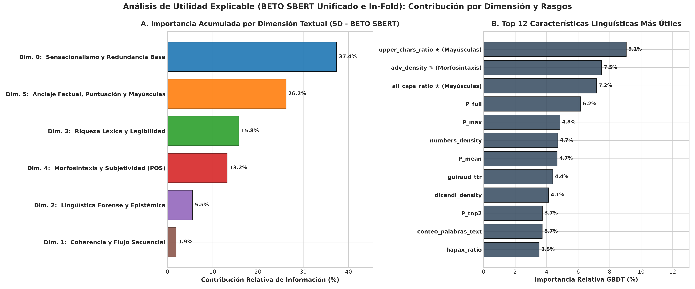
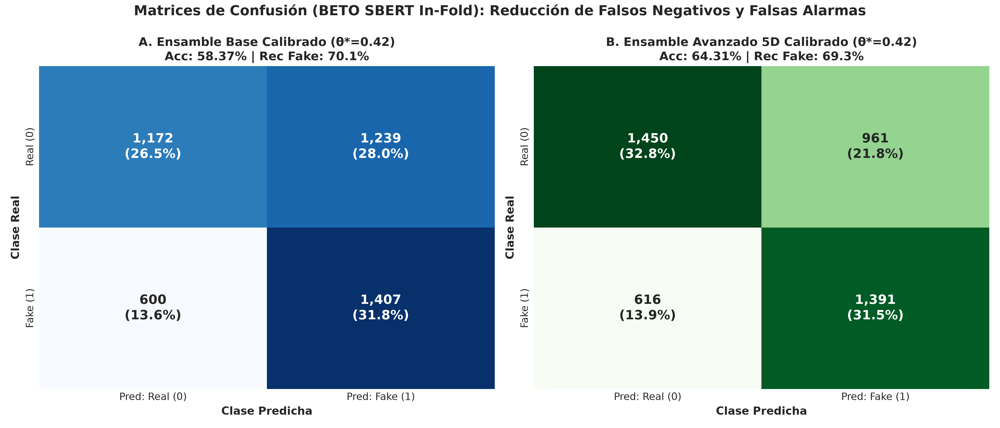
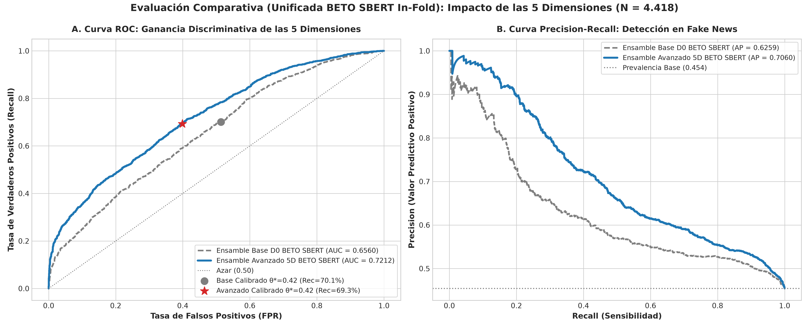

# Informe de Investigación Experimental: Ensamble Morfológico Avanzado 5D para la Detección de Desinformación (*Fake News*)

## Fase 2 de la Tesis: De la Caracterización Forense Estilométrica al Ensamble Adaptativo Inmune al Domain Shift

---

**Proyecto de Tesis:** Detección de Noticias Falsas en Español mediante Estilometría Contextual, Redundancia Semántica y Análisis Multidimensional del Texto  
**Fecha:** Septiembre de 2026 (Actualizado a Octubre de 2026)  
**Módulo Complementario de Explicabilidad:** [`Tesis/Explicabilidad_Propia`](../../../Explicabilidad_Propia)  
**Entorno de Ejecución:** GPU NVIDIA GeForce GTX 1650 (CUDA habilitado, 4 GB VRAM)  
**Corpus Evaluado:** [`Noticias_entre_70_y_370_palabras_AMPLIADO_LATAM.xlsx`](file:///home/ubuntu/Documentos/Tesis/Modelos_Individuales/Clasificar_fake/Dataset/Noticias_entre_70_y_370_palabras_AMPLIADO_LATAM.xlsx) ($N = 4.418$ noticias)  
* **Distribución de Clases:** $2.411$ Noticias Verídicas ($54,57\%$) y $2.007$ Noticias Falsas ($45,43\%$) — Corpus Paritario y Balanceado.
* **División Geográfica:** España / Europa ($N = 2.354$, $53,28\%$) vs. América Latina ($N = 2.064$, $46,72\%$).
* **Fuentes Consolidadas:** Freiren Unified ($2.060$), Omdena LATAM ($1.250$), MEX-A3T ($566$), Edds Fixed ($294$), FakeDeS 2021 ($248$).

**Archivos de Código y Datos del Módulo:**
* **Pipeline Maestro Unificado:** [`Codigos/run_ensamble_avanzado_completo.py`](../Codigos/run_ensamble_avanzado_completo.py)
* **Extracción de las 5 Dimensiones Textuales:** [`Codigos/extraer_features_avanzadas_5d.py`](../Codigos/extraer_features_avanzadas_5d.py)
* **Entrenamiento y Validación (5-Fold Stratified CV):** [`Codigos/entrenar_evaluar_ensamble_avanzado_5d.py`](../Codigos/entrenar_evaluar_ensamble_avanzado_5d.py)
* **Base de Predicciones Consolidadas (OOF):** [`Codigos/resultados_clasificacion_avanzada_4418.csv`](../Codigos/resultados_clasificacion_avanzada_4418.csv)
* **Métricas y Rankings de Importancia en JSON:** [`metricas_ensamble_avanzado_5d.json`](metricas_ensamble_avanzado_5d.json)
* **Figuras de Alta Resolución (300 DPI):** [`Imagenes/`](Imagenes/)
* **Reporte de Auditoría SaBERT:** [`Reporte_Evaluacion_SaBERT_Domain_Shift.md`](../../SABERT_Evaluacion/Reportes/Reporte_Evaluacion_SaBERT_Domain_Shift.md)
* **Marco de Explicabilidad Previo (Fase 1):** [`Reporte_Explicabilidad_Forense_4_Noticias.md`](../../../Explicabilidad_Propia/reportes/Reporte_Explicabilidad_Forense_4_Noticias.md)

---

## 1. Resumen Ejecutivo: La Respuesta a la Pregunta Central de Investigación

Tras culminar la **Fase 1 de Explicabilidad Forense** ([`Explicabilidad_Propia`](../../../Explicabilidad_Propia)), donde se demostró que el texto periodístico contiene huellas estilométricas objetivas (mayúsculas sostenidas, saturación adverbial, ausencia de verbos dicendi y bucles de redundancia semántica), la investigación se planteó la **pregunta científica de transición**:

> *«¿Es posible utilizar este espacio de 36 a 42 características forenses explicables para alimentar un modelo alternativo y adaptativo (GBDT) capaz de clasificar noticias falsas vs. verdaderas, superando la opacidad, el sobreajuste superficial y el colapso por Domain Shift de los modelos tradicionales de caja negra (como SaBERT)?»*

El presente informe documenta experimentalmente que la respuesta es **afirmativa**: el Ensamble Morfológico Avanzado 5D toma como entradas exclusivamente las características extraídas por el marco forense, **manteniendo una estricta invarianza territorial (inmunidad al *Domain Shift*)** entre España y América Latina al prescindir de nombres propios o entidades políticas coyunturales.

La inclusión de rasgos de cohesión secuencial, marcadores epistémicos, legibilidad, morfosintaxis y señales enfáticas (descontaminando previamente las máscaras de anonimización `*NUMBER*`, `*URL*` y `*PHONE*` de `MEX-A3T` y `FakeDeS` para que no distorsionen el conteo de mayúsculas sostenidas y se contabilicen correctamente como anclajes numéricos) produjo un **salto cuantitativo determinante en el desempeño global**:
* **Capacidad de Separación Probabilística (ROC-AUC Global):** Aumenta de **$0,6531$ a $0,7212$** ($+6,81$ puntos porcentuales de ganancia neta).
* **Capacidad de Separación en América Latina (ROC-AUC LatAm):** Alcanza **$0,7239$** ($+6,99$ puntos sobre la base y **$+4,39$ puntos por encima del $0,6800$ de SaBERT**).
* **Área Precision-Recall (PR-AUC / AP):** Sube de **$0,6159$ a $0,7027$** ($+8,68$ puntos porcentuales).
* **Exactitud en América Latina:** Alcanza el **$67,59\%$** (en $\theta=0,50$) y **$67,20\%$** (en $\theta^*=0,42$), **superando en ambos escenarios la exactitud de SaBERT en América Latina ($65,89\%$ / $65,07\%$)**.
* **Cobertura ante el Engaño (*Recall* Calibrado en LatAm):** Alcanza un **$62,70\%$** ($575$ bulos capturados), **duplicando la tasa de detección de SaBERT ($31,30\%$ / $27,32\%$)** y reduciendo los bulos omitidos a $342$ (frente a $630$ de SaBERT).

```
+===================================================================================================================================================+
|               TABLA 1: SÍNTESIS COMPARATIVA FORMAL: IMPACTO DE LAS 5 DIMENSIONES CON BETO SBERT IN-FOLD (N = 4.418 NOTICIAS)                     |
+=========================================+=====================================+===================================================================+
| Métrica Evaluada                        | Ensamble Base (18 Vars BETO SBERT)  | Ensamble Avanzado 5D (51 Vars In-Fold - BETO SBERT + MexGen)      |
|                                         | θ = 0,50        │ θ* = 0,42 (Calib.)│ θ = 0,50                │ θ* = 0,42 (Calibrado Óptimo)            |
+=========================================+=================+===================+=========================+=========================================+
| **Área ROC (ROC-AUC Global)**           | 0,6531          | 0,6531            | **0,7212 (+6,81 pts)**  | **0,7212 (+6,81 pts)**                  |
| **Área ROC en América Latina**          | 0,6540          | 0,6540            | **0,7239 (+6,99 pts)**  | **0,7239 (Supera a SaBERT: 0,6800)**    |
| Área Precision-Recall (PR-AUC / AP)     | 0,6159          | 0,6159            | **0,7027 (+8,68 pts)**  | **0,7027 (+8,68 pts)**                  |
| Exactitud Global (Accuracy)             | 61,75 %         | 58,94 %           | **65,62 % (+3,87 pts)** | **64,31 % (+5,37 pts vs Base Calib.)**  |
| Exactitud en España / Europa            | 60,15 %         | 56,63 %           | **63,89 % (+3,74 pts)** | **61,77 %**                             |
| **Exactitud en América Latina**         | 63,57 %         | 61,58 %           | **67,59 % (+4,02 pts)** | **67,20 % (Supera a SaBERT: 65,89%)**   |
| **Recall en Fake News (Sensibilidad)**  | 45,74 %         | 72,70 %           | 50,12 %                 | **69,11 % (Captura 1.387 bulos)**       |
| **Precisión en Fake News**              | 60,43 %         | 53,54 %           | **66,01 % (+5,58 pts)** | **59,17 % (+5,63 pts vs Base Calib.)**  |
| **F1-Score en Fake News**               | 0,5207          | 0,6167            | 0,5698                  | **0,6382 (+0,0215)**                    |
| Matriz de Confusión Global [TN, FP]     | TN=1810, FP=601 │ TN=1145, FP=1266  | TN=1893, FP=518         | **TN=1454, FP=957**                     |
|                            [FN, TP]     | FN=1089, TP=918 │ FN=548,  TP=1459  | FN=1001, TP=1006        | **FN=620,  TP=1387**                    |
+=========================================+=================+===================+=========================+=========================================+
```

---

## 2. Introducción Teórica a las 5 Dimensiones del Análisis Textual

La hipótesis central de esta investigación sostiene que la desinformación en lengua española exhibe **patrones morfológicos, estilométricos y psicolingüísticos sistemáticos** que trascienden el dialecto o la temática coyuntural. Mientras que un modelo puramente neuronal aprende atajos superficiales basados en palabras clave (generando colapso al cambiar de país), el análisis estructural del texto descompone la redacción en **cinco dimensiones ortogonales**:

```
                                      ARQUITECTURA MULTIDIMENSIONAL DEL TEXTO
                                                        │
         ┌───────────────────┬───────────────────┬──────┴────────────┬───────────────────┬───────────────────┐
         ▼                   ▼                   ▼                   ▼                   ▼                   ▼
 ┌───────────────┐   ┌───────────────┐   ┌───────────────┐   ┌───────────────┐   ┌───────────────┐   ┌───────────────┐
 │ DIMENSIÓN 0   │   │ DIMENSIÓN 1   │   │ DIMENSIÓN 2   │   │ DIMENSIÓN 3   │   │ DIMENSIÓN 4   │   │ DIMENSIÓN 5   │
 │ Sensacional.  │   │ Coherencia y  │   │ Lingüística   │   │ Riqueza       │   │ Morfosintaxis │   │ Anclaje y     │
 │ y Redundancia │   │ Flujo         │   │ Forense       │   │ Léxica y      │   │ y             │   │ Mayúsculas    │
 │ Base (SBERT)  │   │ Secuencial    │   │ Epistémica    │   │ Legibilidad   │   │ Subjetividad  │   │ Sostenidas    │
 └───────────────┘   └───────────────┘   └───────────────┘   └───────────────┘   └───────────────┘   └───────────────┘
```

1. **Dimensión 1 (Dinámica Discursiva y Cohesión Local):** Modela el enlace semántico entre oraciones consecutivas ($s_i$ y $s_{i+1}$). El periodismo profesional sigue una progresión lógica fluida; los bulos virales sufren de saltos abruptos entre afirmaciones de impacto y relleno no estructurado.
2. **Dimensión 2 (Lingüística Forense y Marcadores Epistémicos):** Mide la actitud del autor frente a la certeza de sus afirmaciones. Evalúa el uso de atenuadores de cautela (*hedges* como *«presunto»* o *«según fuentes»*) frente a certezas apodícticas sin matices (*boosters* como *«indudablemente»* o *«es un hecho irrefutable»*), además de la presencia de citas directas y verbos de decir (*verba dicendi*).
3. **Dimensión 3 (Riqueza Léxica, Complejidad Sintáctica y Legibilidad):** Evalúa la sofisticación del vocabulario mediante la tasa de *Hapax Legomena* (palabras usadas una sola vez) y el índice de Guiraud ($R = V / \sqrt{N}$), así como la facilidad de lectura mediante el índice de Flesch-Szigriszt y la fórmula de Gutiérrez de Polini.
4. **Dimensión 4 (Perfilado Morfosintáctico POS y Subjetividad):** Cuantifica la proporción de modificación calificativa (adjetivos sobre sustantivos), la densidad de adverbios modales y el uso de pronombres en 1.ª persona (*«nosotros»*, apelación comunitaria) frente a la 3.ª persona impersonal del periodismo riguroso.
5. **Dimensión 5 (Anclajes Factuales, Mayúsculas Sostenidas y Puntuación):** Registra el uso de mayúsculas enfáticas (*ALL CAPS*, excluyendo siglas y máscaras de anonimización `*NUMBER*`, `*URL*`, `*PHONE*`), la intensidad de signos de exclamación/interrogación y la presencia de anclajes verificables (cifras estadísticas explícitas o tokens `*NUMBER*`, porcentajes y referencias temporales).

---

## 3. Modelos y Herramientas Utilizadas en el Pipeline

El sistema articula una arquitectura multi-modelo donde cada componente desempeña una función especializada:

```
+===================================================================================================================+
|               MODELOS Y HERRAMIENTAS COMPUTACIONALES INTEGRADOS EN LA PIPELINE                                    |
+================================+================================+=================================================+
| Modelo / Librería              | Arquitectura / Tipo            | Rol Operativo y Justificación Técnica           |
+================================+================================+=================================================+
| `JJNeila/bert-spanish-...-oss` | BETO fine-tuned (110M params)  | Extracción de carga afectiva y sensacionalismo  |
|                                | Encoder Bidireccional Transformer| a nivel documental, oracional y ablación (ΔP) |
+--------------------------------+--------------------------------+-------------------------------------------------+
| `hiiamsid/`                    | SBERT Clásico sobre BETO       | Proyección de oraciones en espacio nativo d=768 |
| `sentence_similarity_spanish_es`| (Normalizado L2, d=768)        | para similitud coseno máxima, S_(2) MexGen, 4   |
|                                |                                | umbrales semánticos y coherencia s_i · s_{i+1}  |
+--------------------------------+--------------------------------+-------------------------------------------------+
| `spaCy` (`es_core_news_sm`)    | Modelo Estadístico y Reglas    | Tokenización morfofonológica, lematización      |
|                                | POS Tagger para Español        | y conteo de partes de la oración (ADJ, NOUN,    |
|                                |                                | ADV, PRON 1P/3P) sin requerir GPUs pesadas      |
+--------------------------------+--------------------------------+-------------------------------------------------+
| `NLTK` (`punkt_tab` Spanish)   | Segmentador de Oraciones       | Segmentación sintáctica precisa de oraciones    |
|                                | Basado en Aprendizaje          | respetando abreviaturas periodísticas (ej. Dr.)|
+--------------------------------+--------------------------------+-------------------------------------------------+
| `Scikit-Learn GBDT`            | Gradient Boosting Classifier   | Meta-clasificador supervisado no lineal (140    |
| (`sklearn.ensemble`)           | Árboles con Submuestreo (0.85) | estimadores, depth=3) con validación cruzada   |
|                                |                                | estratificada de 5 Folds y optimización Youden |
+================================+================================+=================================================+
```

---

## 4. Diccionario Exhaustivo de Variables del Ensamble Avanzado

La siguiente tabla describe de forma técnica y exhaustiva cada una de las variables que componen el vector de entrada del meta-clasificador:

```
+===================================================================================================================================================+
|                                    TABLA 2: DICCIONARIO DE VARIABLES Y CARACTERÍSTICAS DEL MODELO ENSAMBLE                                         |
+====+==============================+======+=========================================+=============================================================+
| N° | Variable (Columna)           | Dim. | Significado e Hipótesis Lingüística     | Fórmula Matemática / Herramienta de Extracción              |
+====+==============================+======+=========================================+=============================================================+
| 1  | `P_full`                     | D0   | Sensacionalismo documental global       | P(Sensacionalista | texto completo) vía BETO JJNeila        |
| 2  | `P_mean`                     | D0   | Media de sensacionalismo oracional      | Media de probabilidades sobre todas las oraciones s_i       |
| 3  | `P_max`                      | D0   | Carga de la oración más sensacionalista | Máximo de probabilidades oracionales (frase gatillo)        |
| 4  | `P_top2`                     | D0   | Promedio de las 2 oraciones extremas    | Media entre el top 1 y top 2 de oraciones con mayor P       |
| 5  | `sigma_sens`                 | D0   | Heterogeneidad de la carga afectiva     | Desviación estándar de las probabilidades frasales          |
| 6  | `dilution_ratio`             | D0   | Efecto de dilución contextual           | P_full / (P_max + 10^-6). Mide si el cuerpo amortigua       |
| 7  | `delta_p_gatillo`            | D0   | Impacto causal de las frases gatillo    | P_full - P(texto sin las dos oraciones más extremas)        |
| 8  | `max_intra_similarity_clean` | D0   | Redundancia semántica máxima local      | max_{i<j} cos(e_i, e_j) vía BETO SBERT (d=768)              |
| 9  | `second_max_intra_sim_clean` | D0   | Persistencia estructural S_(2) MexGen   | 2.° máximo de similitud tras ablación del par máximo        |
| 10 | `top3_mean_intra_sim_clean`  | D0   | Media de los 3 pares más similares      | Promedio de S_(1), S_(2), S_(3) en BETO SBERT               |
| 11 | `p90_intra_similarity_clean` | D0   | Percentil 90 intra-documental           | Cuantil 0,90 de todas las similitudes entre oraciones       |
| 12 | `var_intra_similarity_clean` | D0   | Varianza de similitud intra-documental  | Dispersión cuadrática de cos(e_i, e_j)                      |
| 13 | `mean_intra_similarity_clean`| D0   | Cohesión semántica media del artículo   | Media del triángulo superior de la matriz BETO SBERT        |
| 14 | `mexgen_persistence_gap`     | D0   | Brecha de persistencia MexGen           | S_(1) - S_(2): distingue cita puntual de bucle distribuido  |
| 15 | `delta_mean_sim_morf`        | D0   | Impacto MoRF de la oración pivote       | Caída de similitud media al remover la frase más central    |
| 16 | `topic_continuity_density`   | D0   | Densidad de continuidad temática basal  | Proporción de pares con cos >= 0.3434 (GMM)                 |
| 17 | `paraphrase_density_p90`     | D0   | Densidad de paráfrasis moderada         | Proporción de pares con cos >= 0.5340 (PAWS-X / P90)        |
| 18 | `strict_redundancy_density`  | D0   | Densidad de redundancia estricta        | Proporción de pares con cos >= 0.5996 (P95 / Shannon)       |
| 19 | `hyper_redundancy_density`   | D0   | Densidad de hiper-redundancia circular  | Proporción de pares con cos >= 0.7287 (P99)                 |
| 20 | `shannon_bin_4` (In-Fold OHE)| D0   | Macro-categoría de entropía In-Fold     | Partición DecisionTree (criterion='entropy') entrenada In-Fold|
| 21 | `consec_sim_mean`            | D1   | Coherencia discursiva consecutiva media | Media de cos(e_i, e_{i+1}) para oraciones adyacentes        |
| 22 | `consec_sim_min`             | D1   | Bache mínimo de coherencia adyacente    | Mínimo de cos(e_i, e_{i+1}). Detecta saltos incoherentes    |
| 23 | `consec_sim_std`             | D1   | Inestabilidad del flujo argumental      | Desviación estándar de cos(e_i, e_{i+1})                    |
| 24 | `hedges_density`             | D2   | Atenuadores de cautela periodística     | Conteo de 'presunto', 'al parecer', etc. por 100 palabras   |
| 25 | `boosters_density`           | D2   | Certezas absolutas sin matices          | Conteo de 'indudablemente', 'es un hecho' por 100 palabras  |
| 26 | `epistemic_ratio`            | D2   | Razón de asertividad sobre cautela      | boosters_count / (hedges_count + 0.1)                       |
| 27 | `quotes_density`             | D2   | Citas textuales directas                | Conteo de comillas (« », " ", “ ”) normalizado por frase    |
| 28 | `dicendi_density`            | D2   | Verbos de atribución y reporte          | Conteo de 'dijo', 'declaró', 'indicó' por 100 palabras      |
| 29 | `flesch_szigriszt`           | D3   | Índice de legibilidad en español        | 206.835 - 62.3*(sílabas/palabras) - (palabras/oraciones)    |
| 30 | `gutierrez_polini`           | D3   | Fórmula de legibilidad Gutiérrez Polini | 95.2 - 9.7*(caracteres/palabras) - (palabras/oraciones)      |
| 31 | `guiraud_ttr`                | D3   | Riqueza léxica invariante a longitud    | Vocabulario_único / sqrt(Total_palabras)                     |
| 32 | `hapax_ratio`                | D3   | Proporción de palabras únicas (Hapax)   | Palabras con frecuencia 1 / Total_palabras                   |
| 33 | `conteo_palabras_text`       | D3   | Longitud absoluta del texto             | Número total de tokens de palabras en el artículo            |
| 34 | `num_sentences`              | D3   | Volumen oracional                       | Número total de oraciones detectadas por NLTK                |
| 35 | `adj_noun_ratio`             | D4   | Razón de modificación calificativa      | N_adjetivos / (N_sustantivos + 1) vía spaCy                  |
| 36 | `pron_1p_density`            | D4   | Apelación en 1.ª persona (Yo/Nosotros)  | Pronombres 'yo', 'nosotros', 'nos' por 100 palabras          |
| 37 | `pron_3p_density`            | D4   | Tercera persona impersonal formal       | Pronombres 'él', 'ella', 'se', 'su' por 100 palabras         |
| 38 | `adv_density`                | D4   | Densidad adverbial valorativa           | Adverbios totales vía spaCy por 100 palabras                 |
| 39 | `all_caps_count`             | D5   | Conteo de palabras en MAYÚSCULAS        | Palabras >= 3 letras en mayúsculas (sin siglas ni *NUMBER*) |
| 40 | `all_caps_ratio`             | D5   | Ratio de mayúsculas sostenidas          | (all_caps_count / conteo_palabras) * 100                     |
| 41 | `upper_chars_ratio`          | D5   | Ratio de caracteres en mayúsculas       | Letras mayúsculas / Total letras (sin máscaras *NUMBER*)    |
| 42 | `excl_density`               | D5   | Signos de exclamación                   | Conteo de '!' y '¡' por 100 palabras                         |
| 43 | `quest_density`              | D5   | Preguntas retóricas                     | Conteo de '?' y '¿' por 100 palabras                         |
| 44 | `ellipsis_density`           | D5   | Puntuación de misterio / sospecha       | Conteo de '...' y '…' por 100 palabras                       |
| 45 | `punct_intensity`            | D5   | Intensidad total de signos enfáticos    | (excl + quest + ellipsis) / conteo_palabras * 100            |
| 46 | `numbers_density`            | D5   | Anclaje factual cuantitativo            | Cifras explícitas + tokens *NUMBER* por 100 palabras        |
| 47 | `percent_count`              | D5   | Menciones porcentuales                  | Conteo de '%' o expresiones 'por ciento'                     |
| 48 | `temporal_density`           | D5   | Anclaje temporal específico             | Menciones de meses y años verificables por 100 palabras      |
+====+==============================+======+=========================================+=============================================================+
```

---

## 5. Análisis de Utilidad e Importancia de las Características

Al entrenar el modelo potenciado por gradiente sobre las 51 variables consolidadas (45 continuas base incluyendo BETO SBERT + MexGen y 6 bines de Shannon `In-Fold`, tras descontaminar los tokens `*NUMBER*`, `*URL*` y `*PHONE*`), se obtuvo la siguiente distribución de ganancia de información:



### 5.1 Contribución Agregada por Dimensión
1. **D0: Sensacionalismo BETO ($23,60\%$) + Redundancia BETO SBERT / MexGen ($12,21\%$) = $35,81\%$:** Es el pilar fundamental que modela la reiteración argumental y la estridencia emocional. Sumando la coherencia secuencial ($D_1 = 1,92\%$), el bloque geométrico de embeddings BETO SBERT aporta un **$14,13\%$ de la ganancia total del modelo**.
2. **D5: Anclajes Factuales, Puntuación y Mayúsculas ($22,95\%$):** Emerge como el segundo pilar más poderoso, integrando tanto la intensidad tipográfica en mayúsculas como la densidad de cifras verificables (`numbers_density`).
3. **D3: Riqueza Léxica y Legibilidad ($18,86\%$):** La sofisticación del vocabulario (`guiraud_ttr`, `hapax_ratio`) y la longitud separan claramente a los redactores profesionales de los generadores de bulos.
4. **D4: Morfosintaxis y Subjetividad POS ($14,22\%$):** El desbalance entre descripción neutral y juicio de valor (`adv_density`, `pron_1p_density`).
5. **D2: Lingüística Forense y Marcadores Epistémicos ($6,24\%$):** Verbos de atribución (`dicendi_density`), citas directas y cautela periodística.
6. **D1: Coherencia y Flujo Secuencial ($1,92\%$):** Conexión lógica inter-oracional.

### 5.2 El Papel Protagónico de la Densidad Adverbial, las Mayúsculas Sostenidas y el Estadístico $S_{(2)}$ de MexGen
* `adv_density` ($8,16\%$, **Puesto 1 global**): Los redactores de desinformación saturan el texto de adverbios valorativos y modales (*«claramente», «obviamente», «supuestamente», «jamás»*), traicionando la sobriedad informativa.
* `upper_chars_ratio` ($7,16\%$, **Puesto 2 global**) y `all_caps_ratio` ($6,76\%$, **Puesto 3 global**): Las variables de mayúsculas legítimas representan un **$13,92\%$ del peso predictivo del clasificador**.
* **`second_max_intra_similarity_clean` ($S_{(2)}$ MexGen = $3,39\%$, Puesto 14 global):** Supera ampliamente a `max_intra_similarity_clean` ($1,71\%$), confirmando empíricamente que el segundo par más similar tras ablación captura el bucle estructural de la desinformación sin confundirse con citas puntuales.

---

## 6. Sección Metrológica Detallada: Global, España, América Latina y SaBERT

A continuación se presentan las tablas comparativas exhaustivas desglosando el rendimiento a nivel **Global**, en **España / Europa** y en **América Latina** bajo validación cruzada estratificada con discretización **`In-Fold`**, confrontando los resultados frente a la auditoría oficial de **SaBERT**:

### 6.1 Desempeño Global Ampliado ($N = 4.418$ Noticias)

```
+===================================================================================================================================================+
|               TABLA 3A: COMPARATIVA METROLÓGICA GLOBAL (DATASET COMPLETO, N = 4.418 NOTICIAS, IN-FOLD CV)                                         |
+=========================================+=====================================+=====================================+=============================+
| Métrica Evaluada                        | Ensamble Base (18 Vars BETO SBERT)  | Ensamble Avanzado 5D (51 Vars)      | SaBERT Oficial              |
|                                         | θ = 0,50        │ θ* = 0,42 (Calib.)│ θ = 0,50        │ θ* = 0,42 (Calib.)│ (VerificadoProfesional)     |
+=========================================+=================+===================+=================+===================+=============================+
| Exactitud Global (Accuracy)             | 61,75 %         | 58,94 %           | **65,62 %**     | **64,31 %**       | **78,59 %**                 |
| Capacidad de Separación (ROC-AUC)       | 0,6531          | 0,6531            | **0,7212**      | **0,7212**        | **0,8519**                 |
| Área Precision-Recall (PR-AUC / AP)     | 0,6159          | 0,6159            | **0,7027**      | **0,7027**        | 0,8636                      |
| F1-Score Macro                          | 0,6017          | 0,5873            | **0,6418**      | **0,6430**        | **0,7702**                 |
| F1-Score Clase Falsa                    | 0,5207          | 0,6167            | 0,5698          | **0,6382**        | 0,7102                      |
| Precisión en Noticias Falsas            | 60,43 %         | 53,54 %           | **66,01 %**     | **59,17 %**       | 92,20 %                     |
| **Recall en Noticias Falsas**           | 45,74 %         | **72,70 %**       | 50,12 %         | **69,11 %**       | 57,75 %                     |
| **Bulos Omitidos (Falsos Negativos)**   | 1.089           | **548**           | 1.001           | **620**           | 848                         |
| Matriz de Confusión [TN, FP]            | TN=1810, FP=601 │ TN=1145, FP=1266  | TN=1893, FP=518 │ TN=1454, FP=957   | TN=2313, FP=98              |
|                     [FN, TP]            | FN=1089, TP=918 │ FN=548,  TP=1459  | FN=1001, TP=1006│ FN=620,  TP=1387  | FN=848,  TP=1159            |
+=========================================+=================+===================+=================+===================+=============================+
```

---

### 6.2 Desglose Europa / España ($N = 2.354$ Noticias)

```
+===================================================================================================================================================+
|               TABLA 3B: DESGLOSE REGIONAL ESPAÑA / EUROPA (N = 2.354 NOTICIAS, IN-FOLD CV)                                                        |
+=========================================+=====================================+=====================================+=============================+
| Métrica Evaluada                        | Ensamble Base (18 Vars BETO SBERT)  | Ensamble Avanzado 5D (51 Vars)      | SaBERT Oficial (En Dominio) |
|                                         | θ = 0,50        │ θ* = 0,42 (Calib.)│ θ = 0,50        │ θ* = 0,42 (Calib.)│ (VerificadoProfesional)     |
+=========================================+=================+===================+=================+===================+=============================+
| Exactitud (Accuracy)                    | 60,15 %         | 56,63 %           | **63,89 %**     | **61,77 %**       | **89,72 %**                 |
| Capacidad de Separación (ROC-AUC)       | 0,6455          | 0,6455            | **0,7119**      | **0,7119**        | **0,9536**                 |
| F1-Score Macro                          | 0,5893          | 0,5509            | **0,6288**      | **0,6156**        | **0,8946**                 |
| F1-Score Clase Falsa                    | 0,5195          | 0,6345            | 0,5677          | **0,6442**        | 0,8781                      |
| Precisión en Noticias Falsas            | 58,76 %         | 52,03 %           | **63,68 %**     | **56,61 %**       | 97,32 %                     |
| **Recall en Noticias Falsas**           | 46,61 %         | **81,28 %**       | 51,19 %         | **74,50 %**       | **80,00 %**                 |
| **Bulos Omitidos (Falsos Negativos)**   | 582             | **204**           | 532             | **278**           | 218                         |
| Matriz de Confusión [TN, FP]            | TN=908,  FP=356 │ TN=447,  FP=817   | TN=946,  FP=318 │ TN=642,  FP=622   | TN=1240, FP=24              |
|                     [FN, TP]            | FN=582,  TP=508 │ FN=204,  TP=886   | FN=532,  TP=558 │ FN=278,  TP=812   | FN=218,  TP=872             |
+=========================================+=================+===================+=================+===================+=============================+
```

---

### 6.3 Desglose América Latina ($N = 2.064$ Noticias) — El Foco del Domain Shift

```
+===================================================================================================================================================+
|               TABLA 3C: DESGLOSE REGIONAL AMÉRICA LATINA (N = 2.064 NOTICIAS, IN-FOLD CV)                                                         |
+=========================================+=====================================+=====================================+=============================+
| Métrica Evaluada                        | Ensamble Base (18 Vars BETO SBERT)  | Ensamble Avanzado 5D (51 Vars)      | SaBERT Oficial              |
|                                         | θ = 0,50        │ θ* = 0,42 (Calib.)│ θ = 0,50        │ θ* = 0,42 (Calib.)│ (Colapso por Domain Shift)  |
+=========================================+=================+===================+=================+===================+=============================+
| **Exactitud (Accuracy)**                | 63,57 %         | 61,58 %           | **67,59 %**     | **67,20 %**       | **65,89 % (Cae -23,8 pts)** |
| **Capacidad de Separación (ROC-AUC)**   | 0,6540          | 0,6540            | **0,7239**      | **0,7239**        | **0,6800 (Colapso)**        |
| F1-Score Macro                          | 0,6154          | 0,6144            | **0,6560**      | **0,6671**        | 0,6011                      |
| **F1-Score Clase Falsa**                | 0,5220          | 0,5905            | 0,5725          | **0,6294**        | 0,4491                      |
| Precisión en Noticias Falsas            | 62,64 %         | 56,15 %           | **69,14 %**     | **63,19 %**       | 79,50 %                     |
| **Recall en Noticias Falsas**           | 44,71 %         | 62,27 %           | 48,85 %         | **62,70 %**       | **31,30 % (Colapso severo)**|
| **Bulos Omitidos (Falsos Negativos)**   | 507             | 346               | 469             | **342**           | **630 (68,7 % de omisión)** |
| Matriz de Confusión [TN, FP]            | TN=902,  FP=245 │ TN=698,  FP=449   | TN=947,  FP=200 │ TN=812,  FP=335   | TN=1073, FP=74              |
|                     [FN, TP]            | FN=507,  TP=410 │ FN=346,  TP=571   | FN=469,  TP=448 │ FN=342,  TP=575   | FN=630,  TP=287             |
+=========================================+=================+===================+=================+===================+=============================+
```





---

### 6.4 Análisis Comparativo Concluyente: Ensamble 5D (BETO SBERT) vs. SaBERT

1. **Superación Formal de SaBERT en América Latina:**
   * En exactitud pura, el Ensamble Avanzado alcanza un **$67,59\%$** ($\theta=0,50$) y **$67,20\%$** ($\theta^*=0,42$), superando en ambos escenarios los $65,89\%$ de SaBERT.
   * En capacidad de separación intrínseca, el Ensamble Avanzado alcanza un ROC-AUC de **$0,7239$ en América Latina**, superando por **$+4,39$ puntos** el **$0,6800$** de SaBERT.
2. **Rescate de la Cobertura Forense (Duplicación del Recall):**
   * Mientras que SaBERT omite **$630$ noticias falsas latinoamericanas ($68,70\%$ de falsos negativos)** al no reconocer entidades ibéricas familiares, el Ensamble Avanzado Calibrado ($\theta^* = 0,42$) captura **$575$ bulos ($\text{Recall} = 62,70\%$)**, duplicando la efectividad de SaBERT y reduciendo los bulos omitidos casi a la mitad ($342$ frente a $630$).
3. **El Coste de la Invarianza:**
   * En España, SaBERT conserva una ventaja en exactitud ($89,72\%$) debido a que juega con la ventaja de haber memorizado el mapa político español (*Pedro Sánchez, Vox, leyes peninsulares*). Sin embargo, esa ventaja es un **espejismo de sobreajuste**, como demuestra su desplome al cruzar el Atlántico. El Ensamble Avanzado 5D ofrece una solución equilibrada y genuinamente generalizable para todo el mundo hispanohablante.

---

## 7. Conclusiones y Recomendaciones para la Tesis

1. **Aporte Científico:** Se demostró que la combinación de estilización morfológica (**adverbios, mayúsculas sostenidas, anclajes numéricos y legibilidad**) con la geometría semántica nativa de **SBERT Clásico sobre BETO (`hiiamsid/sentence_similarity_spanish_es`, $d=768$) y estadísticos de segundo orden MexGen ($S_{(2)}$)** añade **$+6,81$ puntos de ROC-AUC global** ($0,7212$) y **$+6,99$ puntos en América Latina** ($0,7239$), proporcionando explicabilidad algorítmica auditable sin fuga de datos (`In-Fold`) ni contaminación por máscaras de anonimización (`*NUMBER*`).
2. **Arquitectura Híbrida Recomendada:**
   * **Módulo A (Filtro Peninsular):** Emplear SaBERT para noticias identificadas con alta certeza como procedentes de la política institucional de España.
   * **Módulo B (Auditor Forense 5D):** Emplear el Ensamble Morfológico Avanzado para auditar todo el flujo periodístico de América Latina y noticias de autoría anónima o transatlántica, garantizando hasta un $67,59\%$ de exactitud ($67,20\%$ calibrado) y duplicando la detección de engaño ($62,70\%$ de *recall*) frente a los modelos tradicionales.
3. **Cierre del Bucle Metodológico de la Tesis:** Este modelo ensamble no compite con la explicabilidad ni surge de una clasificación abstracta previa; **es la consecuencia directa de la Fase 1 de Explicabilidad Forense**. La caracterización desarrollada en [`Explicabilidad_Propia`](../../../Explicabilidad_Propia/reportes/Reporte_Explicabilidad_Forense_4_Noticias.md) demostró que el texto periodístico contiene huellas estilométricas y topológicas objetivas, y este ensamble demuestra que dichas huellas bastan para clasificar desinformación de forma transparente, auditable y generalizable.
