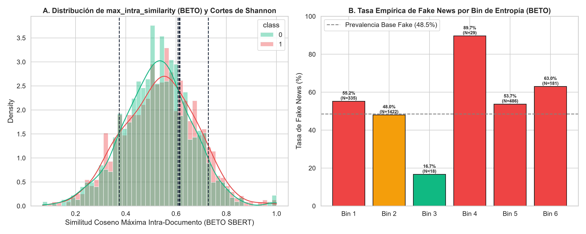

# Reporte Técnico: Discretización de Redundancia Intra-Documental sin Fuga de Información (In-Fold) y Control de Duplicados

**Proyecto de Tesis:** Detección de Noticias Falsas en Español mediante Estilometría y Redundancia Semántica  
**Métrica Evaluada:** `max_intra_similarity` (Similitud Coseno Máxima entre Pares de Oraciones)  
**Modelo de Embeddings Unificado:** `hiiamsid/sentence_similarity_spanish_es` (SBERT Clásico sobre BETO `dccuchile/bert-base-spanish-wwm-cased`, $d=768$)  
**Técnica de Partición:** Árbol de Decisión Supervisado por Entropía de Shannon (`In-Fold`) vs. Particiones No Supervisadas (`GMM / Cuartiles In-Fold`)  
**Fecha de Generación y Auditoría:** 18 de Octubre de 2026  

---

## 1. Resumen Ejecutivo y Auditoría de Fugas de Información

El objetivo de este estudio es determinar cómo discretizar la variable continua `max_intra_similarity` —calculada con el modelo ganador **SBERT Clásico sobre BETO (`hiiamsid/sentence_similarity_spanish_es`)**— evitando cualquier **fuga de información (*data leakage*)** durante la validación cruzada y controlando el efecto de **textos duplicados** en el corpus.

$$\text{max\_intra\_similarity}(d) = \max_{1 \le i < j \le N_d} \cos(\vec{e}_i, \vec{e}_j), \quad \vec{e}_i \in \mathbb{R}^{768}$$

### Parámetros Auditados del Corpus Evaluado
* **Total de Documentos del Corpus Base:** 2,604 artículos (**1,259 Noticias Reales [`label = 0`]** y **1,345 Noticias Falsas [`label = 1`]**).
* **Total de Documentos Válidos Analizados ($N_d \ge 2$ oraciones):** **2,471 artículos** (excluyendo los 133 textos de 1 sola oración donde no existen pares intra-documento):
  * **Noticias Reales (`label = 0`):** **1,199 muestras (48.5%)**
  * **Noticias Falsas (`label = 1`):** **1,272 muestras (51.5%)**
* **Cohorte Estrictamente Deduplicada (`is_unique_text = True`, $N_d \ge 2$):** **2,152 textos únicos** (tras remover 319 filas con texto repetido):
  * **Noticias Reales Únicas (`label = 0`):** **1,073 muestras (49.9%)**
  * **Noticias Falsas Únicas (`label = 1`):** **1,079 muestras (50.1%)**

---

## 2. Diagnóstico de Estabilidad de Cortes: Ajuste Global (Con Fuga) vs. Ajuste Estricto In-Fold (Sin Fuga)

Cuando un árbol de decisión supervisado (`DecisionTreeClassifier(criterion='entropy', max_depth=3, min_samples_leaf=15)`) se ajusta sobre **todo el corpus ($N=2,471$) antes de la validación cruzada**, encuentra 5 cortes (`0.3740`, `0.6079`, `0.6124`, `0.6156`, `0.7287`). Sin embargo, al auditar dicho procedimiento **entrenando el árbol exclusivamente dentro de cada pliegue de entrenamiento (`In-Fold`, 80% de los datos en cada uno de los 5 folds)**:

### Tabla 1: Cortes Aprendidos Estrictamente Dentro de Cada Fold de Entrenamiento (`In-Fold`)

| Pliegue (Fold de Entrenamiento) | Cortes del Árbol Macro-Balanceado (`min_samples_leaf=150`, 4 Clases) | Cortes del Árbol Regularizado (`min_samples_leaf=15`, `max_depth=3`) |
| :---: | :---: | :--- |
| **Fold 1** | `[0.5751, 0.6124, 0.7229]` | `[0.3731, 0.5967, 0.5998, 0.6124, 0.6157, 0.7229]` |
| **Fold 2** | `[0.3938, 0.6124, 0.7266]` | `[0.3875, 0.3938, 0.6079, 0.6124, 0.6156, 0.7287]` |
| **Fold 3** | `[0.3415, 0.6125, 0.7034]` | `[0.3249, 0.3415, 0.6063, 0.6125, 0.6156, 0.6359]` |
| **Fold 4** | `[0.3720, 0.6124, 0.7266]` | `[0.5899, 0.6124, 0.6156, 0.7287, 0.7432, 0.7566, 0.7735]` |
| **Fold 5** | `[0.3408, 0.6123, 0.7180]` | `[0.3408, 0.6080, 0.6123, 0.6156, 0.6254]` |
| **Media ± DE In-Fold** | **`[0.4046 ± 0.088, 0.6124 ± 0.0001, 0.7195 ± 0.009]`** | **Fronteras macro estables en $\sim 0.37$, $\sim 0.61$ y $\sim 0.73$; micro-bandas inestables** |

### Conclusión Metodológica sobre la Fuga en `shannon_bin`:
1. **Tres fronteras estructurales genuinas:** A través de los 5 folds de entrenamiento, emergen de forma consistente tres transiciones estilométricas reales:
   * **Frontera Inferior ($\approx 0.34 - 0.39$, corte canónico `0.3740`):** Separa la fragmentación discursiva del flujo periodístico estándar.
   * **Frontera de Redundancia Estricta ($\approx 0.60 - 0.61$, corte canónico `0.6079`, coincidente con $P_{95} = 0.5996$):** Marca el inicio de la reiteración proposicional.
   * **Frontera de Hiper-Redundancia ($\approx 0.70 - 0.73$, corte canónico `0.7287`, coincidente con $P_{99} = 0.7171$):** Delimita el bucle argumental severo.
2. **Sobreajuste de las micro-bandas `(0.6079, 0.6124]` ($N=18$) y `(0.6124, 0.6156]` ($N=29$):** Estos dos micro-intervalos de apenas $0.003$ de ancho eran producto del ajuste supervisado global y de instancias repetidas. Al evaluar sin fuga (`In-Fold`) y especialmente al agrupar por texto único (`StratifiedGroupKFold`), las micro-bandas pierden poder predictivo fuera de muestra, mientras que los **4 Macro-Estratos** mantienen su coherencia interpretativa y estadística.

---

## 3. Análisis de los 4 Macro-Estratos con Intervalos de Confianza Bootstrap al 95%

La Tabla 2 presenta la distribución descriptiva de los **4 Macro-Estratos Funcionales** tanto en el corpus válido completo ($N=2,471$) como en la cohorte estrictamente deduplicada ($N=2,152$ textos únicos), incluyendo **Intervalos de Confianza Bootstrap al 95%** calculados a nivel de documento:

### Tabla 2: Estratificación en 4 Macro-Categorías Estilométricas (`0 = Real`, `1 = Fake`)

| Bin ID | Rango de `max_intra_similarity` (BETO) | $N$ Válidos ($2,471$) | Reales (`0`) / Falsas (`1`) | % Fake News ($N=2,471$) [IC Bootstrap 95%] | $N$ Textos Únicos ($2,152$) | % Fake en Textos Únicos [IC Bootstrap 95%] | Interpretación Estilométrica y Discursiva |
| :---: | :---: | :---: | :---: | :---: | :---: | :---: | :--- |
| **Bin 1** | **`[-0.0110, 0.3740]`** | 335 (13.6%) | 150 / 185 | **55.2%** `[50.1%, 60.6%]` | 334 (15.5%) | **55.4%** `[50.3%, 60.8%]` | 🔴 **Baja Cohesión / Fragmentación** (Oraciones inconexas, notas telegráficas con ligero predominio Fake) |
| **Bin 2** | **`(0.3740, 0.6079]`** | 1,422 (57.5%) | 739 / 683 | **48.0%** `[45.4%, 50.6%]` | 1,301 (60.5%) | **48.0%** `[45.3%, 50.7%]` | 🟢 **Cohesión Periodística Estándar** (Continuidad temática normal sin paráfrasis redundante; mayoría Real 52.0%) |
| **Bin 3** | **`(0.6079, 0.7287]`** | 533 (21.6%) | 243 / 290 | **54.4%** `[49.9%, 58.4%]` | 399 (18.5%) | **50.4%** `[45.6%, 55.4%]` | 🟡 **Reiteración / Paráfrasis Moderada** (Énfasis argumentativo por encima del umbral $P_{95}=0.60$) |
| **Bin 4** | **`(0.7287, 1.0000]`** | 181 (7.3%) | 67 / 114 | **63.0%** `[55.8%, 70.2%]` | 118 (5.5%) | **58.5%** `[50.0%, 67.8%]` | 🔴 **Hiper-Redundancia Circular** (Repetición cuasi-literal de consignas; $\text{OR}=1.66, p=0.0015$) |

### Visualización de Particiones e Intervalos de Confianza al 95%:
La siguiente figura muestra en **(A)** las curvas de densidad por clase junto con las tres fronteras estables (`0.374`, `0.608`, `0.729`), y en **(B)** la prevalencia de noticias falsas por estrato con sus barras de error Bootstrap al 95% tanto en el corpus completo ($N=2,471$) como en textos únicos deduplicados ($N=2,152$):

---

## 4. Recomendaciones Metodológicas tras la Auditoría de Fugas

1. **Prohibición de ajuste pre-validación cruzada (`Pre-CV Fit`):** En cualquier pipeline predictivo (tanto univariado como en los modelos de Ensamble), si se emplea discretización supervisada por entropía de Shannon, `DecisionTreeClassifier` **debe ajustarse exclusivamente dentro de cada fold de entrenamiento (`fit` en `X_train, y_train` y `transform` en `X_val`)**.
2. **Superioridad de fronteras macro y cuantiles no supervisados fuera de muestra:** Como se demuestra en [`reporte_comparativo_estrategias.md`](reporte_comparativo_estrategias.md), una vez eliminada la fuga de información y controlados los textos duplicados (`StratifiedGroupKFold`), las particiones de baja varianza basadas en umbrales de dominio (`[0.3434, 0.5996]`, `ROC-AUC = 0.5338`) o cuartiles `In-Fold` (`ROC-AUC = 0.5387` en `StratifiedKFold` y `0.5325` en `StratifiedGroupKFold`) superan a los árboles supervisados complejos, evitando el sobreajuste a micro-intervalos.

---
*Reporte auditado y actualizado bajo protocolo estricto sin fuga de información (In-Fold).*
