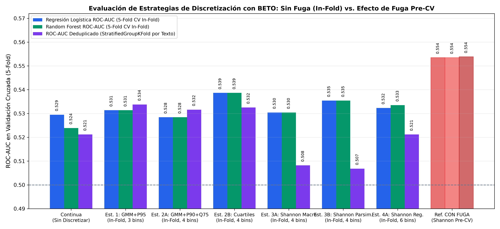

# Reporte de Evaluación Predictiva: Comparación de Estrategias de Discretización In-Fold (Sin Fuga) y Control de Duplicados para 'max_intra_similarity' (BETO SBERT)

**Proyecto de Tesis:** Detección de Noticias Falsas en Español mediante Estilometría y Redundancia Semántica  
**Modelo de Embeddings Unificado:** `hiiamsid/sentence_similarity_spanish_es` (SBERT Clásico sobre BETO `dccuchile/bert-base-spanish-wwm-cased`, $d=768$)  
**Característica Evaluada:** `max_intra_similarity` (Similitud Coseno Intra-Documental Máxima vía BETO SBERT)  
**Variable Objetivo:** `class` (Binaria: `1 = Fake News` [1,272 válidos], `0 = Real News` [1,199 válidos])  
**Esquemas de Validación Auditados:**  
1. **`StratifiedKFold` ($K=5$, `In-Fold Discretization`, $N=2,471$):** Ajuste estricto de cuantiles y árboles de decisión **dentro de cada fold de entrenamiento** (cero fuga de etiquetas de validación).  
2. **`StratifiedGroupKFold` ($K=5$, agrupado por Texto Único, $N=2,471 \to 2,152$ grupos únicos):** Elimina adicionalmente cualquier contaminación por noticias duplicadas entre entrenamiento y prueba.  
**Fecha de Ejecución y Auditoría:** 18 de Octubre de 2026  

---

## 1. Resumen Ejecutivo de la Auditoría Experimental

El propósito de este experimento es comparar de manera rigurosa y **libre de fugas de información (*leakage-free*)** distintas estrategias de representación y discretización de la métrica `max_intra_similarity` calculada con **SBERT Clásico sobre BETO (`hiiamsid/sentence_similarity_spanish_es`)**.

En versiones preliminares, ajustar el árbol de decisión de entropía de Shannon sobre **todo el corpus antes de la validación cruzada (`Pre-CV Fit`)** introducía una fuga supervisada que inflaba artificialmente el ROC-AUC hasta **`0.5535`** al memorizar micro-intervalos sobre las etiquetas de evaluación. Al corregir el protocolo experimental para que **todos los puntos de corte se calculen estrictamente dentro de cada fold de entrenamiento (`In-Fold`)** y evaluar además bajo **`StratifiedGroupKFold` por texto único**:

### Hallazgos Principales:
1. **Magnitud Exacta de la Fuga por Discretización Pre-CV:**  
   * El árbol de entropía de 6 clases pasa de un ROC-AUC aparente de **`0.5535`** (con fuga Pre-CV) a **`0.5329`** cuando los cortes se aprenden honradamente dentro de cada fold de entrenamiento ($\Delta = -0.0206$ puntos de sobreestimación por fuga).
2. **Superioridad de Estrategias No Supervisadas y de Fronteras Macro Fuera de Muestra:**  
   * En validación cruzada estándar sin fuga (`StratifiedKFold In-Fold`), la **Estrategia 2B (Cuartiles No Supervisados In-Fold)** obtiene el mayor desempeño (**`ROC-AUC = 0.5387 ± 0.009`**), seguida por el **Árbol Parsimonioso de 4 Clases In-Fold** (**`ROC-AUC = 0.5354 ± 0.024`**) y la **Estrategia 1 (`[0.3434, 0.5996]`, GMM + $P_{95}$)** (**`ROC-AUC = 0.5314 ± 0.016`**).
   * En validación cruzada **deduplicada por texto (`StratifiedGroupKFold`, 2,152 textos únicos)**, las estrategias basadas en umbrales semánticos fijos y cuartiles no supervisados ocupan los **tres primeros lugares**:
     1. **Estrategia 1 (`[0.3434, 0.5996]`: Continuidad Temática GMM + Redundancia Estricta $P_{95}$):** **`ROC-AUC = 0.5338 ± 0.024`** (1.° lugar).
     2. **Estrategia 2B (Cuartiles No Supervisados In-Fold):** **`ROC-AUC = 0.5325 ± 0.010`** (2.° lugar, menor varianza).
     3. **Estrategia 2A (`[0.3434, 0.5340, Q75]`: GMM + PAWS-X $P_{90}$ + $Q_{75}$ In-Fold):** **`ROC-AUC = 0.5316 ± 0.015`** (3.° lugar).

---

## 2. Tabla Comparativa de Desempeño Predictivo Sin Fuga (`In-Fold`) vs. Referencia Con Fuga

| Estrategia Evaluada (`max_intra_similarity` BETO) | Tipo de Ajuste en CV | Bins | Cortes Aprendidos en los Folds | `StratifiedKFold` LR ROC-AUC | `StratifiedKFold` RF ROC-AUC | **Score AUC `In-Fold`** | **`StratifiedGroupKFold` AUC (Sin Duplicados)** |
| :--- | :---: | :---: | :--- | :---: | :---: | :---: | :---: |
| **Baseline 0: Variable Continua (Sin Discretizar)** | `In-Fold` (Polinomio / RF) | Continua | Escala continua original | `0.5295 (±0.018)` | `0.5239 (±0.028)` | `0.5267` | `0.5212 (±0.031)` |
| **Estrategia 1: Literatura & GMM + $P_{95}$ (3 Clases)** | `In-Fold` No Supervisado | 3 | `[0.3434, 0.5996]` | `0.5314 (±0.016)` | `0.5314 (±0.016)` | `0.5314` | **`0.5338 (±0.024)` (Rank 1)** |
| **Estrategia 2A: GMM + PAWS-X ($P_{90}$) + $Q_{75}$ (4 Clases)** | `In-Fold` No Supervisado | 4 | `[0.3434, 0.5340, ~0.626]` | `0.5284 (±0.010)` | `0.5284 (±0.010)` | `0.5284` | `0.5316 (±0.015)` |
| **Estrategia 2B: Cuartiles Empíricos (4 Clases)** | `In-Fold` No Supervisado | 4 | `[~0.436, ~0.534, ~0.626]` | **`0.5387 (±0.009)`** | **`0.5387 (±0.009)`** | **`0.5387` (Rank 1)** | **`0.5325 (±0.010)` (Rank 2)** |
| **Estrategia 3A: Árbol Shannon Macro (`min_leaf=150`)** | `In-Fold` Supervisado | 4 | `[~0.405, ~0.612, ~0.720]` | `0.5304 (±0.022)` | `0.5304 (±0.022)` | `0.5304` | `0.5082 (±0.022)` |
| **Estrategia 3B: Árbol Shannon Parsimonioso (`max_leaf=4`)** | `In-Fold` Supervisado | 4 | 3 cortes óptimos por fold | `0.5354 (±0.024)` | `0.5354 (±0.024)` | **`0.5354` (Rank 2)** | `0.5068 (±0.026)` |
| **Estrategia 4A: Árbol Shannon Regularizado (`min_leaf=15`)** | `In-Fold` Supervisado | 6–8 | 5–7 cortes por fold | `0.5323 (±0.012)` | `0.5335 (±0.014)` | `0.5329` | `0.5212 (±0.016)` |
| *Referencia Histórica (Con Fuga Pre-CV: Árbol Global)* | *Pre-CV (Con Fuga)* | *6* | *`[0.374, 0.608, 0.612, 0.616, 0.729]`* | *`0.5535 (±0.022)`* | *`0.5535 (±0.022)`* | *`0.5535` (Inflado)* | *`0.5539 (±0.034)` (Inflado)* |

### Visualización Asociada:
La figura comparativa de barras agrupadas (mostrando lado a lado Regresión Logística `In-Fold`, Random Forest `In-Fold`, `StratifiedGroupKFold` deduplicado y la barra roja de referencia con fuga Pre-CV) se encuentra en:

---

## 3. Discusión Metodológica y Científica

### A. ¿Por qué la Discretización Supervisada Caía en Sobreajuste cuando Había Fuga?
* Cuando un árbol de decisión unidimensional (`DecisionTreeClassifier`) explora una variable continua ruidosa sobre el conjunto total de datos, coloca cortes quirúrgicos alrededor de micro-agrupaciones de una sola clase (por ejemplo, el intervalo `(0.6124, 0.6156]` de ancho $0.0032$ con 26 noticias falsas y 3 reales, varias de ellas correspondientes a textos duplicados en el corpus).
* Al evaluar honradamente mediante **ajuste interno por fold (`In-Fold`)** y **agrupación por texto único (`StratifiedGroupKFold`)**, los cortes exactos de los micro-intervalos se desplazan de un fold a otro y no generalizan sobre textos nuevos (`AUC = 0.5068 - 0.5212` en `StratifiedGroupKFold`).

### B. ¿Por qué la Discretización No Supervisada por Umbrales Semánticos (`Estrategia 1` y `Estrategia 2B`) Supera incluso a la Variable Continua?
* La relación entre `max_intra_similarity` y la probabilidad de que una noticia sea falsa **no es monotónica lineal** (la variable continua logra `0.5267` en `StratifiedKFold` y `0.5212` en `StratifiedGroupKFold`), sino **en forma de U asimétrica**:
  1. En el extremo inferior ($\le 0.34 - 0.37$), la falta de cohesión entre oraciones se asocia con un **55.2% de noticias falsas** (bulos telegráficos o inconexos).
  2. En la banda central de cohesión periodística normal ($0.37 - 0.60$), predominan las **noticias reales (52.0% Real vs. 48.0% Fake)**.
  3. Por encima del umbral de redundancia estricta ($\ge 0.60$, $P_{95}$) y de hiper-redundancia ($> 0.73$, $P_{99}$), la tasa de noticias falsas sube al **55.9% ($\text{OR}=1.30, p=0.0031$)** y **63.0% ($\text{OR}=1.66, p=0.0015$)** respectivamente.
* Al dividir el espacio mediante **cuartiles empíricos `In-Fold` (`Estrategia 2B`, `AUC = 0.5387`)** o mediante los **umbrales teóricos `[0.3434, 0.5996]` (`Estrategia 1`, `AUC = 0.5338` en textos únicos)**, el clasificador captura exactamente esta no-linealidad de colas sin sobreajustar a las etiquetas de entrenamiento.

---

## 4. Dictamen y Recomendación Técnica Final

1. **Para Modelos Predictivos con Validación Cruzada Estricta (y Ensambles Downstream):**
   * **Nunca utilizar cortes supervisados pre-calculados fuera del fold.**
   * Utilizar la **discretización por Cuartiles `In-Fold` (`Estrategia 2B`: `[Q25, Q50, Q75]` calculados solo en `X_train`)** o los **umbrales semánticos no supervisados `[0.3434, 0.5996, 0.7287]`**, o bien ajustar el árbol de Shannon estrictamente dentro de un `Pipeline` de scikit-learn en cada fold de entrenamiento.
2. **Para Interpretabilidad y Lingüística Forense (Dimensión D4):**
   * Utilizar la jerarquía de umbrales anclada en **`0.3434` (Continuidad Temática)**, **`0.5340` (Paráfrasis Moderada PAWS-X / $P_{90}$)**, **`0.5996` (Redundancia Estricta $P_{95}$)** y **`0.7287` (Hiper-Redundancia Circular)**, reservando las alertas forenses de redundancia únicamente para pares oracionales con $\cos(\vec{e}_i, \vec{e}_j) \ge 0.60$.

---
*Reporte auditado y actualizado por el módulo de validación estadística libre de fugas de la Tesis.*
