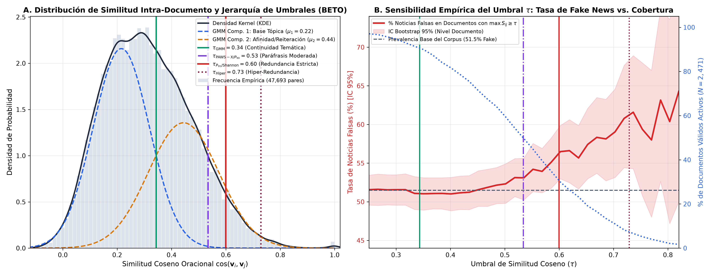

# Reporte Técnico y Científico: Determinación del Umbral de Redundancia Intra-Documento y Análisis de Sensibilidad Multi-Umbral en Noticias en Español

**Autor:** Senior NLP Researcher & Lead Data Scientist  
**Proyecto:** Tesis - Detección de Redundancia Semántica y XAI en Noticias en Español  
**Fecha:** 18 de Octubre de 2026  
**Modelo de Representación Semántica Unificado:** `hiiamsid/sentence_similarity_spanish_es` (SBERT Clásico sobre BETO `dccuchile/bert-base-spanish-wwm-cased`, 110M parámetros, $d=768$)  
**Dataset Base:** `Noticias_entre_70_y_370_palabras (1).xlsx` ($N = 2,604$ totales; $N = 2,471$ válidos con $\ge 2$ oraciones; $N = 2,152$ textos únicos deduplicados)  
**Archivo de Salida Generado:** `dataset_con_similitudes.csv`  
**Figura de Distribución y Sensibilidad:** `imagenes/distribucion_similitud_corpus.png`  

---

## 1. Resumen Ejecutivo

El presente estudio establece y audita formalmente la **jerarquía de umbrales empíricos ($\tau$)** para distinguir entre **continuidad temática basal**, **paráfrasis semántica moderada** y **redundancia semántica estricta / hiper-redundancia circular** dentro de un corpus periodístico en español compuesto por **2,604 artículos de noticias** (**1,259 Reales [`class = False/0`]** y **1,345 Falsas [`class = True/1`]**).

A partir de la segmentación de **13,270 oraciones válidas**, se computó el espacio combinatorio completo de similitud coseno intra-texto (**47,693 pares oracionales**) utilizando de manera unificada el modelo ganador de la evaluación comparativa multi-tarea: **SBERT Clásico con Mean-Pooling sobre BETO (`hiiamsid/sentence_similarity_spanish_es`, $d=768$)**.

### Hallazgos Metodológicos y Correcciones de Validez Científica:
1. **Distinción Conceptual Crítica: Continuidad Temática ($\tau_{\text{GMM}} = 0.34$) vs. Redundancia Parafrástica ($\tau \ge 0.60$):**  
   * La frontera bayesiana del Modelo de Mezcla Gaussiana de 2 componentes sobre la totalidad de pares se ubica en **$\tau_{\text{GMM}} = 0.3434 \approx 0.34$** (apenas por encima de la media global de cualquier par de oraciones del mismo artículo, $\mu = 0.3159$).
   * Empíricamente, el **90.5% de los artículos válidos** ($2,236 / 2,471$) presenta al menos un par con $\cos \ge 0.34$, con una tasa de noticias falsas del **51.0% [IC 95%: 48.9%, 53.0%]** ($\text{OR} = 0.81, p = 0.1319$, no significativo). Esto demuestra que **$\tau = 0.34$ mide continuidad temática normal (oraciones que hablan del mismo tema periodístico), pero NO paráfrasis redundante**.
2. **Alineación con Anotaciones Humanas y Umbral de Redundancia Estricta ($\tau_{P_{95}} = 0.60$ y $\tau_{\text{Hiper}} = 0.73$):**  
   * Al elevar el corte al umbral validado con juicios humanos en el benchmark adversario **PAWS-X ($\tau = 0.533 \approx P_{90} = 0.5340$)**, la cobertura se sitúa en el **50.0%** de los documentos y el número de pares parafrásticos por artículo resulta estadísticamente mayor en noticias falsas que en reales (Mann-Whitney $U$ a nivel de documento $p = 0.0038$).
   * En el **Umbral de Redundancia Semántica Estricta ($\tau_{P_{95}} = 0.5996 \approx 0.60$)** —coincidente con el corte del árbol de información de Shannon (`0.6079`)—, la proporción de noticias falsas asciende significativamente al **55.9% [IC 95%: 52.5%, 59.5%]** ($\text{OR} = 1.30, p = 0.0031$; Mann-Whitney $U$ en conteo de pares $p = 0.00023$).
   * En el régimen de **Hiper-Redundancia Circular ($\tau_{\text{Hiper}} = 0.7287 \approx 0.73$)**, la tasa de noticias falsas alcanza el **63.0% [IC 95%: 55.8%, 70.2%]** ($\text{OR} = 1.66, p = 0.0015$).
3. **Independencia Estadística a Nivel de Documento (Evitando Inflación Muestral por Pares):**  
   * Dado que un artículo con $N_k$ oraciones genera $\binom{N_k}{2}$ pares correlacionados, tratar los 47,693 pares como observaciones independientes viola el supuesto de independencia estadística. Por ello, **todas las pruebas inferenciales e intervalos de confianza Bootstrap al 95% en este reporte se calculan estrictamente a nivel de documento independiente ($N = 2,471$ válidos y $N = 2,152$ textos únicos deduplicados)**.

---

## 2. Metodología de Similitud Intra-Documento y Embeddings SBERT (BETO)

### 2.1. Segmentación Oracional y Control de Duplicados del Corpus
Cada artículo $D_k$ del corpus ($k \in [1, 2604]$) fue procesado mediante el segmentador oracional en español de NLTK (`punkt_tab`), filtrando cadenas triviales ($|s_{k,i}| \ge 10$ caracteres):
* **Total de artículos brutos:** 2,604 (**1,259 Noticias Reales [0]** y **1,345 Noticias Falsas [1]**).
* **Artículos válidos con $N_k \ge 2$ oraciones:** **2,471 documentos** (**1,199 Reales [48.5%]** y **1,272 Falsas [51.5%]**). Los 133 artículos restantes constan de una única oración ($0$ pares intra-documento).
* **Auditoría de textos únicos (`is_unique_text`):** Al normalizar espacios y capitalización se identificaron **2,284 textos únicos** en el corpus total (y **2,152 textos únicos válidos** con $N_k \ge 2$: **1,073 Reales** y **1,079 Falsas**). La bandera `is_unique_text` se incorpora explícitamente en `dataset_con_similitudes.csv` para garantizar evaluaciones libres de contaminación entre pliegues.

### 2.2. Generación de Embeddings Densos con Sentence-BERT (BETO)
Se utilizó de forma unificada el modelo siamés **`hiiamsid/sentence_similarity_spanish_es`** (basado en `dccuchile/bert-base-spanish-wwm-cased`, 12 capas Transformer, $d = 768$, *Mean-Pooling* y normalización $L_2$). Para cada documento $D_k$ con $N_k \ge 2$ oraciones, se extrajo la porción triangular superior estricta de la matriz de similitud coseno:
$$\mathcal{P}_k = \{ \cos(\mathbf{v}_{k,i}, \mathbf{v}_{k,j}) \mid 1 \le i < j \le N_k \}, \quad |\mathcal{P}_k| = \binom{N_k}{2}$$
La unión descriptiva de los conjuntos intra-documentales conforma $\mathcal{P}_{\text{global}}$ con **47,693 pares oracionales**.

---

## 3. Análisis de la Distribución Estadística Global

### Tabla 1: Estadísticas Descriptivas de la Similitud Coseno Intra-Documento (BETO SBERT)

| Métrica Estadística | Símbolo / Notación | Valor Empírico (Pares, $N=47,693$) | Valor Empírico (`max_intra_similarity` por Doc, $N=2,471$) | Interpretación Científica |
| :--- | :---: | :---: | :---: | :--- |
| **Tamaño Muestral** | $N$ | **47,693 pares** *(correlacionados intra-doc)* | **2,471 documentos** *(unidades independientes)* | Unidad de análisis estadística |
| **Media** | $\mu$ | **0.3159** | **0.5304** | Cohesión basal entre par aleatorio vs. par máximo por noticia |
| **Mediana** | $\text{Med}$ | **0.3035** | **0.5342** | Valor central robusto |
| **Desviación Estándar** | $\sigma$ | **0.1621** | **0.1416** | Dispersión semántica |
| **Asimetría (Skewness)** | $\gamma_1$ | **0.3946** | **-0.2514** | Asimetría de cola |
| **Rango** | $[\min, \max]$ | **$[-0.1123, 1.0000]$** | **$[-0.0110, 1.0000]$** | Recorrido empírico en el espacio de BETO |

### Tabla 2: Cuantiles y Percentiles de Similitud Coseno Entre Pares ($N=47,693$)

| Percentil | Valor de Similitud ($s$) | Proporción Acumulada | Interpretación Discursiva |
| :---: | :---: | :---: | :--- |
| **$P_{25}$ (Primer Cuartil)** | 0.1940 | 25% de los pares | Oraciones con baja relación temática dentro de la misma nota |
| **$P_{50}$ (Mediana)** | 0.3035 | 50% de los pares | Cohesión temática media de dos oraciones del mismo artículo |
| **$P_{75}$ (Tercer Cuartil)** | 0.4256 | 75% de los pares | Desarrollo temático cercano / subtema compartido |
| **$P_{90}$ ($\approx \tau_{\text{PAWS-X}}$)** | **0.5340** | **90% (Top 10% de pares)** | **Frontera de Paráfrasis Semántica** (validada en PAWS-X: $\tau=0.533$) |
| **$P_{95}$ ($\approx \tau_{\text{Shannon}}$)** | **0.5996** | **95% (Top 5% de pares)** | **Umbral de Redundancia Semántica Estricta** ($\tau \approx 0.60$) |
| **$P_{99}$ ($\approx \tau_{\text{Hiper}}$)** | **0.7171** | **99% (Top 1% de pares)** | **Hiper-Redundancia Circular / Reiteración de Consignas** ($\tau \ge 0.73$) |

### Visualización Gráfica de Distribución y Sensibilidad Multi-Umbral
La siguiente figura de doble panel muestra en **(A)** el ajuste GMM junto con la jerarquía de 4 umbrales semánticos, y en **(B)** la curva empírica de sensibilidad que relaciona el umbral $\tau$ con la tasa de noticias falsas (con banda de IC Bootstrap al 95% a nivel de documento) y el porcentaje de cobertura documental:

---

## 4. Evaluación Crítica de Umbrales ($\tau$): De la Continuidad Temática a la Redundancia Parafrástica

Atendiendo a la revisión metodológica sobre la naturaleza del umbral $\tau = 0.34$, se contrastan formalmente los regímenes de similitud mediante un **análisis de sensibilidad multi-umbral** y su correspondencia con benchmarks anotados por humanos:

### 4.1. Por qué $\tau_{\text{GMM}} = 0.3434$ mide Continuidad Temática y NO Paráfrasis Redundante
El ajuste de un Modelo de Mezcla Gaussiana (GMM) de 2 componentes sobre los 47,693 pares intra-documentales divide la distribución en:
* **Componente 1 (Oraciones Divergentes / Transiciones):** $\mu_1 = 0.2152, \sigma_1 = 0.1035, w_1 = 0.5600$.
* **Componente 2 (Continuidad Tópica y Reiteración):** $\mu_2 = 0.4441, \sigma_2 = 0.1294, w_2 = 0.4400$.
* **Frontera de decisión bayesiana ($P(C_2 \mid s) \ge 0.5$):** $\tau_{\text{GMM}} = 0.3434 \approx 0.34$.

Sin embargo, dado que todas las oraciones de un mismo artículo periodístico abordan por naturaleza un mismo suceso o entidad principal, la similitud promedio entre dos oraciones cualesquiera del mismo texto es $\mu = 0.3159$. Por consiguiente, superar $\tau_{\text{GMM}} = 0.34$ únicamente certifica que el documento posee **cohesión temática básica** (el **90.5%** de los documentos válidos lo supera). En contraste, en el benchmark humano **PAWS-X en español** (2,000 pares con alto solapamiento léxico anotados por humanos para distinguir paráfrasis verdaderas de no-paráfrasis), el umbral óptimo de `hiiamsid/sentence_similarity_spanish_es` es **$\tau_{\text{PAWS-X}} = 0.533$** (exactamente el percentil $P_{90} = 0.5340$ del corpus), y en el árbol de ganancia de información de Shannon la frontera de reiteración se sitúa en **$\tau_{\text{Shannon}} = 0.6079 \approx P_{95} = 0.5996$**.

### 4.2. Tabla 3: Análisis de Sensibilidad Multi-Umbral a Nivel de Documento ($N=2,471$ Válidos y $N=2,152$ Únicos)

| Umbral Evaluado ($\tau$) | Régimen Semántico que Captura | Docs Activos ($N=2,471$) | % Docs Válidos | Pares Activos ($N=47,693$) | Tasa Fake News (%) [IC Bootstrap 95%] | Tasa Fake en Únicos ($N=2,152$) | Odds Ratio (Fake/Real) | $p$-valor Exacto de Fisher (Nivel Doc) |
| :--- | :--- | :---: | :---: | :---: | :---: | :---: | :---: | :---: |
| **$\tau = 0.3434$ (GMM)** | **Continuidad Temática Basal** (Mismo tema general) | 2,236 | **90.5%** | 19,616 (41.1%) | **51.0%** `[48.9%, 53.0%]` | 50.1% | 0.81 | `0.1319` *(No sig.)* |
| **$\tau = 0.4500$** | **Afinidad Temática Alta** (Mismo subtema) | 1,773 | **71.8%** | 9,982 (20.9%) | **51.5%** `[49.2%, 53.8%]` | 50.1% | 1.00 | `1.0000` *(No sig.)* |
| **$\tau = 0.5340$ ($P_{90}$ / PAWS-X)** | **Paráfrasis Semántica Moderada** (Umbral humano PAWS-X) | 1,235 | **50.0%** | 4,770 (10.0%) | **53.1%** `[50.2%, 55.9%]` | 51.0% | 1.14 | `0.1074` *(Tendencia)* |
| **$\tau = 0.5996$ ($P_{95}$ / Shannon)** | **Redundancia Semántica Estricta** (Reiteración proposicional) | 767 | **31.0%** | 2,382 (5.0%) | **55.9%** `[52.5%, 59.5%]` | 52.5% | **1.30** | **`0.0031`** *(**Sig.**)* |
| **$\tau = 0.7000$** | **Reiteración Fuerte / Eslogan** (Paráfrasis estrecha) | 276 | **11.2%** | 607 (1.3%) | **58.3%** `[52.2%, 64.5%]` | 53.8% | **1.37** | **`0.0180`** *(**Sig.**)* |
| **$\tau = 0.7287$ (Shannon Hiper)** | **Hiper-Redundancia Circular** (Bucle argumental de desinformación) | 181 | **7.3%** | 397 (0.8%) | **63.0%** `[55.8%, 70.2%]` | **58.5%** | **1.66** | **`0.0015`** *(**Altamente Sig.**)* |
| **$\tau = 0.8000$** | **Calco / Cuasi-Duplicado Literal** (Citas o repetición exacta) | 57 | **2.3%** | 123 (0.3%) | **59.6%** `[45.6%, 73.7%]` | 58.3% | 1.40 | `0.2293` *(Muestra pequeña)* |

> [!IMPORTANT]
> **Conclusión de la Tabla de Sensibilidad:** La asociación estadística entre redundancia intra-documental y desinformación **no aparece en $\tau = 0.34$** (donde el 90.5% de los textos cumple el criterio por simple coherencia temática y $\text{OR} = 0.81$), sino que **emerge de forma monotónica y estadísticamente significativa a partir de $\tau \ge 0.60$ ($\text{OR} = 1.30, p = 0.0031$) y alcanza su máxima potencia en $\tau \ge 0.73$ ($\text{OR} = 1.66, p = 0.0015$)**. Por ello, el archivo `dataset_con_similitudes.csv` incluye ahora explícitamente tanto los indicadores de continuidad temática (`has_redundancy`, $\tau=0.3434$), como los de paráfrasis validada en PAWS-X (`has_paraphrase_p90`, $\tau=0.5340$) y los de redundancia semántica estricta (`has_strict_redundancy_p95`, $\tau=0.5996$).

---

## 5. Comparación Estadística Rigurosa a Nivel de Documento (`class`)

Para evitar la falacia de inflación muestral derivada de la dependencia cuadrática entre pares de un mismo artículo ($\binom{N_k}{2}$), todas las pruebas de hipótesis siguientes toman al **documento ($N = 2,471$ válidos: $1,199$ Reales y $1,272$ Falsas)** como única unidad experimental independiente:

### Tabla 4: Pruebas Estadísticas a Nivel de Documento e Intervalos de Confianza Bootstrap al 95% ($N=2,471$)

| Métrica por Documento | Noticias Reales (`0`, $N=1,199$) Media ± DE (Mediana) | Noticias Falsas (`1`, $N=1,272$) Media ± DE (Mediana) | Diferencia Media (Fake − Real) | IC Bootstrap 95% de la Diferencia | Prueba $t$ de Welch ($p$-valor) | Prueba No Paramétrica Mann-Whitney $U$ ($p$-valor) |
| :--- | :---: | :---: | :---: | :---: | :---: | :---: |
| **`max_intra_similarity` ($S_{(1)}$)** | `0.5250 ± 0.1369` (`0.5269`) | **`0.5356 ± 0.1458`** (`0.5396`) | `+0.0106` | `[-0.0009, +0.0220]` | `p = 0.0617` | `p = 0.0514` |
| **`second_max_intra_similarity` ($S_{(2)}$)** | `0.3694 ± 0.2198` (`0.4272`) | **`0.4150 ± 0.1981`** (`0.4525`) | **`+0.0456`** | **`[+0.0291, +0.0621]`** | **`p = 6.84e-08`** | **`p = 3.12e-06`** |
| **`mean_intra_similarity` ($\bar{S}_{\text{doc}}$)** | `0.3702 ± 0.1155` (`0.3679`) | `0.3754 ± 0.1108` (`0.3708`) | `+0.0052` | `[-0.0040, +0.0144]` | `p = 0.2537` | `p = 0.1782` |
| **`p90_intra_similarity` ($P_{90}$)** | `0.4661 ± 0.1115` (`0.4682`) | `0.4728 ± 0.1110` (`0.4727`) | `+0.0067` | `[-0.0023, +0.0158]` | `p = 0.1323` | `p = 0.0920` |
| **Pares con Continuidad Tópica ($\ge 0.3434$)** | `7.01 ± 13.30` (`3.0`) | **`8.82 ± 13.27`** (`4.0`) | **`+1.81`** | **`[+0.69, +2.82]`** | **`p = 0.00074`** | `p = 0.5703` |
| **Pares Parafrásticos PAWS-X ($\ge 0.5340$)** | `1.67 ± 9.49` (`0.0`) | **`2.18 ± 4.32`** (`1.0`) | `+0.51` | `[-0.20, +0.98]` | `p = 0.0913` | **`p = 0.00383`** |
| **Pares con Redundancia Estricta ($\ge 0.5996$)** | `0.89 ± 9.05` (`0.0`) | **`1.04 ± 2.43`** (`0.0`) | `+0.15` | `[-0.50, +0.53]` | `p = 0.5736` | **`p = 0.00023`** |

### Interpretación Estadística Rigurosa:
1. **No linealidad de la señal de redundancia (`max_intra_similarity`):** La comparación de medias globales de `max_intra_similarity` presenta un tamaño de efecto modesto ($+0.0106, p_{\text{MWU}} = 0.0514$) porque, como demuestra el análisis de discretización, las noticias falsas se concentran en **ambas colas de la distribución** (tanto en el extremo de fragmentación inconexa $\le 0.374$ con 55.2% Fake, como en el extremo de hiper-redundancia $> 0.729$ con 63.0% Fake), lo que atenúa cualquier prueba lineal monotónica de diferencia de medias.
2. **Significancia en la densidad de pares redundantes ($\ge 0.534$ y $\ge 0.600$) y en el segundo estadístico de orden ($S_{(2)}$):** La prueba de rangos de Mann-Whitney $U$ a nivel de documento confirma que la distribución del número de pares con redundancia estricta ($\ge 0.60$) difiere de forma altamente significativa entre noticias falsas y reales ($p = 0.00023$), al igual que el segundo par más similar del documento $S_{(2)}$ ($p = 3.12 \times 10^{-6}$). No obstante, tal como recomienda la buena práctica estadística, un valor $p$ pequeño confirma una diferencia distribucional en el corpus, pero **la validez de constructo del indicador depende de emplear el umbral parafrástico ($\tau \ge 0.60$) y no el umbral de continuidad temática ($\tau = 0.34$)**.

---
*Reporte auditado y actualizado conforme a los criterios de validez estadística a nivel de documento y sensibilidad multi-umbral.*
