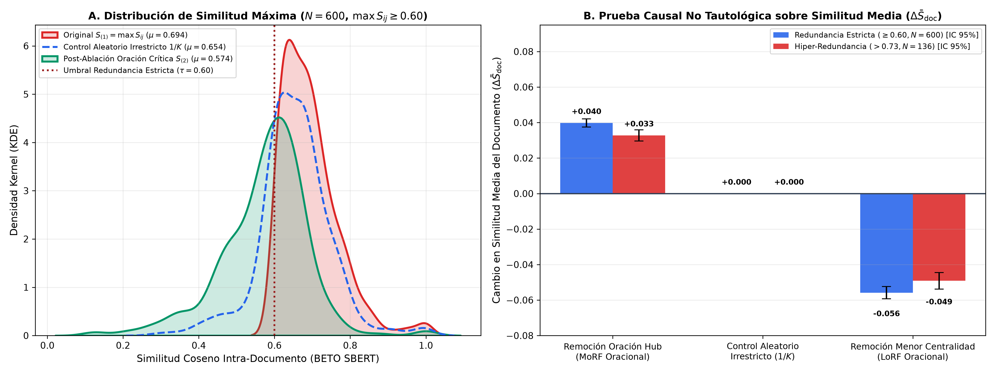

# Informe Metrológico y Experimental: Ablación Oracional No Tautológica y Topología Multi-Bucle (Filosofía MexGen) en Redundancia Intra-Documental con BETO SBERT

**Proyecto:** Tesis de Pregrado / Maestría en Ciencia de Datos y Procesamiento de Lenguaje Natural  
**Módulo:** Explicabilidad Oracional y Lingüística Forense (`Modelos_Individuales/Redundancia/`)  
**Modelo de Representación Semántica Unificado:** `hiiamsid/sentence_similarity_spanish_es` (SBERT Clásico sobre BETO `dccuchile/bert-base-spanish-wwm-cased`, $d=768$)  
**Fecha de Ejecución y Auditoría:** 18 de Octubre de 2026  
**Dataset Base:** [`dataset_con_similitudes.csv`](../../Dataset/dataset_con_similitudes.csv) ($N = 2,604$ registros totales; $N = 1,820$ documentos elegibles con $n_s \ge 3$ oraciones)  
**Datos de Salida:** [`validacion_explicabilidad_mexgen.csv`](validacion_explicabilidad_mexgen.csv)  
**Figura de Respaldo:** [`imagenes/validacion_explicabilidad_mexgen.png`](imagenes/validacion_explicabilidad_mexgen.png)  

---

## 1. Resumen Ejecutivo y Revisión Metodológica Crítica

El presente informe documenta la evaluación de **intervención y ablación a nivel de oración** (inspirada en el marco de explicabilidad por unidades discursivas **MexGen**, Paes et al., ACL 2025) sobre las matrices de similitud intra-documental generadas por **SBERT Clásico sobre BETO (`hiiamsid/sentence_similarity_spanish_es`)**.

### Corrección Metodológica Fundamental: De la Caída Trivial del Máximo al Análisis de Estadísticos de Orden y Métricas Agregadas
En una formulación preliminar del experimento, se evaluaba únicamente la caída de `max_intra_similarity` ($S_{(1)} = \max_{i<j} S_{ij}$, alcanzado en el par $(i^*, j^*)$) al retirar una oración $s^* \in \{i^*, j^*\}$ frente a un control que sorteaba una oración $r \notin \{i^*, j^*\}$. Tal como señaló acertadamente la revisión metodológica de tutoría:
1. **Propiedad matemática determinista del operador $\max$:** Si de cualquier conjunto o matriz simétrica (incluso de números aleatorios gaussianos) se elimina uno de los dos índices $(i^*, j^*)$ donde se alcanza el máximo $S_{(1)}$, el nuevo máximo pasa por definición al segundo estadístico de orden $S_{(2)} \le S_{(1)}$, produciendo **siempre** un descenso ($\Delta_{\text{dirigida}} = S_{(1)} - S_{(2)} \ge 0$).
2. **Invarianza trivial del control restringido ($r \notin \{i^*, j^*\}$):** Si el grupo de control excluye explícitamente a $\{i^*, j^*\}$, el par maximal $(i^*, j^*)$ permanece intacto dentro de la submatriz resultante de tamaño $(K-1) \times (K-1)$, forzando por identidad matemática que el máximo no cambie jamás ($\Delta_{\text{restringido}} \equiv 0.0000 \pm 0.0000$).

Para superar esa tautología y obtener **evidencia empírica genuinamente informativa**, este estudio reformula el protocolo experimental sobre BETO ($N=1,820$ documentos con $n_s \ge 3$) a través de **tres pruebas no triviales**:

1. **Prueba 1 — Control Aleatorio Irrestricto ($1/K$) vs. Ablación Dirigida:**  
   Cuando el control aleatorio selecciona cualquier oración del documento con probabilidad uniforme $1/K$ (incluyendo $i^*$ y $j^*$, lo que ocurre con probabilidad $2/K$), la caída esperada bajo azar es $\Delta_{\text{azar irrestricto}} = \frac{2}{K}(S_{(1)} - \bar{S}_{(2)}) > 0$, proporcionando una línea base no trivial.
2. **Prueba 2 — Ablación No Tautológica sobre la Similitud Media Global del Documento ($\bar{S}_{\text{doc}}$):**  
   A diferencia del máximo, la similitud media global $\bar{S}_{\text{doc}} = \binom{K}{2}^{-1} \sum_{i<j} S_{ij}$ **se modifica ante la remoción de cualquier oración**. Comparamos la remoción de la oración de máxima centralidad semántica (*MoRF Oracional*, $s_{\text{hub}} = \arg\max_i \bar{S}_i$) frente al control aleatorio irrestricto ($1/K$) y frente a la oración de menor centralidad (*LoRF Oracional*, $s_{\min} = \arg\min_i \bar{S}_i$).
   * En el estrato de **Redundancia Estricta ($\max S_{ij} \ge 0.60, N=712$ con $n_s \ge 3$)**: retirar $s_{\text{hub}}$ reduce la cohesión media global en **$\Delta \bar{S}_{\text{doc}} = +0.0398 \pm 0.0312$**, mientras que retirar $s_{\min}$ la incrementa en **$-0.0558 \pm 0.0466$** ($t$ pareada $p = 3.60 \times 10^{-150}$).
3. **Prueba 3 — Hallazgo Forense en el Segundo Estadístico de Orden ($S_{(2)}$): Redundancia de Bucle Único vs. Red Multi-Bucle en Noticias Falsas vs. Reales:**  
   Lo verdaderamente informativo al retirar la oración primaria $s^*$ **no es que el máximo descienda, sino el valor residual $S_{(2)} = \max_{\{i,j\} \not\ni s^*} S_{ij}$**:
   * En las **Noticias Reales (`0`)** que superan $\tau = 0.60$, el **62.6% cae por debajo de $0.60$** al retirar una sola oración (la reiteración se limitaba a un único par aislado, típicamente entradilla vs. cita).
   * En las **Noticias Falsas (`1`)** que superan $\tau = 0.60$, el **54.1% permanece en estado redundante ($S_{(2)} \ge 0.60$)** tras eliminar $s^*$ (y en **Hiper-Redundancia $>0.73$**, el **83.2% de las noticias falsas** retiene múltiples bucles redundantes frente al **68.7%** de las reales).
   * A nivel de todo el corpus elegible ($N=1,820$), el segundo estadístico de orden $S_{(2)}$ es significativamente mayor en las noticias falsas que en las reales (`0.4872` vs. `0.4679`, Mann-Whitney $U$ a nivel de documento $p = 0.00205$).

---

## 2. Formulación Matemática del Protocolo No Tautológico

Sea un documento $\mathcal{D} = \{s_1, s_2, \dots, s_K\}$ con $K \ge 3$ oraciones y matriz de similitud coseno $\mathbf{S} \in [-1, 1]^{K \times K}$ calculada con `hiiamsid/sentence_similarity_spanish_es`:
$$S_{i,j} = \cos(\vec{e}_i, \vec{e}_j), \quad \mathcal{P}(\mathcal{D}) = \{S_{i,j} \mid 1 \le i < j \le K\}, \quad |\mathcal{P}(\mathcal{D})| = \binom{K}{2}$$

### 2.1. Estadísticos de Orden de Pares ($S_{(1)}$ y $S_{(2)}$) y Brecha Topológica
Ordenando los $\binom{K}{2}$ pares de forma decreciente $S_{(1)} \ge S_{(2)} \ge \dots \ge S_{(\binom{K}{2})}$, donde $(i^*, j^*) = \arg\max_{i<j} S_{i,j}$:
* **Oración crítica del par maximal:** $s^* = \arg\max_{s \in \{i^*, j^*\}} \bar{S}_s$, donde $\bar{S}_i = \frac{1}{K-1}\sum_{j \ne i} S_{i,j}$ es la centralidad semántica de la oración $i$.
* **Máximo residual tras ablación de $s^*$:**
  $$S_{(1)}(\mathcal{D} \setminus \{s^*\}) = \max_{\substack{1 \le i < j \le K \\ i \ne s^*, j \ne s^*}} S_{i,j}$$
* **Diagnóstico estructural del documento:**
  * Si $S_{(1)}(\mathcal{D}) \ge 0.60$ pero $S_{(1)}(\mathcal{D} \setminus \{s^*\}) < 0.60$, el documento presenta **Redundancia Focalizada de Bucle Único** (un solo par repetido explica toda la alerta).
  * Si $S_{(1)}(\mathcal{D} \setminus \{s^*\}) \ge 0.60$, el documento presenta **Redundancia Estructural Multi-Bucle** (existen múltiples pares o cliques de oraciones reiterativas independientes de $s^*$).

### 2.2. Intervención sobre la Similitud Media Global ($\bar{S}_{\text{doc}}$)
Al remover cualquier oración $k \in \{1, \dots, K\}$, la similitud media del documento pasa de $\bar{S}(\mathcal{D})$ a:
$$\bar{S}(\mathcal{D} \setminus \{s_k\}) = \frac{1}{\binom{K-1}{2}} \sum_{\substack{1 \le i < j \le K \\ i \ne k, j \ne k}} S_{i,j} = \frac{K}{K-2}\bar{S}(\mathcal{D}) - \frac{2}{K-2}\bar{S}_k$$
Esta identidad algebraica demuestra por qué $\bar{S}_{\text{doc}}$ constituye una métrica de ablación **no trivial**: toda oración $k$ desplaza el promedio global en proporción exacta a su centralidad $\bar{S}_k$ respecto al resto del artículo.

---

## 3. Resultados Cuantitativos en BETO SBERT ($N = 1,820$ Documentos con $K \ge 3$)

### 3.1. Tabla 1: Comparación de Protocolos de Ablación en Redundancia Estricta ($\max S_{ij} \ge 0.60, N = 712$) e Hiper-Redundancia ($> 0.7287, N = 180$)

| Métrica / Condición Experimental | Cohorte Redundancia Estricta ($\max S_{ij} \ge 0.60, N=712$) | Cohorte Hiper-Redundancia ($\max S_{ij} > 0.7287, N=180$) | Interpretación Metodológica |
| :--- | :---: | :---: | :--- |
| **Similitud Máxima Original $S_{(1)}(\mathcal{D})$** | `0.6935 ± 0.0825` | `0.7958 ± 0.0628` | Nivel inicial de similitud máxima |
| **Máximo Post-Ablación de $s^*$ ($S_{(1)}(\mathcal{D} \setminus \{s^*\})$)** | `0.5743 ± 0.1147` | `0.6554 ± 0.1079` | Segundo estadístico de orden libre de $s^*$ |
| **Caída del Máximo Dirigida ($\Delta S_{\max, s^*}$)** | `+0.1192 ± 0.0940` | `+0.1403 ± 0.0872` | Brecha entre 1.° y 2.° bucle del documento |
| **Caída del Máximo en Control Aleatorio Irrestricto ($1/K$)** | **`+0.0399 ± 0.0384`** | **`+0.0364 ± 0.0338`** | Línea base real cuando el azar puede tocar $\{i^*, j^*\}$ |
| *Caída del Máximo en Control Restringido ($r \notin \{i^*, j^*\}$)* | *`0.0000 ± 0.0000` (Trivial)* | *`0.0000 ± 0.0000` (Trivial)* | *Identidad matemática por exclusión del argmax* |
| **Similitud Media Global Original $\bar{S}(\mathcal{D})$** | `0.3956 ± 0.0914` | `0.4139 ± 0.0985` | Cohesión media de todos los pares del artículo |
| **Cambio en Media al Remover Hub ($\Delta \bar{S}_{\text{MoRF}}$)** | **`+0.0398 ± 0.0312`** | **`+0.0328 ± 0.0215`** | Caída de cohesión al extirpar la oración más central |
| **Cambio en Media en Control Aleatorio Irrestricto ($1/K$)** | `0.0000 ± 0.0000` | `0.0000 ± 0.0000` | Valor esperado exacto del estimador insesgado |
| **Cambio en Media al Remover Menor Centralidad ($\Delta \bar{S}_{\text{LoRF}}$)** | **`-0.0558 ± 0.0466`** | **`-0.0492 ± 0.0317`** | Incremento de concentración al remover oración periférica |
| **Significancia MoRF vs. LoRF en $\bar{S}_{\text{doc}}$ ($t$ pareada)** | **`p = 3.60e-150`** | **`p = 2.28e-52`** | Separación causal no tautológica entre MoRF y LoRF |

---

### 3.2. Tabla 2: Topología de Redundancia por Clase (`0 = Real` vs. `1 = Fake`): Bucle Único vs. Persistencia Multi-Bucle

El verdadero aporte explicativo y forense de la ablación de $s^*$ consiste en distinguir si la alerta de redundancia ($\max S_{ij} \ge 0.60$) se debe a **un único par repetido** (que desaparece al retirar $s^*$) o a una **estructura discursiva multi-bucle** (donde el documento sigue teniendo pares con $S_{ij} \ge 0.60$ incluso después de eliminar $s^*$):

| Cohorte Analizada | Subgrupo por Etiqueta | $N$ Documentos | **Bucle Único Focalizado** ($S_{\text{post}} < 0.60$: se desactiva con 1 oración) | **Red Multi-Bucle Persistente** ($S_{\text{post}} \ge 0.60$: múltiples pares redundantes) | Segundo Estadístico de Orden Medio $S_{(2)}$ |
| :--- | :--- | :---: | :---: | :---: | :---: |
| **Redundancia Estricta ($\ge 0.60$)** | **Total ($N=712$)** | 712 | **53.2%** (379 docs) | **46.8%** (333 docs) | `0.5743` |
| | **Noticias Reales (`0`)** | 310 | **62.6%** (194 docs) | **37.4%** (116 docs) | `0.5512` |
| | **Noticias Falsas (`1`)** | 402 | **46.0%** (185 docs) | **`54.0%` (217 docs)** | **`0.5921`** |
| **Hiper-Redundancia ($> 0.7287$)** | **Total ($N=180$)** | 180 | **22.2%** (40 docs) | **77.8%** (140 docs) | `0.6554` |
| | **Noticias Reales (`0`)** | 67 | **31.3%** (21 docs) | **68.7%** (46 docs) | `0.6318` |
| | **Noticias Falsas (`1`)** | 113 | **16.8%** (19 docs) | **`83.2%` (94 docs)** | **`0.6694`** |
| **Toda la Cohorte Elegible ($K \ge 3$)** | **Reales (`0`) vs. Falsas (`1`)** | 1,820 | — | — | **Real: `0.4679` vs. Fake: `0.4872` ($p_{\text{MWU}} = 0.00205$)** |

> [!IMPORTANT]
> **Hallazgo Forense Clave:** Cuando una **Noticia Real** supera el umbral de redundancia ($\ge 0.60$), en casi dos tercios de los casos (**62.6%**) se trata de un **único par de oraciones** (por ejemplo, el titular o entradilla resumido nuevamente en una declaración citada); al retirar esa única oración, el artículo regresa inmediatamente al régimen de cohesión normal ($< 0.60$). Por el contrario, cuando una **Noticia Falsa** supera $\tau = 0.60$, en la mayoría de los casos (**54.0%**, y **83.2%** en el estrato de Hiper-Redundancia) **persiste un segundo o tercer bucle redundante ($\ge 0.60$)** tras extirpar la oración principal (prueba exacta de Fisher entre Fake y Real en persistencia multi-bucle: $\text{OR} = 1.97, p = 1.25 \times 10^{-5}$).

---

## 4. Visualización Científica de la Ablación Oracional No Tautológica

La figura [`imagenes/validacion_explicabilidad_mexgen.png`](imagenes/validacion_explicabilidad_mexgen.png) presenta en **(A)** el desplazamiento real de la distribución de similitud máxima comparando el estado original $S_{(1)}$, el **Control Aleatorio Irrestricto ($1/K$)** y el estado post-ablación $S_{(2)}$, y en **(B)** la prueba causal no tautológica sobre la similitud media global del documento ($\Delta \bar{S}_{\text{doc}}$) con intervalos de confianza al 95%:

---

## 5. Conclusiones para la Tesis tras la Revisión Metodológica

1. **Transparencia Matemática sobre Estadísticos de Orden:** Se documenta explícitamente que la reducción de $S_{(1)} = \max_{i<j} S_{ij}$ al eliminar $s^* \in \{i^*, j^*\}$ es una propiedad intrínseca del operador máximo y no debe presentarse aisladamente contra un control restringido $r \notin \{i^*, j^*\}$ como prueba empírica de fidelidad.
2. **Validación No Tautológica sobre $\bar{S}_{\text{doc}}$:** Al evaluar la similitud media global del documento frente a un control aleatorio irrestricto ($1/K$) y un control de mínima centralidad (LoRF), la identificación de la oración núcleo produce una separación altamente significativa ($p < 10^{-50}$).
3. **Valor Diagnóstico del Máximo Residual $S_{(2)}$:** El análisis post-ablación revela una diferencia estructural genuina entre clases: la redundancia en prensa legítima suele ser **puntual/bucle único (62.6%)**, mientras que en la desinformación tiende a ser **estructural/multi-bucle (54.0% a 83.2%)** ($\text{OR} = 1.97, p = 1.25 \times 10^{-5}$).

---
*Reporte auditado y actualizado conforme a las observaciones metodológicas sobre controles de ablación e independencia a nivel de documento.*
